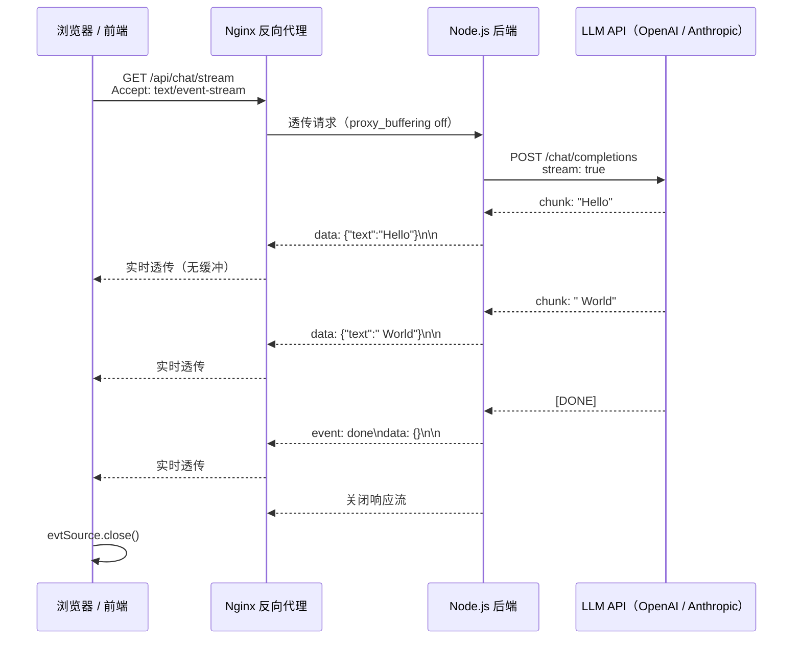

*图：沿 EventSource 与服务端时间线读取 `id/event/data` 事件；断线后顺着 `retry` 和 `Last-Event-ID` 回到重连分支，并留意代理缓冲边界。*

---

SSE（Server-Sent Events）适合通过 HTTP 持续向客户端推送文本事件，例如生成文本增量、任务进度和通知。界面的“打字机效果”不能证明采用了哪种协议；网络 chunk、SSE 事件与模型 token 也不一一对应。

## SSE 协议本质

SSE 的事件流仍运行在 HTTP 响应之上，状态码、字段和缓存含义遵循 [RFC 9110](https://www.rfc-editor.org/rfc/rfc9110.html)；`text/event-stream` 的解析与自动重连则由 HTML 标准规定。


SSE 使用一个可长期保持的 HTTP 响应，响应头声明 `Content-Type: text/event-stream`，服务端以纯文本格式持续写入事件，浏览器 `EventSource` 增量消费。连接仍可能因服务端结束、超时或网络故障关闭，客户端再按标准规则决定是否重连。

### 数据帧格式

每条事件由若干字段行组成，以**空行（`\n\n`）** 作为事件终止标志：

```
id: 42
event: token
data: {"text": "Hello"}

id: 43
event: token
data: {"text": " World"}

: 这是注释行，客户端忽略，常用于心跳保活

retry: 3000

```

四个字段含义：

| 字段 | 是否必填 | 说明 |
|------|----------|------|
| `data` | 分发消息时需要 | 消息正文，多行时每行写一个 `data:`；只有注释、id 或 retry 的块也可合法存在 |
| `event` | 可选 | 自定义事件类型，默认为 `message` |
| `id` | 可选 | 事件 ID，断线重连时作为 `Last-Event-ID` 头发送 |
| `retry` | 可选 | 重连等待毫秒数，服务端可动态调整客户端重连间隔 |

**注意**：标准允许 LF、CRLF 或 CR 行结束符；本文示例统一用 `\n`。空行触发已积累消息的分发，不能把一次网络读取当作完整事件。

---

## 浏览器 EventSource API（TypeScript）

```typescript
// 建立 SSE 连接
const evtSource = new EventSource('/api/chat/stream', {
  withCredentials: true, // 跨域时携带 cookie
});

// 监听默认 message 事件
evtSource.addEventListener('message', (e: MessageEvent) => {
  const payload = JSON.parse(e.data) as { text: string };
  appendToUI(payload.text);
});

// 监听自定义 event 类型（如 Agent 进度摘要）
evtSource.addEventListener('progress', (e: MessageEvent) => {
  const progress = JSON.parse(e.data) as { step: string; content: string };
  renderProgressStatus(progress);
});

// 监听 done 事件，主动关闭连接
evtSource.addEventListener('done', () => {
  evtSource.close();
  markGenerationComplete();
});

evtSource.addEventListener('error', (e: Event) => {
  if (evtSource.readyState === EventSource.CONNECTING) {
    console.warn('连接中断，浏览器正在尝试重连');
  } else if (evtSource.readyState === EventSource.CLOSED) {
    console.warn('连接已终止，不再自动重连');
  }
});
```

`EventSource` 的关键特性：
- **自动重连**：按处理规则重连时进入 `CONNECTING`；初始间隔由实现决定，`retry:` 事件流字段可调整等待。`close()`、HTTP 204 或致命失败可停止重连
- **Last-Event-ID 游标**：最后事件 ID 非空时，重连可携带该头；只有服务端保存并授权重放相应事件，才能据此补发
- **仅支持 GET**：原生 API 不支持 POST 请求体；需要传参时，可改用 `fetch` + `ReadableStream` 手动解析

---

## SSE vs WebSocket vs 长轮询（Long Polling）

| 维度 | SSE | WebSocket | Long Polling |
|------|-----|-----------|--------------|
| 通信方向 | 单向（Server → Client） | 双向 | 单向（模拟） |
| 协议层 | HTTP事件响应流 | HTTP/1.1可Upgrade；HTTP/2可用扩展CONNECT | HTTP |
| 浏览器自动重连 | 是（内置） | 否（需手动实现） | 否（需手动循环） |
| 代理/防火墙兼容 | 核查缓冲、空闲超时和鉴权 | 核查升级/扩展CONNECT及超时 | 核查请求超时与重试 |
| 恢复责任 | 原生EventSource管重连，应用管重放 | 应用管重连、游标和重放 | 应用管轮询、游标和退避 |
| 请求形态 | 一个响应持续传事件 | 建立后交换双向消息 | 重复HTTP请求，可复用底层连接 |
| 典型场景 | LLM 流式输出、通知推送、进度条 | 实时聊天、在线游戏 | 低频状态轮询 |

**选型建议**：单向文本事件可先评估 SSE；持续双向消息可评估 WebSocket。客户端控制命令也可用 POST 配合 SSE。最终比较代理、鉴权、连接数、慢消费者与恢复要求，不按协议名保证兼容性或性能。

---

## SSE 连接建立与 LLM Token 流式推送时序



---

## 服务端实现：NestJS + Express（TypeScript）

### 基础 SSE 响应骨架

```typescript
// events.controller.ts
import { Controller, Get, Req, Res } from '@nestjs/common';
import { Request, Response } from 'express';

@Controller('events')
export class EventsController {
  @Get('stream')
  async streamEvents(@Res() res: Response, @Req() req: Request) {
    // Content-Type声明事件流；缓存与代理策略按部署配置
    res.setHeader('Content-Type', 'text/event-stream');
    res.setHeader('Cache-Control', 'no-cache');
    // 通知 Nginx 禁用缓冲（见后文 Nginx 配置章节）
    res.setHeader('X-Accel-Buffering', 'no');
    res.flushHeaders(); // 立即发送响应头，不等待第一条数据

    let eventId = 0;

    const sendEvent = (eventType: string, data: unknown) => {
      res.write(`id: ${++eventId}\n`);
      res.write(`event: ${eventType}\n`);
      res.write(`data: ${JSON.stringify(data)}\n\n`);
    };

    // 心跳注释行，防止代理/防火墙因空闲超时断连
    const heartbeat = setInterval(() => {
      res.write(': heartbeat\n\n');
    }, 15_000);

    // 客户端断开时必须清理，否则 setInterval 持续泄漏
    res.on('close', () => {
      clearInterval(heartbeat);
    });
  }
}
```

### LLM 流式输出核心实现

下面以流程伪代码说明生命周期，未连接模型或HTTP服务执行。原生EventSource使用GET；POST流通常由fetch读取。SDK适配器须按所用版本传递取消信号、区分文本delta与错误/终态；网络流结束不自动证明Agent工具业务已成功。

```text
serveStream(request, response):
  校验身份、任务归属、输入大小与总deadline
  controller = 创建取消控制器
  在等待上游前监听 response.close → controller.abort()
  try:
    upstream = 打开模型流(input, signal=controller.signal)
    设置 Content-Type: text/event-stream 与本部署的缓存/代理策略
    flushHeaders()
    for 每个经过类型检查的文本delta:
      若取消、deadline到期或响应已关闭：停止
      frame = "event: token\ndata: " + JSON编码(delta) + "\n\n"
      若 response.write(frame) 返回 false:
        有界等待 drain 或取消/关闭；等待期间不继续读取上游
    只有核实正常终态且响应可写时发送 done；失败发送受控错误或结束流
  finally:
    取消/关闭上游，清理心跳与监听器
    响应仍可写时 end()
```

Node的[HTTP响应生命周期](https://nodejs.org/docs/latest-v22.x/api/http.html#class-httpserverresponse)和[Writable背压](https://nodejs.org/docs/latest-v22.x/api/stream.html#writablewritechunk-encoding-callback)分别约束关闭与缓冲。上面的`drain`等待还必须同时响应关闭、错误与deadline；只无限等drain也会泄漏。基础心跳骨架只演示帧格式，生产实现还需这些资源上限。

**Agent 扩展**：在 Agent 场景中，除了 `token` 事件，还可以自定义事件类型：

```typescript
// Agent 进度摘要实时推送
res.write(`event: progress\n`);
res.write(`data: ${JSON.stringify({ step: 'planning', content: '分析用户意图…' })}\n\n`);

// 工具调用开始
res.write(`event: tool_call\n`);
res.write(`data: ${JSON.stringify({ tool: 'web_search', input: 'SSE specification' })}\n\n`);

// 工具调用结果
res.write(`event: tool_result\n`);
res.write(`data: ${JSON.stringify({ tool: 'web_search', output: '…搜索结果…' })}\n\n`);
```

前端展示经过脱敏的进度摘要、工具回执和已确认状态；事件不用于暴露模型私有推理，也不能把一条“正在执行”文本当作业务成功。

---

## 断线重连与 Last-Event-ID 续传

[HTML Server-sent Events 标准](https://html.spec.whatwg.org/multipage/server-sent-events.html) 定义 EventSource 状态、事件流解析、`retry`、自动重连和 `Last-Event-ID`；连接可能因网络或服务端结束而关闭，并非“永不关闭”。


浏览器在 SSE 断线后自动重连，重连请求会携带 `Last-Event-ID` 请求头：

```typescript
@Get('stream')
async streamWithResume(@Req() req: Request, @Res() res: Response) {
  // 读取客户端上次收到的最后事件 ID
  const lastEventId = req.headers['last-event-id'] as string | undefined;
  const startFromId = lastEventId ? parseInt(lastEventId, 10) + 1 : 0;

  res.setHeader('Content-Type', 'text/event-stream');
  res.setHeader('Cache-Control', 'no-cache');
  res.flushHeaders();
  res.write('retry: 3000\n\n'); // retry是响应正文中的字段，不是HTTP响应头

  // 从 startFromId 处开始补发历史消息（适用于通知/日志场景）
  const missedEvents = await this.eventStore.getFrom(startFromId);
  for (const event of missedEvents) {
    res.write(`id: ${event.id}\nevent: ${event.type}\ndata: ${JSON.stringify(event.payload)}\n\n`);
  }

  // 继续推送后续事件…
}
```

> 上例仅示意“本应用使用整数事件 ID”的历史查询，不是完整恢复协议：需校验游标、任务归属与保留窗口，并消除历史追赶到实时订阅的空隙；重复事件由应用按 ID 去重。LLM/Agent 任务若已经执行工具，重新生成可能重复副作用或产生分叉。应先查询原任务状态，按合同恢复事件或明确重新启动，不能把重连当新任务的安全证明。

---

## Nginx 反向代理配置

Nginx 默认开启响应体缓冲（`proxy_buffering on`），可能延迟事件交付。应核对实际 location、压缩、代理链与超时，不能从本地流式正常推断生产链路无缓冲。

```nginx
# /etc/nginx/sites-available/your-app.conf

server {
    listen 80;
    server_name api.example.com;

    location /api/chat/stream {
        proxy_pass http://backend:3000;

        # 关键：关闭缓冲，SSE 数据实时透传
        proxy_buffering off;
        proxy_cache off;

        # 保持长连接
        proxy_http_version 1.1;
        proxy_set_header Connection '';

        # 防止代理 60s 超时断连（LLM 推理可能较慢）
        proxy_read_timeout 300s;
        proxy_send_timeout 300s;

        # 透传必要请求头
        proxy_set_header Host $host;
        proxy_set_header X-Real-IP $remote_addr;
    }
}
```

Nginx也可按上游响应头 `X-Accel-Buffering: no` 控制缓冲，但 `proxy_ignore_headers` 等配置可能忽略它；需核查实际代理链。关闭缓冲也不消除客户端背压或网络延迟。

---

## Agent 后端意义

在 AI Agent 服务中，SSE 不只是"打字机效果"的实现手段，它直接影响用户对 Agent 智能程度的感知：

- **进度状态可视化**：通过 `event: progress` 发送已确认阶段和适合用户查看的摘要，不发送私有推理
- **工具调用实时反馈**：`event: tool_call` 和 `event: tool_result` 让用户看到 Agent 正在调用哪些工具、获得了什么结果，提升透明度
- **长任务进度汇报**：对于需要多步骤执行的 Agent 任务（如代码生成、数据分析），SSE 可以实时汇报每个阶段的完成情况，而不是让用户盯着转圈圈等待
- **错误提前感知**：若某个工具调用失败，可立即通过 `event: error` 推送，前端及时展示局部错误，无需等待整个任务结束

---

## 常见误区与最佳实践

### 误区一：Nginx 未关缓冲，token 积攒后一次性推送

**现象**：本地开发正常，部署到带 Nginx 的生产环境后，LLM 响应全部等到生成完才一次性出现。

**修复**：在 Nginx location 块中加 `proxy_buffering off;`，或在服务端响应头中设置 `X-Accel-Buffering: no`。

### 误区二：忘记 `\n\n` 结束符

**现象**：`res.write('data: hello\n')` 写完，客户端收不到任何事件。

**原因**：空行才触发已积累消息的分发；本文使用LF，所以写作 `\n\n`。只结束一条data行仍没有空行，标准同时允许CRLF或CR行结束符。

**修复**：始终以 `\n\n` 结尾：`res.write('data: hello\n\n')`。

### 误区三：未处理客户端断连导致内存/资源泄漏

**现象**：服务运行数小时后内存持续增长，重启后恢复。

**原因**：客户端关闭标签页或网络断开后，服务端的 `setInterval`（心跳、数据推送）、上游 LLM 请求仍在运行，且持有 `res` 对象引用，无法被 GC。

**修复**：在开始等待上游前，注册响应流的关闭清理，并在 `finally` 清理定时器和监听器；将取消信号传给上游。Node 的 request `close` 也可能表示请求体已完成，不能机械地把它等同于客户端断开。

### 误区四：用 `res.send()` 或 `res.json()` 发送 SSE

**现象**：调用后连接立即关闭，只收到一条数据。

**原因**：`res.send()` / `res.json()` 会自动关闭响应流，SSE 必须使用 `res.write()` 持续写入 + 最后手动 `res.end()`。

### 最佳实践清单

- `res.flushHeaders()` 在写任何数据前调用，确保响应头立即发送
- 核查代理缓冲策略；使用 `X-Accel-Buffering: no` 时确认中间层没有忽略该头
- 按代理空闲超时与业务预算配置心跳；15~30秒只是示例，心跳不保证链路永不失效
- 区分代理读取间隔超时、总deadline和客户端取消，并限制慢消费者队列
- 使用 `event:` 字段区分不同数据类型（token / progress / tool_call / done / error），前端按类型分别处理，避免所有逻辑堆在 `message` 事件里

---

## 面试常问要点

**Q：SSE 和 WebSocket 如何选型？**

单向推送（通知、进度、LLM 流式输出）优先 SSE——更简单、天然支持自动重连、纯 HTTP 无需协议升级；需要客户端频繁双向通信（实时聊天、在线协同编辑、多人游戏）时用 WebSocket。

**Q：SSE 能穿越代理/防火墙吗？**

它使用HTTP响应，但仍要核查代理缓冲、缓存、鉴权和空闲超时；不能保证比WebSocket更容易穿过所有环境。按实际代理时限配置心跳与读取超时，并保留失败恢复路径。

**Q：浏览器原生 EventSource 不支持 POST，怎么传复杂参数？**

可先用POST创建任务，再以GET读取绑定权限的事件流；也可用fetch发起POST并自行解析。URL长度上限取决于浏览器、服务与代理，敏感凭据和大输入不应直接放进query string。fetch方案需另行实现SSE解析、取消与重连策略。

**Q：为什么 LLM 流式输出几乎都用 SSE 而不是 WebSocket？**

一次请求后持续返回文本增量适合HTTP事件流，但不能从界面效果推断具体产品协议，也不能保证SSE开销始终更小。原生EventSource与fetch流的重连能力不同；涉及任务状态与工具副作用时，两种传输都需要独立恢复协议。

**Q：Last-Event-ID 的工作原理？**

`id:`更新浏览器保存的字符串游标，不要求数字。非空游标可随重连作为Last-Event-ID发送；服务端必须有相应事件日志、授权与重放政策，应用也要处理重复和过期游标，字段本身不保证无丢失或恰好一次。

**Q：SSE 在 HTTP/2 下有什么变化？**

HTTP/2可在同一连接承载多个流，但并发流上限、代理连接和服务端资源仍有限。不要把HTTP/1.1浏览器常见的连接数经验值当作统一协议上限，也不因多路复用取消连接预算。

## 出现于（热度来源）

<!-- interview-source-history:start -->
- [字节 AI 全栈一面：Pipeline 质量、Doris 与消息轮播](../../../interview/bytedance/base/bytedance-base-23.md)
- [字节 Managed Agent 校招一面：评测、运行链路与后端基础](../../../interview/bytedance/base/bytedance-base-26.md)
- [字节剪映 AI 前端一面：Agent 运行时、MCP 与性能](../../../interview/bytedance/base/bytedance-base-30.md)
- [腾讯 Agent 实习一面：RAG、工具与通信](../../../interview/tencent/ai/tencent-ai-10.md)
<!-- interview-source-history:end -->

## 参考资料

- [HTML Standard: Server-sent events](https://html.spec.whatwg.org/multipage/server-sent-events.html)
- [RFC 9110: HTTP Semantics](https://www.rfc-editor.org/rfc/rfc9110.html)
- [Node.js 22：HTTP响应生命周期](https://nodejs.org/docs/latest-v22.x/api/http.html#class-httpserverresponse)
- [Node.js 22：流与背压](https://nodejs.org/docs/latest-v22.x/api/stream.html)
- [Nginx：proxy_buffering](https://nginx.org/en/docs/http/ngx_http_proxy_module.html#proxy_buffering)
- [RFC 8441：WebSocket over HTTP/2](https://www.rfc-editor.org/rfc/rfc8441.html)
