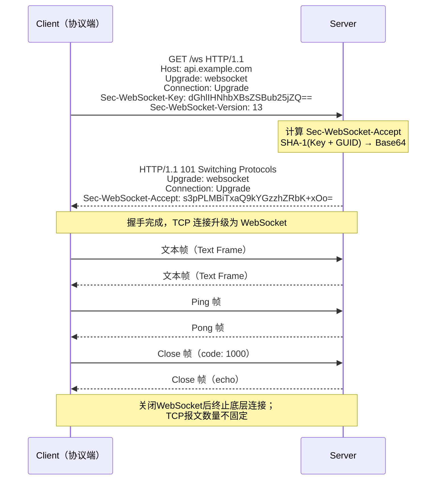
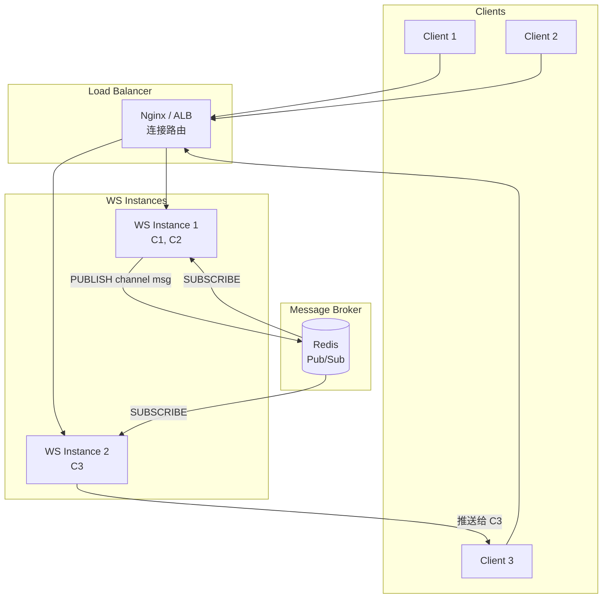

*图：沿图中的节点与箭头阅读，重点是准确描述 HTTP Upgrade 握手、frame、消息分片、ping/pong、关闭握手和应用层背压。*

---

WebSocket 提供双向消息通信，适用于聊天、协作与持续交互。下文先按 RFC 6455 的 HTTP/1.1 Upgrade 与 TCP 帧传输说明；HTTP/2 的扩展 CONNECT 另有建立方式。连接管理、消息授权、背压与重连恢复仍由应用负责。

## 握手升级（HTTP Upgrade）过程

WebSocket 连接的建立需借助 HTTP/1.1 的协议升级机制。客户端发送一个特殊的 `GET` 请求，携带升级所需的协议头；服务端验证通过后返回 `101 Switching Protocols`，此后该 TCP 连接脱离 HTTP 协议，进入 WebSocket 帧传输模式。（参见 [RFC 6455: The WebSocket Protocol](https://www.rfc-editor.org/rfc/rfc6455.html)）



握手阶段的关键字段：

- `Sec-WebSocket-Key`：随机16字节nonce经过Base64编码；Accept证明服务端理解本次WebSocket握手，不是身份认证或加密
- `Sec-WebSocket-Accept`：服务端将 Key 拼接 GUID（`258EAFA5-E914-47DA-95CA-C5AB0DC85B11`）后做 SHA-1 + Base64，客户端会校验此值
- `Sec-WebSocket-Protocol`：协商应用子协议（如 `chat`）；不是标准认证头，将凭据放入其中还涉及回显、日志与网关处理风险
- `Sec-WebSocket-Version: 13`：本文RFC 6455握手所用版本

## 帧结构（Frame）

WebSocket 数据以"帧"为单位传输，每帧包含一个固定格式的二进制头部：

```
 0                   1                   2                   3
 0 1 2 3 4 5 6 7 8 9 0 1 2 3 4 5 6 7 8 9 0 1 2 3 4 5 6 7 8 9 0 1
+-+-+-+-+-------+-+-------------+-------------------------------+
|F|R|R|R| opcode|M| Payload len |    Extended payload length    |
|I|S|S|S|  (4)  |A|     (7)    |             (16/64)           |
|N|V|V|V|       |S|             |                               |
| |1|2|3|       |K|             |                               |
+-+-+-+-+-------+-+-------------+-------------------------------+
```

核心字段说明：

| 字段 | 位数 | 说明 |
|------|------|------|
| `FIN` | 1 bit | 为 1 表示这是消息的最后一帧；分片传输时中间帧为 0 |
| `opcode` | 4 bit | 帧类型，见下表 |
| `MASK` | 1 bit | 客户端→服务端必须为 1（掩码），服务端→客户端为 0 |
| `Payload len` | 7 bit | 0-125 直接表示长度；126 时后 2 字节为实际长度；127 时后 8 字节 |

opcode 取值及含义：

| opcode | 值 | 类型 |
|--------|-----|------|
| `0x0` | 0 | 延续帧（Continuation Frame） |
| `0x1` | 1 | 文本帧（UTF-8 编码） |
| `0x2` | 2 | 二进制帧（Binary Frame） |
| `0x8` | 8 | 关闭帧（Close Frame） |
| `0x9` | 9 | Ping 帧 |
| `0xA` | 10 | Pong 帧 |

## WebSocket vs SSE vs 轮询

浏览器侧的 [WHATWG WebSockets Standard](https://websockets.spec.whatwg.org/) 定义了连接状态、`send()`、`bufferedAmount` 与关闭算法；`bufferedAmount` 只能用于观察排队字节，应用仍需自行设计背压阈值。


三种实时通信方案覆盖不同的工程场景，选型前需明确通信方向和复杂度预算：

| 维度 | WebSocket | SSE（Server-Sent Events） | 长轮询（Long Polling） |
|------|-----------|--------------------------|----------------------|
| 通信方向 | 全双工（双向） | 单向（服务端→客户端） | 模拟单向推送 |
| 协议 | ws:// / wss://，建立方式依HTTP版本 | HTTP事件响应流 | HTTP请求响应 |
| 浏览器支持 | IE10+，全现代浏览器 | IE 不支持，现代浏览器全支持 | 全支持 |
| 自动重连 | 需手动实现 | 浏览器原生支持 | 需手动实现 |
| 消息格式 | 文本 / 二进制 | 纯文本（`text/event-stream`） | 任意 HTTP 响应体 |
| 恢复责任 | 应用维护重连、游标和重放 | EventSource管重连，应用管重放 | 应用维护轮询游标与退避 |
| 水平扩展 | 按业务设计跨实例事件路由 | 同样需要事件路由与恢复 | 是否无状态取决于会话/游标设计 |
| 适用场景 | 聊天、游戏、协同编辑、Agent 双向交互 | 通知推送、日志流、Agent 步骤进度 | 偶发性低频更新 |
| 代理/防火墙 | 核对升级、扩展CONNECT与空闲超时 | 核对缓冲、鉴权与空闲超时 | 核对超时与请求预算 |

**选型建议**：单向文本事件可先评估SSE，持续双向消息可评估WebSocket；低频更新也可使用轮询。将交互方向、鉴权、代理、背压与恢复放在同一合同下比较，不把协议名当成本或可靠性保证。

## 服务端实现：Node.js ws 库 + TypeScript

`ws` 提供Node.js WebSocket服务接口。下面保留为**错误演示**：在connection之后才认证、未校验消息Schema、向全部用户广播且没有背压；这些都不能用于生产。正确实现应在升级前核身份与Origin，在每条消息上校验动作/资源授权，按租户或任务路由，并限制消息大小、发送队列和处理并发。库的选择仍需按目标负载测量。

```typescript
import { WebSocketServer, WebSocket, RawData } from 'ws';
import { IncomingMessage } from 'http';
import { parse } from 'url';
import { verify, JwtPayload } from 'jsonwebtoken';

interface Client {
  ws: WebSocket;
  id: string;
  userId?: string;
  isAlive: boolean;
}

const clients = new Map<string, Client>();

const wss = new WebSocketServer({ port: 8080 });

function requiredEnv(name: string): string {
  const value = process.env[name];
  if (!value) throw new Error(`Missing required environment variable: ${name}`);
  return value;
}

const jwtConfig = {
  secret: requiredEnv('JWT_SECRET'),
  issuer: requiredEnv('JWT_ISSUER'),
  audience: requiredEnv('JWT_AUDIENCE'),
};

function verifyJwt(token: string): string | null {
  try {
    const payload = verify(token, jwtConfig.secret, {
      algorithms: ['HS256'],
      issuer: jwtConfig.issuer,
      audience: jwtConfig.audience,
    });

    if (typeof payload === 'string') return null;
    const { sub } = payload as JwtPayload;
    return typeof sub === 'string' && sub.length > 0 ? sub : null;
  } catch {
    // 过期、签名不匹配、issuer/audience 错误都按未认证处理。
    return null;
  }
}

// ── 认证：从 query param 中读取 token ──────────────────────────────
function authenticate(req: IncomingMessage): string | null {
  const { query } = parse(req.url ?? '', true);
  const token = query.token as string | undefined;
  if (!token) return null;
  return verifyJwt(token);
}

wss.on('connection', (ws: WebSocket, req: IncomingMessage) => {
  const userId = authenticate(req);
  if (!userId) {
    ws.close(4001, 'Unauthorized');
    return;
  }

  const clientId = crypto.randomUUID();
  const client: Client = { ws, id: clientId, userId, isAlive: true };
  clients.set(clientId, client);

  console.log(`[WS] Client connected: ${clientId}, user: ${userId}`);

  // ── 消息处理 ───────────────────────────────────────────────────────
  ws.on('message', (raw: RawData) => {
    try {
      const msg = JSON.parse(raw.toString());
      handleMessage(client, msg);
    } catch {
      ws.send(JSON.stringify({ type: 'error', message: 'Invalid JSON' }));
    }
  });

  // ── Pong 响应：标记客户端仍然存活 ──────────────────────────────────
  ws.on('pong', () => {
    client.isAlive = true;
  });

  ws.on('close', (code, reason) => {
    clients.delete(clientId);
    console.log(`[WS] Client disconnected: ${clientId}, code: ${code}`);
  });

  ws.on('error', (err) => {
    console.error(`[WS] Error for ${clientId}:`, err.message);
  });

  // 发送欢迎消息
  ws.send(JSON.stringify({ type: 'connected', clientId }));
});

function handleMessage(client: Client, msg: Record<string, unknown>) {
  switch (msg.type) {
    case 'ping':
      client.ws.send(JSON.stringify({ type: 'pong' }));
      break;
    case 'broadcast':
      broadcast(msg, client.id);
      break;
    default:
      console.log(`[WS] Unknown message type: ${msg.type}`);
  }
}

function broadcast(msg: unknown, excludeId?: string) {
  const payload = JSON.stringify(msg);
  for (const [id, client] of clients) {
    if (id !== excludeId && client.ws.readyState === WebSocket.OPEN) {
      client.ws.send(payload);
    }
  }
}
```

发送侧还需限制`bufferedAmount`和应用队列，慢消费者按合同暂停、丢弃可丢事件或关闭；重连后用任务游标与可重放事件恢复，不能靠连接仍在就认定业务消息成功。

## 心跳机制（Ping/Pong）

代理与负载均衡的空闲超时取决于配置。WebSocket有Ping/Pong控制帧，收到Ping的协议端按规范及时回应Pong；心跳间隔和失败阈值按实际链路与任务预算确定，不能套统一60秒。下面只示意存活探测，不保证业务消息已被处理。

```typescript
// 服务端：定时心跳检测（基于上面的 clients Map）
const HEARTBEAT_INTERVAL = 30_000; // 30 秒

const heartbeatTimer = setInterval(() => {
  for (const [id, client] of clients) {
    if (!client.isAlive) {
      // 上一个周期内未收到 Pong，判定为失活
      console.warn(`[WS] Client ${id} timed out, terminating`);
      client.ws.terminate(); // 强制关闭，不发 Close 帧
      clients.delete(id);
      continue;
    }
    client.isAlive = false;    // 重置标志
    client.ws.ping();          // 发送 WS 协议级 Ping 帧
  }
}, HEARTBEAT_INTERVAL);

wss.on('close', () => clearInterval(heartbeatTimer));
```

浏览器JavaScript不直接暴露协议级Ping/Pong方法，但浏览器协议栈会自动回应Pong。应用层JSON心跳可另测业务响应，不能与协议控制帧混为一谈。

## 认证：握手阶段 Token 验证

先以HTTP/1.1握手为例。认证应在升级前完成；浏览器场景还需校验Origin并在每条业务消息上做对象授权。以下两种传递方式只展示接口风险，不是生产推荐：

**方式一：Query Parameter（简单，但 Token 会出现在 URL 日志）**

```typescript
// 客户端
const token = localStorage.getItem('access_token');
const ws = new WebSocket(`wss://api.example.com/ws?token=${token}`);

// 服务端（握手阶段）
wss.on('connection', (ws, req) => {
  const { query } = parse(req.url ?? '', true);
  const userId = verifyJwt(query.token as string);
  if (!userId) { ws.close(4001, 'Unauthorized'); return; }
});
```

**方式二：Sec-WebSocket-Protocol 子协议头（Token 不进入 URL）**

```typescript
// 客户端：将 token 作为子协议名传递（RFC 6455 允许自定义子协议）
const ws = new WebSocket('wss://api.example.com/ws', [`token.${accessToken}`]);

// 服务端
import { createServer } from 'http';

const server = createServer();
const wss = new WebSocketServer({ noServer: true });

server.on('upgrade', (req, socket, head) => {
  const protocols = req.headers['sec-websocket-protocol']?.split(', ') ?? [];
  const tokenProto = protocols.find((p) => p.startsWith('token.'));
  const token = tokenProto?.replace('token.', '');
  const userId = token ? verifyJwt(token) : null;

  if (!userId) {
    socket.write('HTTP/1.1 401 Unauthorized\r\n\r\n');
    socket.destroy();
    return;
  }

  wss.handleUpgrade(req, socket, head, (ws) => {
    wss.emit('connection', ws, req, { userId });
  });
});
```

Query凭据可能进入URL日志、历史和监控；子协议值也可能被回显或记录，不因离开URL就天然安全。可按威胁模型选择受作用域限制的Cookie加Origin/CSRF策略，或通过已认证HTTPS接口签发短时、单次且绑定用途的连接票据。长效bearer不应默认置于localStorage或子协议。上例尚未实现Origin、票据重放防护、claims/当前授权完整校验与子协议白名单，不能直接上线。

## 水平扩展：多实例 Pub/Sub（Redis Adapter）

每条连接由某个服务实例持有。若另一实例需要向该连接推事件，应设计跨实例路由；Pub/Sub只是其中一种。消息仍须绑定租户、任务和授权，不能把“全节点广播”等同于“全用户可读”。Redis Pub/Sub不提供离线重放，恢复需另有可持久事件日志。



**Socket.IO + Redis Adapter 接口形状（未包含授权）**

```typescript
import { createClient } from 'redis';
import { Server } from 'socket.io';
import { createAdapter } from '@socket.io/redis-adapter';

const pubClient = createClient({ url: 'redis://localhost:6379' });
const subClient = pubClient.duplicate();

await Promise.all([pubClient.connect(), subClient.connect()]);

const io = new Server(httpServer, { cors: { origin: configuredOrigins } }); // 仍需认证与逐房间授权
io.adapter(createAdapter(pubClient, subClient));

// 此后 io.to(roomId).emit(...) 会自动通过 Redis 广播到所有实例
io.on('connection', (socket) => {
  socket.on('join', (roomId: string) => socket.join(roomId));
  socket.on('message', ({ roomId, content }) => {
    io.to(roomId).emit('message', { content, from: socket.id });
  });
});
```

上面房间示例没有实现连接身份、join/message的逐项Schema及资源授权，`configuredOrigins`也只是应用配置名；它只演示Adapter接线，不能复制为公开聊天室或任务流。

**原生 ws + Redis 手动实现（未包含授权与重放）**

```typescript
import { createClient } from 'redis';

const publisher = createClient({ url: process.env.REDIS_URL });
const subscriber = publisher.duplicate();
await Promise.all([publisher.connect(), subscriber.connect()]);

const CHANNEL = 'ws:broadcast';

// 订阅：收到消息后推送给本实例的所有连接
await subscriber.subscribe(CHANNEL, (message) => {
  const payload = JSON.parse(message);
  for (const client of clients.values()) {
    if (client.ws.readyState === WebSocket.OPEN) {
      client.ws.send(JSON.stringify(payload));
    }
  }
});

// 发布：将消息发布到 Redis，所有实例都会收到
function publishToAll(data: unknown) {
  publisher.publish(CHANNEL, JSON.stringify(data));
}
```

纯WebSocket的后续帧在已建立的同一连接上，不需要为了把每帧送回原实例额外开启粘性会话。Socket.IO使用HTTP long-polling时，同一会话有多个HTTP请求，标准多节点部署通常需粘性会话；只启用WebSocket则无此要求。具体集群引擎可能另有转发方案，按所选实现核对。

## Socket.IO 与原生 ws 的取舍

| 维度 | 原生 ws | Socket.IO |
|------|---------|-----------|
| 客户端依赖 | 浏览器可用原生API | 需要匹配Socket.IO客户端，体积随版本与打包变化 |
| 自动重连 | 需手动实现 | 内置，指数退避 |
| 房间 / 命名空间 | 需自行管理 Map | 内置 Room + Namespace |
| 降级兼容 | 不支持（无 WS 则失败） | 自动降级为 Long Polling |
| 二进制支持 | 原生支持 | 支持，但包一层协议头 |
| 跨实例扩展 | 自行设计路由与恢复 | 可选Adapter；授权、重放与恢复仍需配置 |
| 协议合同 | 原生WebSocket消息 | Engine.IO/Socket.IO额外协议；不能直接混用原生客户端 |
| 适用场景 | 高性能、自控协议（Agent、游戏） | 快速落地、需要房间管理 |

需要事件、房间和现成客户端时可评估Socket.IO；需要自定消息协议时可评估原生WebSocket。分别验证复杂度、恢复、延迟与费用，不从团队阶段直接决定。

## 对 Agent 后端的意义

WebSocket 是 AI Agent 后端实时交互的核心通道，典型场景包括：

**1. Agent 执行步骤实时推送**

```typescript
// Agent 执行器每完成一个步骤，立即推送给前端
async function runAgent(agentId: string, input: string, clientId: string) {
  const client = clients.get(clientId);
  if (!client) return;

  const push = (event: string, data: unknown) => {
    client.ws.send(JSON.stringify({ event, agentId, data }));
  };

  push('agent:start', { input });

  for await (const step of agent.stream(input)) {
    push('agent:step', {
      type: step.type,          // 脱敏后的progress | tool_call | tool_result
      content: step.content,
      toolName: step.toolName,
    });
  }

  push('agent:done', { output: agent.finalAnswer });
}
```

**2. 多智能体状态同步**

多个 Agent 并行执行时，通过 WebSocket + Redis Pub/Sub 将各 Agent 的状态变更实时广播给订阅了该任务的所有前端客户端，实现任务看板的实时更新。

**3. 双向交互（Human-in-the-Loop）**

WebSocket可承载批准请求与回复；SSE推状态配合HTTP POST提交批准也能实现。无论用哪种传输，批准都应绑定身份、任务、精确参数和有效期，由服务端验证后恢复，不能把收到一条approve消息直接当作授权。

## 常见误区与最佳实践

**误区一：不实现断线重连**

`close` 事件触发时不做任何处理，导致网络抖动后连接永久断开。应实现带指数退避的重连逻辑，避免重连风暴。

**误区二：无心跳，依赖代理服务器保活**

核对每一跳的空闲超时及关闭行为，再配置心跳、超时与重连退避。静默网络故障可能延迟发现，代理主动关闭也可能产生可见的close/error；不存在所有部署都必须30秒心跳的规则。

**误区三：不做消息大小限制**

恶意客户端发送超大消息（如 100MB JSON）会打满服务内存。`ws` 库通过 `maxPayload` 选项限制：

```typescript
const wss = new WebSocketServer({ port: 8080, maxPayload: 1024 * 1024 }); // 1MB
```

**误区四：在握手前连接已建立时才做认证**

连接建立后再发消息认证会有一个短暂的"未授权窗口"。应在 `upgrade` 事件（握手阶段）完成认证，认证失败直接拒绝升级，不建立 WebSocket 连接。

**误区五：忽略 Close Frame 的状态码**

关闭帧可带状态码（1000正常、1001离开、4000–4999应用自定义）。1006是本地观察异常关闭的保留值，不得放进线上Close帧；日志中看到1006不代表对端发来了这个码。

## 面试常问

- **WebSocket 握手过程中 `Sec-WebSocket-Key` 的作用是什么？** 防止缓存代理将 WebSocket 握手请求误作缓存的 HTTP 响应返回，并非用于安全加密；真正的安全靠 TLS（wss://）。

- **为什么客户端发送的帧必须 Mask，而服务端不需要？** RFC 6455用客户端随机掩码减少恶意脚本构造代理可误解字节流的风险；掩码不提供机密性或身份认证。不能解释为“服务端到客户端不经过代理”，该方向同样可能有代理，协议只是不要求其做客户端式掩码。

- **WebSocket 和 HTTP/2 Server Push 有什么区别？** HTTP/2 Server Push 是服务端在响应主请求时预先推送关联资源（CSS、JS），浏览器已逐渐废弃该特性；WebSocket 是持久的全双工通道，两者应用场景完全不同。

- **如何防止 WebSocket 跨站攻击（CSWSH）？** 握手阶段校验 `Origin` 头，只允许可信域名建立连接；配合 Token 认证，避免纯 Cookie 认证（Cookie 会自动随 WS 握手请求发送）。

- **Socket.IO 的房间（Room）原理是什么？** 默认Adapter维护本地rooms与sids映射。Redis Adapter通过Pub/Sub向其他节点转发匹配房间的广播，各节点再选自己的本地连接；它不把整个房间Map自动同步成Redis里的共享状态，房间名也不是授权。

- **WebSocket 在 HTTP/2 下如何工作？** RFC 8441定义HTTP/2扩展CONNECT来建立WebSocket流，与HTTP/1.1 Upgrade/101不同。是否可用取决于客户端、服务和代理支持，不能只因HTTP/2已启用就假设自动使用。

## 出现于（热度来源）

<!-- interview-source-history:start -->
- [字节 Agent 开发一面：RAG、AI Coding 与高并发系统（2026 年 8 月）](../../../interview/bytedance/base/bytedance-base-14.md)
- [字节 AI 全栈一面：Pipeline 质量、Doris 与消息轮播](../../../interview/bytedance/base/bytedance-base-23.md)
- [字节 Managed Agent 校招一面：评测、运行链路与后端基础](../../../interview/bytedance/base/bytedance-base-26.md)
- [腾讯 Agent 实习一面：RAG、工具与通信](../../../interview/tencent/ai/tencent-ai-10.md)
<!-- interview-source-history:end -->

## 参考资料

- [RFC 6455: The WebSocket Protocol](https://www.rfc-editor.org/rfc/rfc6455.html)
- [WHATWG WebSockets Standard](https://websockets.spec.whatwg.org/)
- [RFC 8441：WebSocket over HTTP/2](https://www.rfc-editor.org/rfc/rfc8441.html)
- [Socket.IO：多节点与粘性会话](https://socket.io/docs/v4/using-multiple-nodes/)
- [Socket.IO：Rooms](https://socket.io/docs/v4/rooms/)
- [Socket.IO：Redis Adapter](https://socket.io/docs/v4/redis-adapter/)
