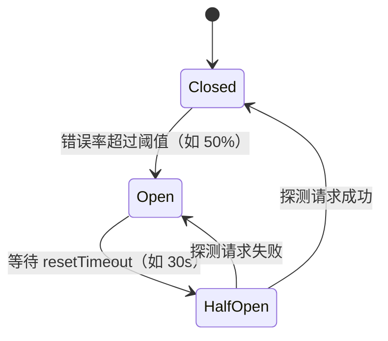

*图：区分限流保护容量、熔断隔离故障与降级保持核心功能。429可以附Retry-After，但并非必带；图中的RateLimit表示可选的配额协作信息，本文按version11工作草案说明RateLimit-Policy/RateLimit，旧字段或自定义字段须另按服务版本核对。半开时用有限探测判断恢复。*

---

在Agent服务中，失控的循环或突发请求可能放大计算、连接与排队负荷；采用按量计费的模型服务时，还可能放大费用。是否计费、怎样计量以及多久触及预算，取决于服务合同、模型与实际用量，不能从调用次数直接推出。限流（Rate Limiting）控制流量入口，熔断（Circuit Breaker）限制下游故障扩散。

## 为什么限流对 AI 服务尤为关键

普通API与AI服务都可能需要保护容量、公平性和下游依赖；AI任务的单次资源用量还可能随输入、输出、工具步骤和重试次数变化。应分别观察：

- 失控循环与重试放大了多少请求、实际用量和等待时间；按量计费时，再按对应合同核算费用，不用“几百次调用”等同固定美元金额；
- 某个租户的突发是否占用了共享连接、并发槽位或服务配额；
- 下游实际的速率与并发合同，以及本地整形、拒绝或有界排队能否减少过载；本地有限流也不保证下游永不返回429。

## 限流算法对比

| 算法 | 原理 | 优点 | 缺点 | 适用场景 |
|------|------|------|------|----------|
| 固定窗口（Fixed Window） | 按等长时间窗计数，达到窗口配额后拒绝 | 状态简单，单个Key可只存计数与窗口信息 | 相邻窗口边界附近可集中接受接近两份窗口配额；不等于任意瞬间存在固定QPS上界 | 接受边界突发的粗粒度保护 |
| 滑动窗口日志（Sliding Window Log） | 用时间戳队列或有序记录保存已接受请求，清除窗口外记录再判断 | 可约束任意指定长度窗口内的接受量，避免固定窗口边界效应 | 日志内存随窗口内保留的请求记录数增长；Redis ZSET是可选实现，复合判断须原子执行；分桶近似方案有精度取舍 | 需要较精确窗口配额的场景 |
| 令牌桶（Token Bucket） | 按速率补充令牌，每次请求消耗，桶空时拒绝或按合同等待 | 桶容量允许受控突发 | 需定义补充速率、容量与计量单位；不能据此承诺任意一秒都严格不超同一数量 | 接受受控突发的入口或网关 |
| 漏桶排队整形（Leaky Bucket Shaper） | 请求进入有界队列，再按设定速率向下游释放 | 控制输出节奏；有余量时队列可吸收输入突发 | 可能增加等待，队满或deadline到期须按合同处理；这是输出整形模型，不是禁止输入出现任何突发 | 下游需要较平稳输出且任务允许等待的场景 |

> 可按合同组合：允许受控输入突发时考虑令牌桶；需要平稳输出且允许等待时考虑有界队列整形。限流算法、并发上限与费用预算各有计量口径，不因“AI场景”就固定采用某一种组合。

## 限流中间件在 Agent 请求链路中的位置


## 分层限流策略

429 的语义来自 [RFC 6585 §4](https://www.rfc-editor.org/rfc/rfc6585.html#section-4)。[RateLimit header fields，draft-ietf-httpapi-ratelimit-headers-11](https://datatracker.ietf.org/doc/html/draft-ietf-httpapi-ratelimit-headers-11)在本次核验中仍为工作草案；其中 RateLimit-Policy 与 RateLimit 是协作信号，不代替服务端限流。[RFC 9333](https://www.rfc-editor.org/rfc/rfc9333.html)实际讨论 Minimal IP ESP，保留此链接用于辨明原来的误引。


以下是可选限流维度示例。实际按主体、共享资源与下游合同选取，不要求每个服务都按同一顺序叠加全部四层：

| 维度 | 限制目标 | 典型限额 | Key 设计 |
|------|---------|---------|---------|
| IP 维度 | 防 DDoS、爬虫 | 100 req/min | `rl:ip:{clientIp}` |
| 用户维度 | 控制单用户消耗 | 60 req/min | `rl:user:{userId}` |
| API Key 维度 | 管理第三方调用方配额 | 按套餐定制 | `rl:key:{apiKey}` |
| 模型维度 | 控制高成本模型用量 | GPT-4：10 req/min | `rl:model:{userId}:{model}` |

### 错误演示：pipeline 不是原子滑动窗口

```typescript
import { Redis } from 'ioredis';

const redis = new Redis(process.env.REDIS_URL!);

/**
 * 基于 Redis ZSET 的滑动窗口限流
 * @returns true = 放行, false = 限流
 */
async function slidingWindowRateLimit(
  key: string,
  limit: number,
  windowMs: number
): Promise<boolean> {
  const now = Date.now();
  const windowStart = now - windowMs;
  const requestId = `${now}-${Math.random()}`;

  const pipeline = redis.pipeline();
  pipeline.zremrangebyscore(key, '-inf', windowStart);   // 清除窗口外旧记录
  pipeline.zadd(key, now, requestId);                     // 记录本次请求
  pipeline.zcard(key);                                    // 计算当前窗口请求数
  pipeline.pexpire(key, windowMs);                        // 设置 key 过期

  const results = await pipeline.exec();
  const count = results![2][1] as number;

  return count <= limit;
}

// Express 中间件：用户级 + 模型级双重限流
import { Request, Response, NextFunction } from 'express';

export function aiRateLimiter(model: string) {
  return async (req: Request, res: Response, next: NextFunction) => {
    const userId = req.user?.id;
    if (!userId) return next(); // 未认证走 IP 层限流

    const userKey = `rl:user:${userId}`;
    const modelKey = `rl:model:${userId}:${model}`;

    // 高成本模型（如 gpt-4o）单独限流
    const isHighCostModel = ['gpt-4o', 'claude-opus-4'].includes(model);
    const modelLimit = isHighCostModel ? 10 : 30;

    const [userOk, modelOk] = await Promise.all([
      slidingWindowRateLimit(userKey, 60, 60_000),
      slidingWindowRateLimit(modelKey, modelLimit, 60_000),
    ]);

    if (!userOk || !modelOk) {
      return res.status(429).json({
        error: 'rate_limit_exceeded',
        message: !userOk
          ? '请求过于频繁，请稍后重试'
          : `${model} 模型调用超出每分钟限额`,
        retryAfter: 60,
      });
    }

    next();
  };
}
```


上面的代码仅用于识别错误，不能作为正确放行实现：pipeline 降低网络往返，但不保证“清理、计数、判断、写入”整体不被其他客户端插入；它还先记录请求，再决定拒绝，使拒绝尝试也占用窗口。正确合同应在单次 Redis Lua 脚本或具有冲突检测的事务中完成：清理窗口外记录，读取已接受请求数，超限即拒绝且不新增记录，允许才加入唯一 requestId 并设过期。先定义窗口端点、时钟来源与重复 requestId 的处理。多层配额要么原子组合，要么明确单层拒绝是否允许保守耗额，不能把 Promise.all 当成组合事务。[Redis pipeline](https://redis.io/docs/latest/develop/using-commands/pipelining/)与[Lua 原子执行](https://redis.io/docs/latest/develop/programmability/eval-intro/)分别说明这两个边界。

## AI 专项：Token 用量限额与并发 Agent 控制

除了请求速率，还要控制 Token 消耗与并发任务。下面保留的是错误演示：INCR 后拒绝仍扣额度，分开的过期设置可能失败；共享槽位计数过期后再 DECR 或重复释放会影响新任务，不能复制为生产配额实现。

```typescript
// Token 用量限额：每用户每日 Token 预算
async function checkTokenBudget(
  userId: string,
  estimatedTokens: number
): Promise<{ allowed: boolean; remaining: number }> {
  const key = `token:budget:${userId}:${new Date().toISOString().slice(0, 10)}`;
  const dailyLimit = 100_000; // 每用户每日 10 万 token

  const current = await redis.incrby(key, estimatedTokens);
  if (current === estimatedTokens) {
    // 首次写入，设置 24 小时过期
    await redis.expire(key, 86400);
  }

  return {
    allowed: current <= dailyLimit,
    remaining: Math.max(0, dailyLimit - current),
  };
}

// 并发 Agent 任务数限制：防止单用户独占资源
async function acquireAgentSlot(userId: string): Promise<boolean> {
  const key = `agent:slots:${userId}`;
  const maxConcurrent = 3;

  const count = await redis.incr(key);
  await redis.expire(key, 300); // 5 分钟兜底过期，防止泄漏

  if (count > maxConcurrent) {
    await redis.decr(key);
    return false;
  }
  return true;
}

async function releaseAgentSlot(userId: string) {
  await redis.decr(`agent:slots:${userId}`);
}
```


正确预算合同：按 requestId 建立幂等 reservation，原子检查“已用量 + 预留量 <= 上限”，允许才预扣并记录预留；拒绝不增加已接受预算。预留同时考虑输入与输出上限，完成、取消和缺失 usage 通过有状态、只执行一次的结算或待对账处理。日期切换与过期也属于同一策略。

正确槽位合同：每个 task/attempt 使用唯一 leaseId，原子清理过期租约、检查容量、增加该租约；释放只删除该 leaseId，重复释放无效，续期核对身份。过期只说明租约失效，不证明旧任务已经停止；硬并发上限还需运行器取消或资源准入验证。Redis 租约的网络与故障切换边界见[分布式锁文档](https://redis.io/docs/latest/develop/clients/patterns/distributed-locks/)。这些是正确实现应满足的合同，不是本文已经执行过的分布式故障测试。

## 熔断器（Circuit Breaker）

[Resilience4j CircuitBreaker 文档](https://resilience4j.readme.io/docs/circuitbreaker) 把 Closed、Open、Half-open 以及有限探测定义为状态机；熔断限制的是失败扩散，不等同于入口限流。


熔断保护的是**出站调用**——当下游 LLM Provider 出现大规模超时或错误时，熔断器快速失败，避免请求线程被阻塞堆积。



| 状态 | 行为 |
|------|------|
| Closed（关闭） | 正常放行，持续统计错误率 |
| Open（打开） | 直接快速失败，不发起真实调用 |
| Half-Open（半开） | 放行少量探测请求，判断下游是否恢复 |

### TypeScript 实现（opossum 库）

以下仅为接口调用形状示意，未实现多租户安全的 fallback，不可直接用于生产。缓存键只含 prompt hash，缺少可信主体、租户、资源权限与版本边界；真实缓存必须绑定这些范围并在返回时重新授权。同一 Provider 的故障可能同时影响两个模型，小模型不保证更稳定。原调用和 fallback 还需共享调用、费用预算与总 deadline，并明确超时后的取消或对账；熔断器返回超时不自动证明底层请求已停止。这里没有执行 SDK 或故障测试。

```typescript
import CircuitBreaker from 'opossum';
import Anthropic from '@anthropic-ai/sdk';

const client = new Anthropic();

async function callLLM(prompt: string) {
  return client.messages.create({
    model: 'claude-opus-4-5',
    max_tokens: 1024,
    messages: [{ role: 'user', content: prompt }],
  });
}

const llmBreaker = new CircuitBreaker(callLLM, {
  timeout: 30_000,                 // 30 秒超时视为失败（LLM 响应慢）
  errorThresholdPercentage: 50,    // 错误率 50% 触发熔断
  resetTimeout: 30_000,            // 30 秒后进入 Half-Open
  volumeThreshold: 5,              // 至少 5 次请求才统计错误率
});

// 降级策略：返回缓存结果或切换到更小模型
llmBreaker.fallback(async (prompt: string) => {
  const cached = await redis.get(`llm:cache:${hashPrompt(prompt)}`);
  if (cached) return JSON.parse(cached);

  // 尝试较小模型；可用性与质量仍需独立验证
  return client.messages.create({
    model: 'claude-haiku-4-5',
    max_tokens: 512,
    messages: [{ role: 'user', content: prompt }],
  });
});

llmBreaker.on('open', () => {
  console.error('[CircuitBreaker] LLM service OPEN — fast failing');
  // 触发告警（PagerDuty / Slack）
});

export async function generateWithFallback(prompt: string) {
  return llmBreaker.fire(prompt);
}
```

## 服务降级策略

| 降级方案 | 适用场景 | 注意事项 |
|---------|---------|---------|
| 返回缓存结果 | 查询类 Agent，允许轻微数据滞后 | 缓存 key 要足够精确，避免错误命中 |
| 降级到更小模型 | 对话质量要求不极致时 | 提前测试小模型输出是否满足基本可用 |
| 队列排队 | 非实时任务（批处理、报告生成） | 需配合任务状态轮询或 WebSocket 推送 |
| 返回友好错误 | 任何场景的最后兜底 | 带 `retryAfter` 字段，客户端指数退避 |

## 常见误区与最佳实践

**误区一：只做全局 IP 限流，不做用户级限流**
IP 限流无法区分正常用户和恶意用户，在 NAT 场景下多个用户共享同一 IP，全局 IP 限流会误杀正常流量。多用户共享资源时可按受信任主体增加配额；是否使用用户、租户或其他维度取决于身份与资源模型。

**误区二：熔断阈值设置过于激进**
将 `errorThresholdPercentage` 设为 10% 且 `volumeThreshold` 设为 2，LLM 偶发超时就触发熔断，导致整个服务频繁降级。应结合实际 SLA 设置合理阈值，并搭配充足的 `volumeThreshold`。

**误区三：忽视 Token 维度的限流**
仅按请求次数通常不足以约束实际用量：输入、输出和工具步骤不同，单次消耗可能相差很大。采用按Token等用量计费的服务时，应记录可信usage，并按业务合同设置预算或预留上限；不使用固定“100倍”作为通用估计。

**最佳实践清单：**
- 分层限流：网关 IP 层 → 用户层 → API Key 层 → 模型层，层层收窄
- 按已声明的服务合同返回剩余额度与 Retry-After；RateLimit 草案和服务自定义 X-RateLimit-* 字段的版本不同，客户端仍须限制次数、退避并加入抖动。
- 熔断后可按任务合同快速失败或采用已验证的降级；缓存、小模型、排队各有一致性、质量和deadline要求，不存在统一优先级。
- 将限流触发次数、熔断状态变化接入 Prometheus + Grafana，超阈值触发告警
- 需要跨实例的全局额度时，使用统一入口、协调服务或正确的共享状态；Redis是一种选择。实例内计数仍可保护本机，但不能自动表达全局上限。

## 面试要点

**令牌桶与漏桶排队整形的区别**：令牌桶通过补充速率与容量允许受控突发；本文的漏桶整形模型允许输入突发先进入有界队列，再按设定节奏输出。要平滑的是输出，输入能等待多少取决于队列容量与deadline；是否采用它，应按下游速率合同和任务延迟要求决定。

**多实例怎样共享限流状态**：若需要全局额度，应采用统一网关、协调服务或共享状态存储。各实例独立计数不能自动得到全局上限；Redis pipeline 只减少往返，复合判断与扣减须由原子脚本或正确事务实现。

**熔断 Half-Open 状态的作用**：Open 状态下完全拒绝请求，Half-Open 是一个"试探恢复"的过渡态，只放行少量请求验证下游是否真正恢复，成功则关闭熔断，失败则重新打开，避免下游刚恢复就被大量请求再次压垮。

**AI 服务特有的限流维度**：除常规请求速率外，还需控制 Token 消耗（费用）、并发 Agent 任务数（资源隔离）、模型维度（高成本模型单独限额），三者结合才能有效管控 AI 配额。

## 出现于（热度来源）

<!-- interview-source-history:start -->
- [阿里淘天 AI 应用研发一面：RAG、限流 Top-K 与优惠策略](../../../interview/alibaba/ai/alibaba-ai-5.md)
- [腾讯职能线 AI 全栈一面：容量、安全、Worker 与限流](../../../interview/tencent/ai/tencent-ai-14.md)
- [字节 Agent 实习：异步消息、上下文与容器隔离](../../../interview/bytedance/base/bytedance-base-41.md)
- [蚂蚁 AI 开发一面：协作式 Agent、交付门禁与后端基础（2026 年 8 月）](../../../interview/antfin/ai/antfin-ai-4.md)
- [字节 Agent 实习：缓存一致性、定时任务与后端基础](../../../interview/bytedance/base/bytedance-base-47.md)
<!-- interview-source-history:end -->

## 参考资料

- [RFC 9333：Minimal IP ESP（原误引辨析，非 RateLimit 规范）](https://www.rfc-editor.org/rfc/rfc9333.html)
- [RFC 6585 §4：429 Too Many Requests](https://www.rfc-editor.org/rfc/rfc6585.html#section-4)
- [RateLimit header fields，version 11 工作草案](https://datatracker.ietf.org/doc/html/draft-ietf-httpapi-ratelimit-headers-11)
- [Resilience4j CircuitBreaker documentation](https://resilience4j.readme.io/docs/circuitbreaker)
