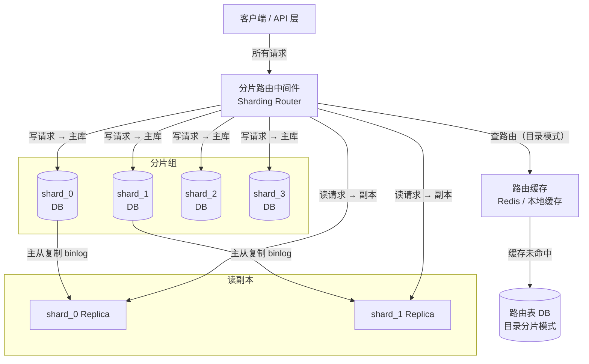

*图：应用按 shard key 经路由访问主分片，虚线表示跨片查询 fan-out、再平衡迁移与副本复制；右下指出复制延迟可能影响写后读。图中没有画跨片事务协议。*

---

当单节点在既定索引、查询和硬件条件下无法满足容量、写入或延迟目标时，才需要评估水平扩展。分片（Sharding）分散数据与写入，副本读取分担部分读流量；二者责任不同，也都会引入路由、再平衡或一致性成本，没有通用的“行数阈值”。

## 为什么需要分库分表

InnoDB B-tree 没有适用于所有表的“行数拐点”：树高、页命中率和查询成本同时受行宽、索引宽度、数据分布、buffer pool、硬件与访问模式影响。是否扩展应从实际资源和 SLO 观察，而不是套固定阈值：

- **容量**：结合当前数据量、日增长、保留周期、索引和复制开销预测何时触及可用存储上限。
- **写入**：用目标事务和硬件压测吞吐、锁等待、日志与复制延迟；不存在跨部署通用的单机 QPS。
- **读取与连接**：观察慢查询、缓存命中、连接池等待和副本陈旧度，再判断该优化查询、增加副本还是分片。

> **对 Agent 后端的意义**：对话、Tool Call 和步骤状态会产生持续写入。先按租户/时间规划归档与索引，并基于真实增长和查询模式评估分区、冷热分层或分片；用户数量本身不能推出写入量，也不能证明分片必然必要。

## 垂直拆分 vs 水平拆分

拆分有两个正交维度：按"列"拆（垂直）还是按"行"拆（水平）。

| 维度 | 垂直拆分（Vertical Sharding） | 水平拆分（Horizontal Sharding） |
|------|-------------------------------|----------------------------------|
| 拆分对象 | 表的列 / 库的业务 | 表的行 |
| 解决问题 | 宽表、业务耦合 | 单表数据量过大 |
| 结构变化 | 多张结构不同的表 | 多张结构相同的表 |
| 跨分片查询 | 跨库 JOIN 变难 | 跨分片 JOIN / 排序变难 |
| 扩容方式 | 按业务继续拆 | 增加分片数量 |
| 常见场景 | 微服务拆库、宽表瘦身 | 订单表、日志表、消息表 |

### 垂直拆分

**垂直分库**：将不同业务的表迁移到独立数据库，降低单库负载并实现业务解耦。

```
拆分前：monolith_db
  ├── users / profiles
  ├── orders / order_items
  ├── products / categories
  └── agent_sessions / agent_logs

拆分后：
  user_db     → users, profiles
  order_db    → orders, order_items
  product_db  → products, categories
  agent_db    → agent_sessions, agent_logs   ← AI 业务独立库
```

**垂直分表**：将宽表中低频访问的大字段（`TEXT`、`BLOB`、`JSON`）拆到独立表，减少热表行宽，让 Buffer Pool 缓存更多有效行。

```sql
-- 拆分前：users（id, name, email, avatar_url, bio, settings_json, …）
-- 拆分后：
CREATE TABLE users_core (
  id       BIGINT PRIMARY KEY,
  name     VARCHAR(64) NOT NULL,
  email    VARCHAR(128) NOT NULL
);  -- 高频访问，行小，缓存命中率高

CREATE TABLE users_profile (
  user_id       BIGINT PRIMARY KEY,
  bio           TEXT,
  settings_json JSON
);  -- 低频访问，单独读取
```

### 水平分表（Sharding）

水平分表将同一张表的行按某个维度（Sharding Key）散布到多张结构相同的表或多个库中。

```
orders_0  → user_id % 4 == 0 的订单
orders_1  → user_id % 4 == 1 的订单
orders_2  → user_id % 4 == 2 的订单
orders_3  → user_id % 4 == 3 的订单
```

## 分片键（Sharding Key）选择原则

分片键是水平拆分中最关键的设计决策，一旦上线极难更改。

**核心原则：**

1. **均匀分布**：各分片数据量、写入 QPS 尽量均衡，避免热点分片成为瓶颈。
2. **业务查询友好**：高频查询能够通过分片键定位到单个分片，减少跨分片 Scatter-Gather。
3. **基数与频率**：取值太少会限制可拆分单元；高基数本身不保证均衡，还要检查高频键与请求分布。[MongoDB 选键文档](https://www.mongodb.com/docs/manual/core/sharding-choose-a-shard-key/)同时比较基数、频率、单调性与查询模式；这里借其分析角度，不套用其产品命令到 MySQL。
4. **不可变性**：分片键一旦写入不应修改，否则需要跨分片迁移行。

**常见选择：**

- `user_id`：按用户维度查询时可作为候选，仍需检查大用户造成的数据量与流量倾斜。
- `order_id`（雪花 ID）：订单服务中按 ID 直查的场景。
- `tenant_id`：可按租户组织路由，但共置不等于授权隔离；还需认证授权与访问检查，并评估大租户热点。
- `created_at`：单调追加配合当前范围路由可能集中写入；按时间桶、复合键、查询与保留需求评估，参见“常见误区”，不能仅凭字段名排除。

## 分片策略对比

| 策略 | 规则 | 优点 | 缺点 |
|------|------|------|------|
| Hash 取模（Hash Mod） | `shard = key % N` | 实现简单；均衡取决于键分布与映射 | 扩容时键可能重新映射，迁移比例取决于旧、新分片数与路由算法 |
| 一致性哈希（Consistent Hash） | 环上位置映射，可使用虚拟节点 | 节点变化时可减少全量重映射 | 迁移范围与均衡取决于节点位置、虚拟节点和负载 |
| 范围分片（Range） | `id [0, 1M) → shard0` | 可按范围定位，扩展需明确拆分与迁移协议 | 单调追加落入当前范围时可能形成热点 |
| 目录分片（Directory / Lookup） | 路由表记录每个 key 的分片 | 可显式指定映射与调整路由 | 增加目录可用性、版本与缓存一致性成本 |

目录分片可支持显式映射和受控迁移；是否适合取决于目录规模、可用性与路由一致性合同：

```sql
-- 路由表：记录每个 tenant 属于哪个分片
CREATE TABLE shard_routing (
  tenant_id  BIGINT PRIMARY KEY,
  shard_id   TINYINT NOT NULL,
  created_at TIMESTAMP DEFAULT CURRENT_TIMESTAMP
);

-- 查询时先查路由表，再去对应分片
-- SELECT shard_id FROM shard_routing WHERE tenant_id = ?
-- 然后连接 shard_{shard_id}.agent_sessions
```

## 路由架构图

[MongoDB Sharding 文档](https://www.mongodb.com/docs/manual/sharding/index.html) 区分按 shard key 定向的查询与 scatter/gather，并说明 chunk 迁移和 balancer 承担再平衡职责。




## TypeScript 分片路由中间件示例

下面是一个中间件层路由骨架，封装了 Hash 取模和目录分片两种模式，外部调用无需感知底层分片细节。

```typescript
// shard-router.ts
import { DataSource } from 'typeorm';

type ShardStrategy = 'hash' | 'directory';

interface ShardConfig {
  strategy: ShardStrategy;
  totalShards: number;
  dataSources: DataSource[];        // 每个分片对应一个 DataSource（含读写分离配置）
  lookupFn?: (key: string | number) => Promise<number>; // 目录分片的路由查找函数
}

export class ShardRouter {
  constructor(private config: ShardConfig) {}

  /**
   * 根据 Sharding Key 解析目标 DataSource
   */
  async resolve(shardingKey: string | number): Promise<DataSource> {
    let shardIndex: number;

    if (this.config.strategy === 'hash') {
      // Hash 取模：key 转为数字后取模
      const numKey = typeof shardingKey === 'string'
        ? this.hashString(shardingKey)
        : shardingKey;
      shardIndex = numKey % this.config.totalShards;

    } else {
      // 目录分片：查路由表（通常加缓存）
      if (!this.config.lookupFn) throw new Error('lookupFn required for directory strategy');
      shardIndex = await this.config.lookupFn(shardingKey);
    }

    return this.config.dataSources[shardIndex];
  }

  /**
   * 跨分片 Scatter-Gather：向所有分片并发查询，应用层归并
   */
  async scatterQuery<T>(
    queryFn: (ds: DataSource, shardIndex: number) => Promise<T[]>
  ): Promise<T[]> {
    const results = await Promise.all(
      this.config.dataSources.map((ds, idx) => queryFn(ds, idx))
    );
    return results.flat();
  }

  private hashString(str: string): number {
    let hash = 0;
    for (let i = 0; i < str.length; i++) {
      hash = (hash * 31 + str.charCodeAt(i)) >>> 0; // 无符号右移保持正整数
    }
    return hash;
  }
}

// ---- 使用示例 ----

const router = new ShardRouter({
  strategy: 'hash',
  totalShards: 4,
  dataSources: [ds0, ds1, ds2, ds3],
});

// 单分片写入：Agent Session 按 userId 路由
async function createAgentSession(userId: number, sessionData: object) {
  const ds = await router.resolve(userId);
  await ds.getRepository(AgentSession).save({ userId, ...sessionData });
}

// 跨分片分页（谨慎使用）：全局最新 10 条日志
async function getLatestLogs(limit = 10) {
  const allLogs = await router.scatterQuery(async (ds) =>
    ds.getRepository(AgentLog)
      .createQueryBuilder('log')
      .orderBy('log.createdAt', 'DESC')
      .limit(limit)      // 每个分片取 limit 条
      .getMany()
  );
  // 应用层归并排序，取最终 Top N
  return allLogs
    .sort((a, b) => b.createdAt.getTime() - a.createdAt.getTime())
    .slice(0, limit);
}
```

## 读写分离（Read-Write Splitting）

[MongoDB Read Preference 文档](https://www.mongodb.com/docs/manual/core/read-preference/) 明确副本读取可能因异步复制返回陈旧数据，`maxStalenessSeconds` 只能约束可接受的陈旧程度，不能创造强一致性。


读写分离与分库分表是正交的优化：前者解决读多写少场景下的读 QPS 瓶颈，后者解决数据量和写 QPS 的瓶颈，实际系统常常同时使用。

**架构要点：**

- 主库（Master）处理所有写操作，通过 binlog 异步/半同步复制到一个或多个从库（Replica）。
- 读请求路由到从库，多个从库间做负载均衡（Round Robin 或最小连接数）。
- 从库只读，禁止应用写入。

**主从延迟（Replication Lag）** 是读写分离最常见的踩坑点：

- 延迟取决于写入、网络、接收与应用能力，应在目标负载下测量，不能假设通用毫秒级上界。
- 写后立即读可能读到旧数据（Read-Your-Own-Writes 问题）。
- 对写后读或特定新鲜度要求，明确主库路由、等待已确认写入的复制位点及超时回退；时间戳或单一延迟值不能单独证明副本已应用该次写入。

```typescript
// TypeORM 读写分离配置示例
const dataSource = new DataSource({
  type: 'mysql',
  replication: {
    master: {
      host: 'master.db.internal',
      port: 3306,
      username: 'app',
      password: process.env.DB_PASSWORD,
      database: 'agent_db',
    },
    slaves: [
      { host: 'replica1.db.internal', port: 3306, username: 'app', password: process.env.DB_PASSWORD, database: 'agent_db' },
      { host: 'replica2.db.internal', port: 3306, username: 'app', password: process.env.DB_PASSWORD, database: 'agent_db' },
    ],
  },
});

// 普通查询走从库（TypeORM 默认）
const sessions = await dataSource.getRepository(AgentSession).find({ where: { userId } });

// 强制走主库：支付后查余额 / 写后立即读
const qr = dataSource.createQueryRunner('master');
try {
  const freshBalance = await qr.manager.findOneBy(Account, { userId });
} finally {
  await qr.release();
}
```

## 分布式 ID：Snowflake 算法

分表后各表的 `AUTO_INCREMENT` 独立计数，会产生跨表 ID 冲突，必须使用全局唯一 ID 方案。

| 方案 | 原理 | 优点 | 缺点 |
|------|------|------|------|
| UUID v4 | 随机 128 bit | 无需中心节点 | 无序，B+ 树写入碎片化，索引性能差 |
| 雪花算法（Snowflake） | 时间戳 + 机器 ID + 序列号 | 趋势递增，高性能，可反解时间 | 依赖时钟，时钟回拨风险 |
| 数据库号段模式 | 批量预分配 ID 段 | 简单可靠，无时钟依赖 | 服务重启浪费号段；号段服务单点 |
| Redis INCR | 原子自增 | 极简 | 依赖 Redis 可用性；持久化风险 |

**Snowflake 64-bit 结构：**

```
┌──┬───────────────────────────────────────────┬──────────────┬────────────┐
│0 │         41 bit 毫秒时间戳（相对纪元）       │  10 bit 机器 │ 12 bit 序列│
│符│  (2^41 ms ≈ 69 年，自 2010 纪元起)         │  ID（最多    │ 号（每毫秒 │
│号│                                            │  1024 节点） │ 最多 4096）│
└──┴───────────────────────────────────────────┴──────────────┴────────────┘
```

```typescript
// 简化版 Snowflake 实现
class SnowflakeIdGen {
  private sequence = 0;
  private lastTimestamp = -1n;
  private readonly machineId: bigint;
  private readonly epoch = 1577836800000n; // 2020-01-01 纪元

  constructor(machineId: number) {
    this.machineId = BigInt(machineId & 0x3FF); // 10 bit
  }

  nextId(): bigint {
    let ts = BigInt(Date.now());
    if (ts < this.lastTimestamp) throw new Error('Clock moved backwards');
    if (ts === this.lastTimestamp) {
      this.sequence = (this.sequence + 1) & 0xFFF; // 12 bit
      if (this.sequence === 0) ts = this.waitNextMs(ts);
    } else {
      this.sequence = 0;
    }
    this.lastTimestamp = ts;
    return ((ts - this.epoch) << 22n) | (this.machineId << 12n) | BigInt(this.sequence);
  }

  private waitNextMs(current: bigint): bigint {
    let ts = BigInt(Date.now());
    while (ts <= current) ts = BigInt(Date.now());
    return ts;
  }
}
```

## 分表后的查询挑战

[分片集群事务说明](https://www.mongodb.com/docs/manual/core/transactions-sharded-clusters/index.html) 指出跨分片事务有额外协调成本；跨多个分片读取一致快照还需要相应的 snapshot read concern。


### 跨分片 JOIN

先区分同一 MySQL 实例的跨 schema JOIN 与独立节点之间的跨片 JOIN：[MySQL 8.4 官方例子](https://dev.mysql.com/doc/refman/8.4/en/identifier-qualifiers.html)可以在 SQL 中连接 db1.t 与 db2.t。独立节点能否由查询引擎协调、下推过滤或关联，取决于实际实现；跨节点传输与一致性可能增加成本，但不等于必须拉取两端全量数据。可比较关联数据共置、受控冗余或分布式查询，并用执行计划与目标负载验证。

### 跨分片分页

```
需求：查询全局最新 10 条 Agent 日志（按时间排序 + OFFSET 分页）

问题：数据分布在 4 个分片，无法直接 ORDER BY + LIMIT

方案 1（适合小分片数）：
  → 各分片分别查 LIMIT 10 → 应用层归并排序 → 取 Top 10
  缺点：OFFSET 越大，每个分片要查的行越多，性能随 OFFSET 线性下降

方案 2（推荐）：
  → 引入 Elasticsearch 冗余存储日志摘要，专门处理全局搜索/排序
  → DB 分片保留完整数据，ES 只做索引
```

### Agent 后端实践：对话历史分表策略

对于存储 LLM 多轮对话的 `messages` 表，推荐按 `session_id`（由 `user_id` 生成的雪花 ID）做 Hash 分片：

- 每次对话查询只需命中单个分片（session 内所有消息的 session_id 相同）。
- 历史消息冷热分离：超过 90 天的消息归档到冷存储（如 OSS + Parquet），热表保留近期数据。
- Tool Call 日志量级更大，可单独建表并按 `agent_run_id` 分片。

## 常见误区

**误区 1：用 `created_at`（时间戳）做分片键**

单调增加的时间键配合当前时间范围路由，可能把持续追加写入集中到最新分片而形成热点；实际分布还取决于回填、路由和时间桶设计。按查询范围、保留期限与目标写入负载选择时间范围、复合键或其他策略，不能一概禁止时间参与分片键；二级时间索引也是需要比较的一种方案。

**误区 2：没有测量单节点瓶颈就提前分片**

分库分表会引入分布式 ID、跨分片查询、事务与运维成本。先按行宽、索引、访问模式、硬件、增长与一致性目标实测单节点瓶颈，再比较查询优化、副本、归档或分片；不存在跨部署通用的“数亿行”容量结论，也不要求固定采用同一种优化顺序。

**误区 3：分片数选小了，之后扩容痛苦**

改变 Hash 取模分片数时，键可能重新映射；迁移比例取决于旧、新分片数和路由算法，不能统一写成一个固定比例。设计时明确路由版本、迁移与切换协议，比较虚拟槽、一致性哈希或其他方案；分片数为 2 的幂并非所有实现的正确性条件，在线双写也不能代替迁移与一致性验证。

**误区 4：读写分离后忽视主从延迟**

识别真正需要读到本次已确认写入或满足特定新鲜度的请求，再定义主库路由、等待指定复制位点或超时回退等合同；其余请求按业务容忍的陈旧程度选择副本。只比较一个版本号不会让副本自动追上，检测到落后后还须明确等待、回退或返回未满足条件。

## 面试常问

- **什么时候需要分片？** 在明确容量、写入、延迟和一致性目标后，测量单节点限制，并比较适用的查询优化、归档、扩容、副本与分片方案。没有要求逐项按固定次序尝试；选择由压测、增长模型和运维成本支持，不能套固定行数。

- **分片键选错了怎么办？** 先确认新路由能改善目标负载，再设计回填、增量变更捕获或受控双写、校验、切换与回退协议；能否在线及需要多久由数据量、变更速率和系统能力决定。双写不是唯一方法，也不能替代重复、遗漏和并发更新的一致性验证。

- **跨库 JOIN 需要先澄清什么？** 同实例跨 schema JOIN 可以由数据库执行；独立节点的关联则要检查引擎支持、数据共置、过滤下推、网络和一致性合同。按实际计划与负载评估，不把“跨库”直接等同于应用全量拉取。

- **雪花 ID 时钟回拨怎么处理？** 常见方案：检测到回拨时抛出异常（拒绝生成）；或等待时钟追上；或记录上次时间戳，回拨时在序列号维度打补丁。生产中应启用 NTP 时钟同步并监控时钟偏移。

- **分布式事务如何处理？** 先明确原子性、隔离、可补偿性、资源预留和失败恢复要求，再比较数据库事务、Saga、TCC 或消息模式。以 [Seata v2.6 TCC](https://seata.apache.org/docs/user/mode/tcc/)为例，业务要实现 Try 预留及 Confirm/Cancel；机制名称本身不能保证所需隔离或吞吐优势，补偿与重试也须按实际合同验证。

- **读写分离复制延迟如何监控？** 以 [MySQL 8.4 SHOW REPLICA STATUS](https://dev.mysql.com/doc/refman/8.4/en/show-replica-status.html)及 `Seconds_Behind_Source` 为例，同时检查接收/应用线程、错误和复制位点：数值 0 仍可能是接收端落后，NULL 表示相应条件下未知；多线程复制与时钟变化也影响解读。Exporter 指标名按实际版本确认，告警阈值由业务新鲜度目标和持续时间定义，不设通用 1 秒门槛。

## 普通 InnoDB 表分区与跨节点分片

以 [MySQL 8.4 普通 InnoDB 用户分区](https://dev.mysql.com/doc/refman/8.4/en/partitioning-overview.html)为例，逻辑表按规则组织不同数据分区，可在满足条件时减少需要访问的分区；这不会自动建立应用跨数据库节点的路由、迁移和独立写入合同。NDB 的分布式存储与分区机制另有规则，不应与这个普通 InnoDB 例子混写。

跨节点分片还要定义分片键、对象定位、再平衡、跨片查询与事务。对海量商品，先列出 ID 直查、筛选搜索、更新并发、删除传播与一致性要求，再按行宽、索引、增长和实测流量评估方案。不能用通用“数亿行”或固定优化顺序证明容量。

口述时可说：“先按容量、访问模式和一致性目标实测。普通 InnoDB 表分区组织同一逻辑表的数据；跨节点分片还要路由、迁移和跨片合同，行数本身不能证明方案。”

以下是教学模拟追问：

- **表分成 100 个分区，就获得 100 台机器的写能力吗？** 不会；分区语法不自动创建独立节点与跨节点执行能力。
- **商品很多但只有按 ID 读取，需要先加跨片搜索平台吗？** 先测实际访问与容量；没有跨片搜索需求时，不因数据量数字引入额外系统。

## 冷热分层与分片、读写分离解决不同问题

冷热分层依据访问模式与服务要求安排存储，不等同于水平分片或把读请求发往副本。文中的按时间归档只是示例；温度也可能由最近访问、业务状态、价值与恢复要求共同决定，不能把某个天数当统一阈值。

先定义热查询需要的延迟、冷数据的检索方式、允许恢复时间和保留条件，再设计归档水位与校验。可先复制到冷层并核对记录、索引与可读性，确认迟到更新和增量传播的处理方式后，再按合同收缩热副本。删除或归档不是只更新一个路由字段，跨层查询、失败重试与回迁也需要可验证路径。

设计时分别衡量热路径资源、冷层取回成本、查询覆盖与恢复演练。冷数据不是可以丢掉的数据；权威事实与可重建索引应区别对待。存储生命周期与取回边界可结合[对象存储](../storage/object-storage.md)理解。

## 出现于（热度来源）

<!-- interview-source-history:start -->
- [蚂蚁数字支付 AI 应用研发二面：数据分层、迁移与微调](../../../interview/antfin/ai/antfin-ai-13.md)
- [字节 Agent 实习：异步消息、上下文与容器隔离](../../../interview/bytedance/base/bytedance-base-41.md)
- [百度后端 Go / Agent 一面：会话恢复、记忆冲突与评测](../../../interview/baidu/ai/baidu-ai-2.md)
- [阿里云 AI 应用一面：并发审查、RAG 评估与海量商品](../../../interview/alibaba/ai/alibaba-ai-16.md)
<!-- interview-source-history:end -->

## 参考资料

- [Sharding — MongoDB Manual](https://www.mongodb.com/docs/manual/sharding/index.html)
- [Read Preference — MongoDB Manual](https://www.mongodb.com/docs/manual/core/read-preference/)
- [Production Considerations (Sharded Clusters) — MongoDB Manual](https://www.mongodb.com/docs/manual/core/transactions-sharded-clusters/index.html)
- [MySQL 8.4：Partitioning Overview](https://dev.mysql.com/doc/refman/8.4/en/partitioning-overview.html)（普通 InnoDB 与 NDB 机制分开；2026-10-20 北京时间核验）
