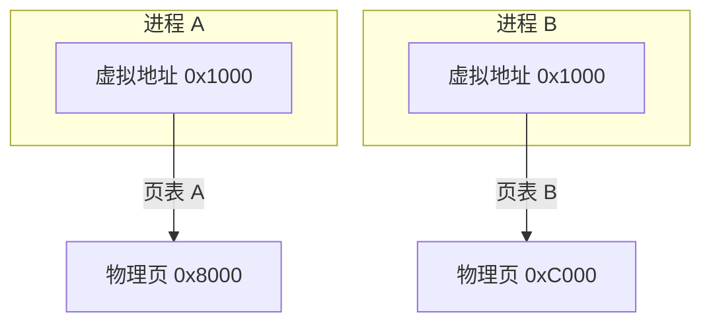
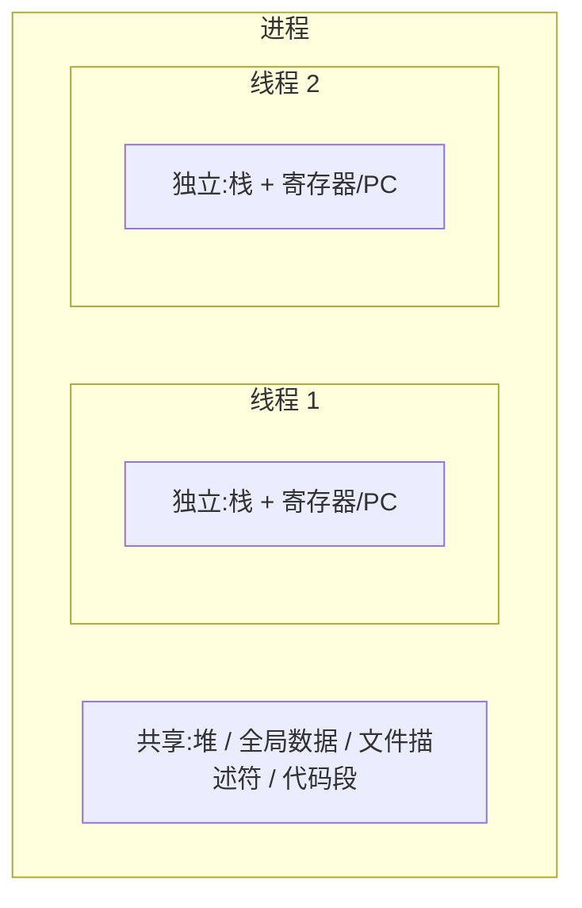
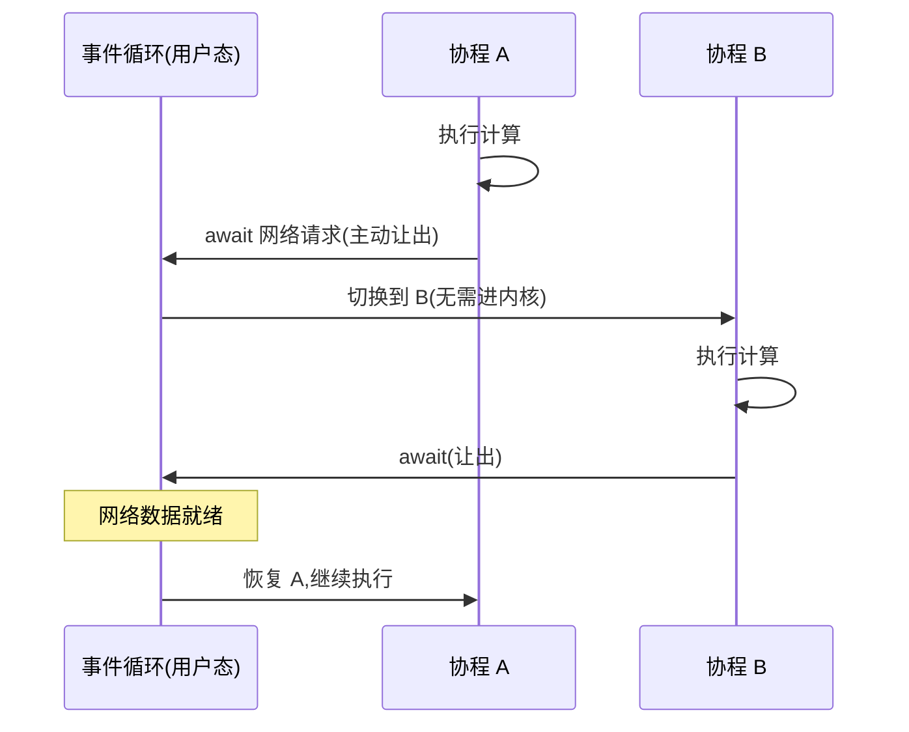

*图：地址空间边界与共享资源协议分别标出；左侧只放大线程A1的单线程事件循环，不代表所有协程运行时都只能单线程。图为机制示意，不包含调度耗时或容量实测。*

---

## 进程、线程与协程有什么区别?

设想浏览器、编辑器和音乐程序分别运行在不同进程中，一个程序的普通内存错误通常不会直接改写另一个进程的私有内存；但共享文件、数据库或系统资源仍可能传播影响。编辑器内部的响应输入、自动保存等工作又可以由不同线程完成。再往上，网络程序可用协程在等待 IO 时切换任务。这三个概念分别回答资源与地址空间、可调度执行流，以及语言运行时怎样组织任务的问题。

下文的进程和线程以常见 Linux/POSIX 模型为基准；协程先用 Python 3.13 `asyncio` 的单线程事件循环解释，再说明多线程运行时的差别。并发是任务交错推进，并行是同一时刻在不同执行资源上工作，二者不能混称。

阅读时依次问：资源与地址空间属于谁，系统调度哪个执行流，语言任务又怎样在等待IO时交接执行。

## 一、进程:资源分配的基本单位

进程是"一个正在运行的程序"。但更精确地说,**进程是操作系统进行资源分配的基本单位**。

当你双击一个可执行文件,操作系统会为它创建一个进程,并为这个进程划拨一整套独立的资源:

- **通常独立的虚拟地址空间**：代码、数据、堆和栈在进程自己的映射中；可用范围取决于架构、内核与配置，不从“64 位”直接推出固定容量。
- **打开的文件描述符表**:它打开了哪些文件、哪些 socket。
- **其他内核资源**:信号处理设置、当前工作目录、环境变量等。

关键在于映射边界。两个进程中的同一个虚拟地址不自动代表同一份对象；对各自的私有映射，可以指向不同物理页。MMU 与操作系统维护这种映射与访问权限。但显式共享映射、共享库等也可能让进程访问同一物理页，因此不能说两个进程的物理内存始终完全不同。下面只画私有映射的示意。

地址空间隔离有利于限制普通内存破坏的影响，但它不是完整的故障隔离协议。进程仍可能改坏共享文件、占满公共资源或写错数据库；浏览器也可能按站点、子框架等策略安排进程，不能把“每个标签页一个进程”当成普遍固定实现。

进程交换数据需要明确通信机制，如管道、消息队列、共享内存或 socket。代价取决于复制、序列化、系统调用与同步；共享内存建立映射后不要求每次读写都陷入内核，但仍须处理并发和生命周期。

## 二、线程:CPU 调度的基本单位

[POSIX 线程通用概念](https://pubs.opengroup.org/onlinepubs/9799919799/basedefs/V1_chap02.html#tag_02_09) 定义同一进程内线程共享的执行环境以及各线程独有状态；协程则是语言/运行时的协作调度抽象，不能等同于 POSIX 线程。

如果一个进程内部想同时做多件事(比如编辑器一边响应键盘一边自动保存),就需要线程。

**线程是 CPU 调度的基本单位**。一个进程至少有一个线程(主线程),也可以有多个。同一进程内的所有线程**共享该进程的地址空间和资源**——同一片堆内存、同样的文件描述符、同样的全局变量。但每个线程有自己**独立的栈和寄存器状态(包括程序计数器)**,因为它们各自执行着不同的代码路径,需要记住"我执行到哪了、我的局部变量是什么"。

"共享地址空间"是线程的核心优势,也是它最大的陷阱:

- **优势**：线程可以直接访问同一地址空间的数据，减少某些复制或序列化；内存访问、缓存一致性及同步仍有成本。
- **陷阱**:多个线程同时读写同一块内存,会产生**竞态条件(race condition)**。比如两个线程都执行 `count++`,这条语句在底层是"读—加—写"三步,可能交错执行导致结果错误。所以多线程编程必须用锁(mutex)、信号量、原子操作等手段做**同步**,而锁用不好又会带来死锁和性能瓶颈。

## 三、上下文切换:进程 vs 线程的成本差异

当CPU从一个内核执行流切换到另一个时，需要保存与加载执行状态，这叫**上下文切换**。是否跨进程，以及工作集和运行队列状态，都会改变成本。

**同进程的内核线程切换**需要保存与恢复执行状态，还涉及调度、缓存和运行队列。它通常不需要换到另一进程的地址空间，但不能将成本简化成“只换几个寄存器”。

**跨进程执行流切换**还可能切换地址空间上下文，并改变地址转换和数据缓存的工作集。TLB 用于缓存地址转换，但不同架构与内核的保留、失效方式不同，不能一概说每次都清空它。

因此“线程较轻”应理解为某些资源共享和切换路径较少，而不是固定性能结论。比较时要在相同任务、数据、核数和负载下测量通信、同步、调度及尾延迟，不能给一个通用耗时倍数。

内核调度的是可运行执行流；时间片、阻塞、唤醒等都可能触发调度。用户态运行时还可以在自己的任务间切换，二者是不同层次，不能将每次语言任务切换都算成一次内核线程切换。

## 四、协程:用户态的轻量执行单元

**协程是语言或库的可挂起执行抽象，调度由相应运行时组织。**先以 Python 3.13 `asyncio` 为例：同一个事件循环每次运行一个 Task；Task 等待未完成的 Future 时可挂起，循环继续执行其他任务、回调或 IO。[Task 文档](https://docs.python.org/3.13/library/asyncio-task.html#task-object)明确限定了这个单循环的协作调度模型。

在这个模型中，`await` 需要等待的对象时才可能让出；不能仅凭代码里有 `await` 就认为任务一定被切走。长时间CPU计算或同步阻塞调用会阻塞同一事件循环。其他运行时未必采用相同策略，例如 [Go FAQ](https://go.dev/doc/faq#goroutines)说明 goroutine 会复用一组操作系统线程，调度器也可抢占；不能把一种协程实现的规则推广到所有语言。

用户态任务切换可以避免为每次交接调度一个新内核线程，但实际耗时还包括运行时状态管理、队列及所等待的IO。协程是否有独立栈、栈怎样分配以及能承载多少任务都依实现而异；每个任务保存的大对象和外部连接仍可能成为容量瓶颈，不给固定纳秒数或数量上限。

**同一个内核线程同一时刻只运行一个任务，不等于所有协程都不能并行。**多个运行线程可以在多核上并行执行可并行的工作，仍受语言锁、任务依赖与运行时限制。异步调用也不自动消除竞态：即使只有一个事件循环，任务在检查条件后挂起，另一个任务也可能改变该条件，因此跨等待点的共享状态仍需协议。

## 五、三者对比

| 维度 | 进程 | 线程 | 协程 |
| --- | --- | --- | --- |
| 本质定位 | 资源分配的基本单位 | CPU 调度的基本单位 | 用户态的轻量执行单元 |
| 地址空间 | 通常私有映射；也可显式共享 | 进程内共享 | 依所在进程与运行时作用域，不提供普通内存隔离边界 |
| 调度者 | 操作系统内核 | 操作系统内核 | 用户态运行时 / 事件循环 |
| 调度方式 | 所属内核执行流受系统调度 | 内核调度 | 依运行时；本例事件循环采用协作调度 |
| 切换成本 | 可能含地址空间切换，需实测 | 调度、工作集与同步成本需实测 | 任务切换及运行时成本，不能承诺固定倍数 |
| 是否真并行 | 多核与负载允许时可以 | 多核与运行时允许时可以 | 单线程内不并行；多线程运行时可能并行 |
| 通信方式 | IPC或显式共享内存，仍需同步 | 共享内存与同步 | 按任务作用域共享；跨等待点也可能竞态 |
| 隔离/容错 | 私有地址空间提供一层隔离，共享外部资源另行处理 | 内存破坏可能影响同进程其他线程，普通任务异常依运行时处理 | 依异常传播、取消与调度协议 |
| 容量限制 | 内存、句柄、系统配置与工作负载 | 栈、调度、内存及运行时限制 | 任务状态、队列、连接与运行时限制 |

## 六、各自的适用场景

理解了机制,选型就有了依据:

- **多进程**：需要更明确的地址空间和故障边界，且能承担通信与状态同步时优先评估。对启用GIL的常规CPython构建，多进程可支持CPU密集Python代码利用多核；释放GIL的原生扩展及其他构建另论。[CPython3.13 free-threading文档](https://docs.python.org/3.13/howto/free-threading-python.html)已说明可选的实验性无GIL构建，不能把GIL限制说成所有Python版本的永久规则。
- **多线程**:CPU 密集型任务在多核上做并行计算,且任务间需要频繁共享大量数据。比如图像处理、并行排序、科学计算。前提是你愿意承担同步(加锁)的复杂度。
- **协程 / 异步 IO**：大量任务等待IO、依赖有非阻塞接口时值得评估。还要限制并发、队列和下游连接，并处理超时与取消；它不是所有IO密集负载的通用最优解。

## 七、为什么高并发 IO 更适合协程 / 异步 IO

这是最值得讲透的"为什么"。

设想一个服务要同时处理一万个请求,每个请求都要去查一次远程数据库,网络往返要 50 毫秒。

若采用“一请求一条内核线程”的阻塞模型，等待时该线程仍保留栈等资源。仅作计算示意：若每条线程配置1MiB虚拟栈预留，一万条约预留9.8GiB虚拟地址空间，但这不是已驻留物理内存，也不是所有运行时的默认值。线程池可以限制数量，却会把多出的请求放入队列；因此要比较线程、队列和下游连接的整体容量，而不是只数并发请求。

单线程事件循环可在任务等待非阻塞IO时执行其他就绪任务，由IO就绪通知唤回等待者，减少一请求一内核线程的资源需求。但同步驱动、CPU工作或下游串行限制仍会阻塞关键路径；对具体并发规模和尾延迟必须实测，不能仅凭使用了`await`就宣称没有调度成本。

要点是把可重叠的等待组织为并发，同时保留可控的任务数量、超时与取消。异步没有消除操作系统IO或调度开销，只改变了应用怎样利用等待时间。

> 对Agent工具调用，可将确实独立且已获准的IO并发执行；有数据依赖的调用仍等待前置结果。理想无排队情况下，独立调用的等待可重叠，但服务限流、连接池、CPU处理和结果合并都会增加总时长。`asyncio.gather`等接口不是权限、背压或故障处理协议，仍需按实际API处理异常、取消与重试。

## 小结

- **进程**提供地址空间和资源边界；共享外部状态仍需通信、同步与故障协议。
- **内核线程**是系统调度的执行流；进程内共享地址空间，每条线程保留自己的执行状态。
- **协程任务**由语言运行时组织；单线程事件循环可重叠IO等待，多线程运行时的并行性和调度机制须单独说明。

选择依据是故障与共享边界、CPU/IO结构、运行时能力，以及受控负载下的测量。单线程不等于没有逻辑竞态，多协程也不等于多核并行；明确这些条件比给三者排一个固定性能名次更有用。

## 出现于（热度来源）

<!-- interview-source-history:start -->
- [腾讯 AI 应用开发日常实习二面：并发模型与索引设计](../../../interview/tencent/ai/tencent-ai-17.md)
- [字节后端与 Agent：运行链路、数据库与网络](../../../interview/bytedance/base/bytedance-base-55.md)
- [字节 Agent 开发一面：上下文工程、协作与编程基础（2026 年 8 月）](../../../interview/bytedance/base/bytedance-base-19.md)
- [字节飞书 AI 应用一面：Runtime、评测与后端基础](../../../interview/bytedance/base/bytedance-base-24.md)
- [字节 Agent 后端一面：进程线程、Transformer 与训练](../../../interview/bytedance/base/bytedance-base-31.md)
- [蚂蚁 Agent 实习一面：缓存、消息与 RAG](../../../interview/antfin/ai/antfin-ai-6.md)
- [腾讯 Agent 实习一面：RAG、工具与通信](../../../interview/tencent/ai/tencent-ai-10.md)
- [字节 Agent 实习：缓存一致性、定时任务与后端基础](../../../interview/bytedance/base/bytedance-base-47.md)
<!-- interview-source-history:end -->

## 参考资料

- [POSIX General Concepts: Threads](https://pubs.opengroup.org/onlinepubs/9799919799/basedefs/V1_chap02.html#tag_02_09)
- [PEP 3156: Asynchronous IO Support Rebooted](https://peps.python.org/pep-3156/)
- [Linux man-pages：POSIX threads共享与独有属性](https://man7.org/linux/man-pages/man7/pthreads.7.html)
- [Python3.13：asyncio Task协作调度](https://docs.python.org/3.13/library/asyncio-task.html#task-object)
- [Python3.13：实验性free-threading构建](https://docs.python.org/3.13/howto/free-threading-python.html)
- [Go FAQ：goroutine与线程、并行性](https://go.dev/doc/faq#goroutines)
