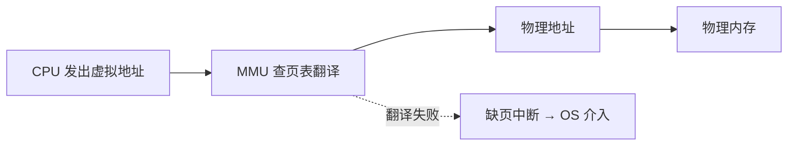

*图：沿图中的节点与箭头阅读，重点是解释虚拟地址、页表、TLB、page fault、匿名/文件映射、copy-on-write 与回收边界。*

---

## 虚拟内存与分页机制是怎么工作的?

设想这样一个场景:你的电脑只有 16GB 物理内存,却同时开着浏览器(几十个标签页)、IDE、Docker、一个本地跑着的大模型推理进程。把它们占用的内存加起来可能远超 16GB,但系统依然在跑——而且每个程序都"以为"自己独占了一整块从 0 开始、连续无缝的地址空间。普通进程的私有地址空间提供访问保护，因此一个程序的野指针通常不会直接改写另一程序的私有映射；共享文件、显式共享内存和系统资源仍需另行保护。

这一切看似矛盾的现象,背后是同一套机制在支撑:**虚拟内存(Virtual Memory)**。理解它,几乎是理解现代操作系统的钥匙。（参见 [Linux kernel memory management documentation](https://docs.kernel.org/mm/index.html)）

## 为什么需要虚拟内存?

如果让进程直接操作物理内存(像早期没有 MMU 的系统那样),会立刻撞上三个难题。虚拟内存正是为了同时解决它们而生。

**第一,进程隔离与保护。** 多个进程同时驻留内存,谁能保证 A 进程不会读写 B 进程的数据?直接用物理地址的话,一个 bug 就能拖垮整个系统。我们需要一道墙,让每个进程只能碰自己的内存。

**第二,连续地址的假象。** 程序员和编译器都希望面对一块"从 0 开始、连续、巨大"的地址空间,这样链接、寻址都简单。但物理内存是被各进程瓜分得支离破碎的。我们需要一层映射,把进程眼中连续的地址,翻译到实际上零散的物理位置。

**第三，按需驻留与容量管理。** 虚拟地址空间不等于已经分配并驻留的物理页。系统可按需建立映射、回收文件缓存，并在配置允许时使用 swap；Linux 的 overcommit 准入策略还会影响分配何时失败。虚拟内存不是无限容量承诺，分配返回成功也不保证以后访问时总有物理内存可用。[Linux malloc 的分配失败与 overcommit 说明](https://man7.org/linux/man-pages/man3/malloc.3.html)

虚拟内存的核心思想可以一句话概括:**给每个进程一套独立的、虚拟的地址空间,再由硬件+操作系统把虚拟地址翻译成物理地址。** 这层"翻译",就是全部魔法的来源。

## 内存碎片：用户态分配与物理页要分层回答

堆与栈只是使用方式的一部分，不能仅列出二者就解释碎片。**内部碎片**是分配粒度或对齐造成已分配块中未被请求使用的空间；**外部碎片**是空闲空间分散，难以满足某层所需的连续块。用户态堆分配器的空闲块、内核物理页的高阶连续分配，与进程看到的虚拟连续地址是不同层次；虚拟连续不要求对应物理页也连续。[Linux：内存压缩与物理碎片](https://docs.kernel.org/admin-guide/mm/concepts.html#compaction)

先观察对象大小、存活期、分配频率与实际占用，再选择大小分级池、同生命周期 arena 或适当预留容量等办法。比如同一请求产生且能一起释放的小对象，可从一块区域递增分配并整体回收，减少逐个分配/释放的管理；若长期对象混入，整块空间可能被拖延释放。以 C++ 的 `monotonic_buffer_resource` 为例，单次 `deallocate` 不回收，耗尽初始缓冲时可向上游申请更多空间，且自身不提供同步；“先申请一大块”并不等于不会耗尽、不会浪费或自动线程安全。[C++20 N4861：monotonic buffer resource](https://timsong-cpp.github.io/cppwp/n4861/mem.res.monotonic.buffer)

分级大小也可能留下内部浪费，线程缓存与多个 arena 会增加保留空间。jemalloc 的维护者文档明确说明了分级、arena 与线程缓存的这些取舍，因此不能脱离负载承诺换分配器就能消除碎片；应比较活跃对象字节、分配器保留字节、进程驻留与分配尾延迟，再决定策略。[jemalloc：Implementation Notes](https://jemalloc.net/jemalloc.3.html#implementation_notes)

## 虚拟地址到物理地址的转换

每个进程看到的地址都是**虚拟地址(Virtual Address)**。CPU 执行指令时给出的地址也都是虚拟地址。但内存条上的存储单元只认**物理地址(Physical Address)**。两者之间的翻译,由 CPU 里一个叫 **MMU(内存管理单元)** 的硬件完成。



关键在于:翻译规则不是一对一硬编码的,而是存在一张**页表(Page Table)**里,由操作系统为每个进程单独维护。进程切换时,操作系统切换页表,MMU 就开始按新表翻译——于是每个进程都活在自己的地址空间里,互不干扰。隔离就是这么实现的。

## 分页:把内存切成等大的块

直接对每个字节做映射显然不现实,映射表会比内存本身还大。于是引入**分页(Paging)**:把虚拟地址空间切成固定大小的**页(Page)**,把物理内存切成同样大小的**页框(Page Frame)**,具体页大小依架构与内核配置而异，下面以 **4 KiB** 普通页作示例；大页还有其他粒度。映射以"页"为单位进行,粒度大大降低。

既然按页映射,虚拟地址就被自然拆成两部分:

| 部分 | 含义 |
| --- | --- |
| 页号(高位) | 用来在页表里查找映射到哪个物理页框 |
| 页内偏移(低位) | 在页框内的字节偏移,翻译前后保持不变 |

以 4KB 页为例,低 12 位($2^{12}=4096$)是页内偏移,高位是页号。翻译过程就是:用页号去页表查出对应的物理页框号,再把页框号和原来的偏移拼起来,得到物理地址。

```
虚拟地址:  [   页号 20 位   ][ 偏移 12 位 ]
                  │ 查页表
                  ▼
物理地址:  [ 页框号 ][ 偏移 12 位 ](偏移原样拷贝)
```

页表的每一项(PTE)除了记录物理页框号,还带着一组标志位:是否有效(present)、是否可写、是否可执行、是否被访问过(accessed)、是否被修改过(dirty)。这些标志位是后面缺页、保护、置换算法的基础。

## 多级页表:别让页表自己吃光内存

用 32 位虚拟地址、4 KiB 页和 4 字节表项作简化计算，完整单级页表有 $2^{20}$ 项，约占 4 MiB；若直接为更大的虚拟地址空间逐页预留表项，开销会继续增长。而大多数进程的地址空间是**稀疏**的——代码在低地址、栈在高地址,中间一大片根本没用。为这些空洞也分配页表项,纯属浪费。

解决办法是**多级页表(Multi-level Page Table)**:把页号再切成几段,逐级查找,像查字典先翻部首再翻笔画。只有真正用到的那一段子页表才需要在内存里存在,空洞区域对应的子页表干脆不分配。


页表层数取决于架构与配置，上图只表达逐级导航。多级转换可能增加访存工作，因此还需要缓存地址转换结果；不能把示意图层数当所有机器的固定事实。[Linux 虚拟内存概念](https://docs.kernel.org/admin-guide/mm/concepts.html)

## TLB:翻译的高速缓存

如果每次地址转换都要完整遍历多级页表，就会增加额外访存工作。于是 CPU 里又加了一块小而快的缓存:**TLB(Translation Lookaside Buffer,快表)**,专门缓存最近用过的"页号 → 页框号"映射。

翻译流程因此变成:

1. MMU 先查 TLB。**命中（TLB hit）**：复用已有地址转换，避免相应页表遍历；仍有硬件访问成本。
2. **未命中(TLB miss)**:才去走多级页表(称为 page table walk),查到后把结果填回 TLB。

程序的访问局部性、工作集、页大小和 TLB 容量都会影响命中率，不能给所有程序一个固定的高命中率。切换地址空间也可能改变转换缓存与数据缓存的使用情况，具体保留或失效方式依架构和内核机制判断。

## 缺页中断与按需调页

访问尚未建立所需物理映射的地址，或触及某些保护条件时，CPU 会触发 **page fault**，由操作系统判断能否修复。它不等于一次内存申请失败，也不一定需要读磁盘。

操作系统接手后会判断这是哪种情况:

- 合法文件映射尚未建立物理页映射：可能从已有 page cache 建立映射，也可能需要 I/O 读入文件页，这是按需调页的一种情况。
- 匿名页已换出且仍有有效 swap 内容：按需换入；首次匿名访问也可能涉及共享零页或分配零填充页。
- 写时复制（copy-on-write）：某次写访问需要得到私有可写副本；这类 fault 不要求从磁盘读数据。
- 无法修复的未映射或权限违规访问：按平台规则报告错误；Linux 可能发出 SIGSEGV，不能把所有 fault 都当正常换页。

可以修复的 fault 会建立所需映射或权限后继续执行，期间可能经历分配、回收或 I/O 等待。已有缓存页、零填充和写时复制，与需要实际存储读取的 fault 代价不同；诊断时应区分相关计数与等待原因，不用总 fault 数直接推断磁盘瓶颈。[Linux：匿名内存、页缓存与回收](https://docs.kernel.org/admin-guide/mm/concepts.html)

## 页面置换算法:内存满了换谁走?

需要更多物理页时，系统可回收可重建的干净文件缓存；脏文件页涉及写回，匿名页能否换出还取决于 swap 等条件，并非每次都把已有页写入 swap。教材的**页面置换算法（Page Replacement）**用简化模型讨论优先回收谁，以降低后续访问代价；实际 Linux 的回收机制不能直接等同某一个教材算法。

| 算法 | 思路 | 优缺点 |
| --- | --- | --- |
| FIFO | 换出最早进来的页 | 实现简单;但可能换掉常用页,甚至出现 Belady 异常(加内存反而更多缺页) |
| LRU | 换出最久未被访问的页 | 接近最优;但精确实现需为每次访问记时间戳,硬件开销大 |
| Clock(二次机会) | LRU 的近似 | 用一个 accessed 标志位 + 环形指针,低成本逼近 LRU,实际系统常用 |

理论上最优的是 OPT 算法(换出未来最久不用的页),但它需要预知未来,只能作为衡量其他算法好坏的标尺。在这个教学模型中，**Clock 算法**利用访问标志位：指针扫到一页时,若该位为 1 就清零并跳过(给它"第二次机会"),为 0 才换出——用极小成本拿到了接近 LRU 的效果。

## Thrashing:换页换到崩溃

当物理内存严重不足,进程们需要的"活跃页面集合"(工作集)加起来装不下时,会发生一种恶性循环:刚换出去的页马上又被访问,于是又换进来,又得换出别的页……CPU 大部分时间不是在干活,而是在等磁盘读写页面。这种状态叫**内存抖动(Thrashing)**。


这可能表现为回收或换入换出等待增加、尾延迟上升、吞吐下降；不是所有内存压力都会出现同一种 CPU 或磁盘现象。处理方向包括减少活跃工作集、限制并发与缓存增长、修复泄漏，或调整经过验证的资源容量与部署；进程数本身不能代表内存需求。

## mmap、Page Cache 与异步写回怎样衔接

下面限定为 Linux 常见文件系统的缓冲文件 I/O，不把匿名映射、Direct I/O、DAX 等路径混为同一机制。Page cache 缓存文件内容，普通 `read`、`write` 和文件 `mmap` 都可以经由它；它不是只供 `mmap` 使用，也不是进程自己维护的一份普通缓存。[Linux：Page Cache](https://docs.kernel.org/mm/page_cache.html)

文件 `mmap` 把文件范围映射到虚拟地址空间，访问时按需建立映射；它可能减少显式 `read`/`write` 和用户缓冲复制，但仍有 fault、页表、同步与 I/O 成本。`MAP_SHARED` 的文件修改可影响同一底层文件；`MAP_PRIVATE` 是写时复制，其私有修改不写回原文件。匿名映射也不自动拥有一个可写回的普通文件。[Linux mmap：共享与私有映射](https://man7.org/linux/man-pages/man2/mmap.2.html)

缓冲写入或共享文件映射的修改会形成脏页，内核再把它们写回文件系统与存储设备。后台 flusher 可以按脏数据规模与年龄等条件推进；达到某些限制时，产生脏数据的进程也可能参与写回或等待。因此“异步写回”不保证前台永不阻塞，也不能说固定间隔后所有数据必然安全落盘。[Linux：dirty_* 与后台写回参数](https://docs.kernel.org/admin-guide/sysctl/vm.html#dirty-background-bytes)

### 返回成功，究竟确认了哪一层

| 观察 | 可以确认什么 | 还不能直接推出什么 |
| --- | --- | --- |
| 缓冲 `write` 返回字节数 | 本次接受了多少字节；可能是短写 | 全部请求已经完成，或数据具备崩溃持久性 |
| 异步接口提交成功 | 接口接受请求；完成结果需按该 API 另查 | I/O 已完成，更不能自动推出已同步到稳定存储 |
| 某轮后台 writeback 的 I/O 完成 | 相应脏页写出请求已完成 | 存储缓存已按同步协议刷新，或整个业务操作具备崩溃持久性 |
| `msync(MS_SYNC)` 返回成功 | 对应映射范围按该接口完成同步 | 其他文件、目录项及整个业务事务也已经同步或原子完成 |
| `fsync`/`fdatasync` 返回成功 | 在相应平台、文件系统和存储遵守协议的前提下，完成该接口规定的同步 | 业务事务原子性、所有文件及目录的整体一致性 |

Linux `write` 成功不等于数据已经提交到磁盘，错误也可能延迟到后续写入或同步才报告。映射同步的 `MS_SYNC` 要求等待对应更新完成；`MS_ASYNC` 的可移植语义是安排更新而立即返回，且 Linux 自 2.6.19 起该标志实际无需额外动作，因为内核已经跟踪脏页。它不能作为“本次已持久化”的凭据。[write 的短写与延迟错误](https://man7.org/linux/man-pages/man2/write.2.html)、[msync 的同步语义与 Linux 差异](https://man7.org/linux/man-pages/man2/msync.2.html)

`fsync` 还同步文件相关元数据，`fdatasync` 可以省略不影响后续数据读取的元数据；创建或重命名涉及目录项时，还要按协议处理目录同步。即使同步成功，应用仍要设计多对象一致性、崩溃恢复和存储故障模型，不能把一个 syscall 当成完整事务。[Linux fsync 与目录同步](https://man7.org/linux/man-pages/man2/fsync.2.html)

### 异步刷盘失败后，为什么不能只答“加 WAL”

先澄清失败发生在提交、I/O 完成、脏页回写还是同步确认阶段，再检查返回值、完成结果和错误码。`ENOSPC`/配额问题、设备 `EIO` 和暂时性中断需要不同处置；记录受影响范围，停止承诺相应数据已经持久化，按业务协议限流、告警、保留可恢复副本并修复。不能把一个未知失败无界重试成成功，也不能把后一次 `fsync` 返回 0 当作先前失败数据已经重新写好的证明；具体错误追踪还依内核与文件系统。[Linux VFS：写回错误的记录与报告](https://www.kernel.org/doc/html/latest/filesystems/vfs.html#handling-errors-during-writeback)

数据库 WAL 是上层恢复协议：以 PostgreSQL 文档描述的规则为例，对应日志须先持久化，之后才能把相关数据页修改写出，崩溃后再据完整日志 redo。它可以允许数据页延后写入，但日志自身写入/同步失败、介质损坏或所需日志丢失仍是故障；不能说“加 WAL 就解决所有刷盘失败”。若应用已经按较弱合同确认成功，也要如实报告可能丢失的窗口，不能事后补写日志抹去它。[PostgreSQL：WAL 先写规则](https://www.postgresql.org/docs/current/wal-intro.html)

## 内存暴涨会不会影响服务

会不会变慢或失败，要看实际工作集、可回收缓存、swap、进程限制与容器约束。Linux 可以后台回收，也可能在分配路径直接回收并让申请者等待；回收不足时可能分配失败或触发 OOM 处理。文件缓存被回收后，后续访问还可能需要重新 I/O；有 swap 也不表示不会 OOM。[Linux：Reclaim 与 OOM](https://docs.kernel.org/admin-guide/mm/concepts.html#reclaim)

“申请不到内存就发生缺页置换”混淆了不同事件。合法首次访问、写时复制或换入可产生 page fault；分配函数则可能返回失败，或在 overcommit 情况下先返回成功、后续访问才暴露容量问题。排查时对齐应用错误、RSS/工作集、fault、回收/换页等待与内核或容器的 OOM 证据，再区分泄漏、缓存增长、并发激增和资源上限，不能只凭一次内存申请失败判定根因。[malloc：失败条件与 overcommit](https://man7.org/linux/man-pages/man3/malloc.3.html)

## 类比:大模型推理里的"显存换页"

如果你做 AI/Agent 工程,这套机制会让你产生强烈的既视感。GPU 显存就像物理内存,稀缺而昂贵;模型权重、KV Cache 就像要驻留的页面。

分页思想可以帮助理解推理框架把 KV Cache 分块管理，但类比不能直接当成操作系统机制。是否把 KV 数据换到 CPU 或磁盘、何时驱逐及恢复，都取决于具体框架版本和资源合同；“分块管理”不自动意味着无限超额分配或透明换页，也不消除所有内部浪费。这里仅作概念类比，不据此判断某个推理系统实际启用了哪种换入换出策略。

## 小结

虚拟内存提供地址映射、访问保护和按需驻留；页表与 TLB 共同完成地址转换，但不消除容量或访问成本。内存压力、分配失败、page fault 与 OOM 是不同观察；文件映射与 page cache 还要区分脏页写回、同步完成和崩溃持久性。先说清操作、平台、失败模型与确认条件，再选择分配、回收或恢复策略。

## 出现于（热度来源）

<!-- interview-source-history:start -->
- [阿里云 Agent Infra 一面：SGX、吞吐与日志写入](../../../interview/alibaba/ai/alibaba-ai-8.md)
- [腾讯 CDG 金融科技二面：Agent 评估、协程与存储基础](../../../interview/tencent/ai/tencent-ai-29.md)
- [字节 AML / 火山方舟 AI Infra 一面：Agent Runtime、OS 与网络（2026 年 8 月）](../../../interview/bytedance/base/bytedance-base-17.md)
<!-- interview-source-history:end -->

## 参考资料

- [Linux：内存、Page Cache、Reclaim、Compaction 与 OOM 概念](https://docs.kernel.org/admin-guide/mm/concepts.html)
- [Linux：Page Cache](https://docs.kernel.org/mm/page_cache.html)
- [Linux：dirty_* 写回参数](https://docs.kernel.org/admin-guide/sysctl/vm.html)
- [Linux man-pages：malloc 与 overcommit](https://man7.org/linux/man-pages/man3/malloc.3.html)
- [Linux man-pages：mmap](https://man7.org/linux/man-pages/man2/mmap.2.html)
- [Linux man-pages：write](https://man7.org/linux/man-pages/man2/write.2.html)
- [Linux man-pages：msync](https://man7.org/linux/man-pages/man2/msync.2.html)
- [Linux man-pages：fsync](https://man7.org/linux/man-pages/man2/fsync.2.html)
- [Linux VFS：Handling errors during writeback](https://www.kernel.org/doc/html/latest/filesystems/vfs.html#handling-errors-during-writeback)
- [jemalloc：分级、arena 与线程缓存取舍](https://jemalloc.net/jemalloc.3.html#implementation_notes)
- [C++20 N4861：monotonic buffer resource](https://timsong-cpp.github.io/cppwp/n4861/mem.res.monotonic.buffer)
- [PostgreSQL：Write-Ahead Logging](https://www.postgresql.org/docs/current/wal-intro.html)
- [Linux kernel memory management documentation](https://docs.kernel.org/mm/index.html)
- [POSIX mmap](https://pubs.opengroup.org/onlinepubs/9799919799/functions/mmap.html)
