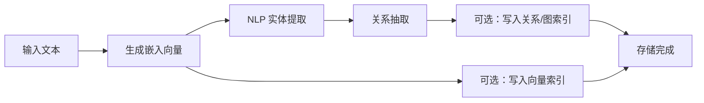
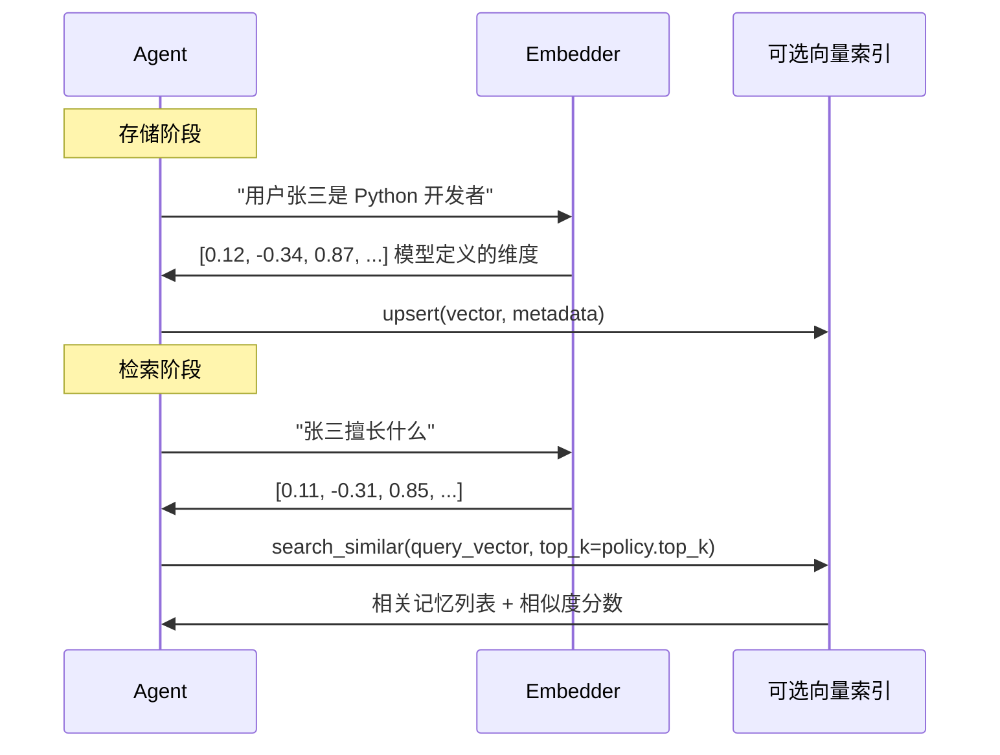
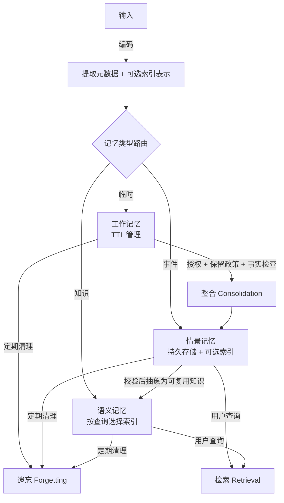

*图：工作记忆在上下文窗口内，情景、语义、感知记忆存在窗口外；检索后装入上下文使用，新内容先校验再写回，不是所有历史都叫长期记忆。*

---

「Agent 的记忆怎么设计」是 Agent 岗的必考题，站内 18 场面经问到过，追问通常落在三处：短期和长期记忆怎么分、什么时候检索、记忆越来越多怎么办。

> **30 秒答法**：我把记忆分三层。上下文窗口里的是工作记忆，靠摘要和裁剪控制长度；窗口外的是长期记忆，按需检索再装回来；还有一层很小的常驻索引，每次会话开头直接注入，告诉模型「我知道什么、去哪找」。写入要过授权和事实校验，不是什么都存。记忆变多以后，与其设计复杂的写入规则，不如在空闲时让模型回看日志、合并和纠错，Anthropic 把这一步叫 dreaming。

没有记忆，每次对话都是一次性的：Agent 不知道你是谁，也不记得上一轮说过什么。下面依次讲记忆的分层、存储与召回、向量检索，最后讲记忆变多以后怎么整理和遗忘。

---

## 记忆的分层模型

[MemGPT](https://arxiv.org/abs/2310.08560)（项目后来改名为 Letta）将上下文窗口内外的状态组织成分层存储，并由运行时决定信息的换入与换出，而不是把所有历史永久塞进一次推理。


工程文章常借用工作记忆、情景记忆和语义记忆这些认知术语来区分信息用途；这里使用的是设计类比，不主张 Agent 与人类记忆机制等同。

Agent 的记忆系统借鉴了同样的分层设计：

```
┌────────────────────────────────────────────────────┐
│                 Agent Memory System                │
│                                                    │
│  ┌──────────────────┐   ┌────────────────────────┐ │
│  │   工作记忆        │   │       长期记忆           │ │
│  │   Working Memory │   │                        │ │
│  │                  │   │  ┌──────────────────┐  │ │
│  │ · 当前对话上下文  │   │  │  情景记忆           │  │ │
│  │ · 任务中间状态   │◄──┤  │  Episodic Memory  │  │ │
│  │ · 临时变量       │   │  ├──────────────────┤  │ │
│  │                  │   │  │  语义记忆           │  │ │
│  │  TTL 自动清理    │   │  │  Semantic Memory  │  │ │
│  │  容量按预算配置  │   │  ├──────────────────┤  │ │
│  └──────────────────┘   │  │  感知记忆           │  │ │
│                         │  │  Perceptual Memory│  │ │
│                         │  └──────────────────┘  │ │
│                         └────────────────────────┘ │
└────────────────────────────────────────────────────┘
```

| 类型 | 持久性 | 典型内容 | 存储方案 |
|------|--------|----------|----------|
| 工作记忆 | 会话级（TTL） | 当前对话、任务状态 | 进程内或可恢复状态存储，按故障恢复需求选择 |
| 情景记忆 | 长期 | 具体交互事件、时序经历 | 可过滤的持久存储；是否加检索索引按需求决定 |
| 语义记忆 | 长期 | 用户偏好、领域知识、规则 | 文档、关系、向量或图索引的可配置组合 |
| 感知记忆 | 动态管理 | 图片、音频等多模态数据 | 对象存储与可选的多模态索引 |

---

## 工作记忆：短期上下文管理

工作记忆是 Agent 的"当前工作台"，存放当前会话中的临时信息。它有两个核心约束：

- **容量上限**：按上下文预算、检索延迟和会话并发配置，防止无限增长
- **TTL 机制**：每条记录可带生存时间；时长来自业务有效期与合规要求

当容量接近上限时，策略可以按任务状态、保留期限和可恢复性决定压缩或移除内容，而不是默认只做先进先出截断。

TF-IDF 是**稀疏词法检索**：它按词项统计匹配，不应称为语义检索。工作记忆可以只做词法检索，也可以增加稠密向量、时间或业务字段；候选生成、过滤与排序应由目标查询集决定，而不是套用一个通用加权公式。下面把排序收口到可替换策略，避免示例暗示某组权重普遍有效：

```python
class WorkingMemory:
    def __init__(self, config: MemoryConfig):
        self.config = config
        self.max_capacity = config.working_memory_capacity
        self.max_age_minutes = config.working_memory_ttl
        self.memories = []

    def add(self, memory_item: MemoryItem) -> str:
        self._expire_old_memories()               # 先清过期
        if len(self.memories) >= self.max_capacity:
            self._remove_lowest_priority_memory() # 再清低优先级
        self.memories.append(memory_item)
        return memory_item.id

    def retrieve(self, query: str, limit: int, **kwargs) -> list:
        self._expire_old_memories()
        lexical_candidates = self._tfidf_candidates(query)
        # rank_policy 在带标注的业务查询集上选择特征、过滤条件和顺序。
        return self.config.rank_policy.rank(
            query=query,
            candidates=lexical_candidates,
            limit=limit,
        )
```

---

## 长期记忆：情景与语义

[Generative Agents](https://arxiv.org/abs/2304.03442) 的原始架构把记忆流、基于相关性/近期性/重要性的检索、反思与规划连接起来，说明长期记忆还需要召回和写回策略。


### 情景记忆（Episodic Memory）

情景记忆存储具体交互事件与时间元数据。实现可以从一个支持租户、会话和时间过滤的关系或文档存储开始；只有业务查询需要语义相似召回时，再增加稠密向量索引。时间、相关性和业务重要性可以作为候选特征，但“更新”不等于“更相关”，应以带“应召回 / 不应召回”标注的查询集选择过滤与排序策略。

### 语义记忆（Semantic Memory）

语义记忆存储经授权保留的事实、偏好或规则。具体索引取决于查询：文本相似检索可以使用向量索引，明确实体关系可以使用关系表或图索引，简单键值事实可能根本不需要向量库。下面是一种**可配置示例**，不是每个 Agent 都必须同时建设的架构：

添加一条语义记忆的完整流程：



如果目标查询同时需要相似文本与显式关系，可以分别产生候选，再由经过评估的策略过滤和排序：

```python
def retrieve(self, query: str, limit: int) -> list:
    candidate_limit = self.config.candidate_limit(limit)
    vector_results = self._vector_search(query, candidate_limit)
    graph_results  = self._graph_search(query, candidate_limit)
    return self.config.rank_policy.rank(
        query=query,
        candidates=deduplicate(vector_results + graph_results),
        limit=limit,
    )
```

图检索能表达向量相似度无法直接回答的显式关系，但不代表它应占固定权重。合并前还要处理两路分数是否可比，并按查询类型验证排序质量。

---

## OpenClaw：持久笔记、检索索引与当前上下文

具体产品的记忆可以用文件保存，而不是必须另建向量数据库。以 2026-11-04 核验的 [OpenClaw Memory 文档](https://docs.openclaw.ai/concepts/memory)为例，工作区的 `MEMORY.md` 保存经过整理的持久事实与决定，`memory/YYYY-MM-DD.md` 保存较详细的每日观察和上下文；当前文档另用可选的 `USER.md` 管理稳定偏好等用户资料。这是该产品的约定，不是所有 Agent 的标准文件布局。

| 层次 | 在这个例子中的职责 | 不能据此推断什么 |
|---|---|---|
| 持久笔记 | 保存可回读的事实、决定和日常记录 | 磁盘上有文件，不等于内容已经进入本轮模型输入 |
| 检索索引 | 为笔记切块，建立关键词与可选的向量表示，按查询找候选 | 相似度高不等于事实正确，也不代替访问权限 |
| 当前上下文 | 使用受预算约束的已加载笔记、召回片段和近期消息 | 没有加载的历史不能被当成模型此刻已知的信息 |

[内置记忆引擎文档](https://docs.openclaw.ai/concepts/memory-builtin)说明默认索引采用每个 Agent 的 SQLite 数据库，也可按 Agent 的存储配置使用 PostgreSQL。向量检索取决于嵌入能力和配置，文件本身与向量索引并不是二选一。`memory_search` 用于找相关笔记，`memory_get` 用于读取具体记忆文件或行范围；先召回再按需读取，不必把所有每日记录重新塞回提示词。索引、提供商或模型变化后，还要核对索引兼容性与重建状态。

压缩前的 memory flush 只是给持久化增加一次机会。文件型 Memory Core 需要可写工作区，其他插件可能使用自己的持久化工具；跳过或失败不能证明事实已经保存。会话 transcript、压缩摘要与长期笔记各有职责，具体压缩机制见[上下文压缩、摘要与裁剪](../prompt/prompt-context-compression.md)。

教学上可以用“本次只整理材料，不发布”检查这套分工：先把它作为当前任务约束保留，不把临时要求误写成永久偏好；压缩后检查约束与来源是否仍可回读。跨会话需要使用某条事实时，再检查其有效期、来源和授权。若文件超过启动加载预算，OpenClaw 可能只截短注入上下文的副本；原文件仍在，并不代表模型已经看到了被省略的部分。

---

## 向量检索在 Agent 记忆中的应用

向量检索（Vector Retrieval）是长期记忆的一种可选索引。它将文本转换为稠密向量，再按相似度产生候选；候选仍要经过租户、权限、时效和业务规则过滤。对精确标识符、否定、数字或权限敏感查询，稀疏词法检索和结构化过滤可能更合适。

### 嵌入与检索流程



### 三种嵌入方案对比

| 方案 | 表示方式 | 运行依赖 | 主要边界 | 评估重点 |
|------|----------|----------|----------|----------|
| 托管嵌入 API | 稠密向量 | 网络与外部服务 | 数据边界、版本与计费 | Recall@k、延迟、失败率与权限隔离 |
| 本地嵌入模型 | 稠密向量 | 本地模型运行时 | 算力、模型升级与索引迁移 | 同一查询集上的召回、吞吐与资源占用 |
| TF-IDF | 稀疏词法向量 | 词表与本地索引 | 同义改写召回较弱 | 标识符、数字、专有名词及词法召回 |

这些方案不是固定降级链。只有使用同一向量索引的文档与查询才需要兼容的嵌入模型和预处理；不同租户、记忆类型或索引可以有各自版本。切换某个稠密嵌入模型时，应为受影响的索引做版本化迁移或重建，避免混用不可比较的向量。

---

## 记忆存储与召回：生命周期管理

工程上可以把生命周期拆成编码、存储、检索、整合和删除，以便分别定义授权、保留与质量检查：



### 记忆整合（Consolidation）

“整合”可以作为业务策略：例如，在用户授权、事实校验与保留期限检查通过后，把会话事件写入长期存储，或将多次出现的候选事实送入人工/规则审核。它不是自动正确的认知规律；召回次数或模型给出的重要性分数都不能单独证明事实应被永久保存。

```python
# 只有授权、事实校验与保留政策都通过，才允许写入长期存储。
memory_tool.execute("consolidate",
    from_type="working",
    to_type="episodic",
    item_id=item_id,
    authorization=policy.authorization_for(item_id),
    validation=policy.validation_for(item_id),
    retention=policy.retention_for(item_id),
)

# 抽象知识也要保留证据与来源版本，不能只看召回次数或模型分数。
memory_tool.execute("consolidate",
    from_type="episodic",
    to_type="semantic",
    item_id=item_id,
    evidence_ids=verified_evidence_ids,
    source_version=source_version,
)
```

### 记忆要少而准：Anthropic 的 dreaming 实验

2026 年 11 月，Anthropic 发表了一篇 [记忆实验总结](https://www.anthropic.com/research/components-of-agent-memory)，几个结论可以直接用在面试里：

- **记得多不等于记得好**。让模型玩宝可梦时，Sonnet 3.7 常常给每场战斗、每个道具、每个 NPC 单独建文件，最后写了 225 个文件夹、413 个文件，只拿到 1 枚徽章；Fable 5 只写了 2 个文件夹里的 9 个文件，外加一个顶层的 `global.md`，拿到 4 枚。游戏状态一直在变，堆起来的旧记录反而成了噪音。
- **告诉模型记忆是干什么的，别规定怎么记**。只告诉 Opus 4.7 和 Opus 5「有一个记忆文件夹可用」，它们就能用好；加一条「只记录失败」的硬规则，记忆带来的提升反而丢了很大一部分。模型越强，越应该让它自己判断什么值得记。
- **离线整理（dreaming）能纠错**。和 Letta、UC Berkeley 提出的 sleep-time compute 是同一个思路：在两次任务之间，让模型回看原始日志，把记忆合并、改正、删掉。宝可梦里模型曾把地标的方向记反，写下「月见山已通过」，结果走下单向台阶回到了来时的路；dreaming 对照日志改正这条笔记后，模型就知道要回去重新进洞。
- **整理成 wiki 再配合搜索最好**。让多个会话接力把大量内部文档整理成 wiki，会话数从 2 个加到 128 个，只用 wiki 的得分从 13% 涨到 48%；只用搜索是 53%，搜索加 wiki 从 54% 提到 61%，每题还省约 2 万 Token。但 wiki 也会失控：有一次整理出来的 wiki 比原始文件还大，等于什么都没抽象。
- **常驻层要小**。每次会话都注入的那层记忆会占 Token，错一条就会带进每次会话，指令越长模型越不容易照做。Claude Code 的自动记忆只加载 `MEMORY.md` 的前 200 行或 25 KB，内容是一份索引，细节放在下层文件里按需读取。

落到设计上就是三条：日志是事实来源，记忆是从日志里提炼出的结论，提炼要能对照日志纠错；常驻层只放索引和当前目标；整理放在离线做，不占用户等待的时间。

---

## 记忆压缩与遗忘

记忆系统如果只增不减，会带来存储膨胀和检索退化两个问题。遗忘机制是保持记忆系统健康的必要手段。

### 三种可配置的删除策略

| 策略 | 触发条件 | 清理目标 | 适用场景 |
|------|----------|----------|----------|
| 基于重要性（importance_based） | 按需 | importance < threshold 的记忆 | 清理噪声 |
| 基于时间（time_based） | 定时 | 超过 N 天未更新的记忆 | 清理过时信息 |
| 基于容量（capacity_based） | 容量接近上限 | 重要性最低的若干条 | 防止存储溢出 |

```python
# 所有阈值与期限均来自 MemoryPolicy，而不是通用常量
memory_tool.execute("forget", strategy="importance_based", threshold=policy.min_importance)

memory_tool.execute("forget", strategy="time_based", max_age_days=policy.max_age_days)

# 容量管理：清理最不重要的条目
memory_tool.execute("forget", strategy="capacity_based", threshold=policy.capacity_trim_ratio)
```

### 时间不是通用排名答案

时间可以用于强制过期、按有效期过滤，或作为某类查询的排序特征，但不应默认套用指数衰减。长期事实、临时会话状态、合规到期数据和“最近一次操作”查询需要不同语义。应先定义查询与失效规则，再用标注集验证是否需要时间特征以及如何使用。

---

## 常见误区与最佳实践

**常见误区**

- 将所有对话消息无差别地存入长期记忆，导致噪声淹没有效信息
- 忽略记忆整合步骤，工作记忆满了就直接丢弃，丢失重要上下文
- 嵌入方案混用（不同模型维度不同），向量空间不统一导致检索失效
- 遗忘时只删除文档存储，忘记同步清理向量库，产生"僵尸向量"
- 多用户场景下不做记忆隔离，用户数据相互污染

**最佳实践**

- 根据业务保留政策选择重要性、时效和授权字段，不把模型分数直接当作保留许可
- 工作记忆与长期记忆的介质按恢复、延迟、合规和查询需求选择
- 对每个向量索引记录嵌入模型与预处理版本；升级时迁移受影响索引
- 定期执行整合（consolidate）与遗忘（forget），维持检索质量
- 多用户部署同时执行授权检查、租户过滤和存储分区；`user_id` 或 namespace 不能替代访问控制

**面试常问要点**

- Agent 记忆为什么要分层？工作记忆与长期记忆各自的工程特点是什么？
- 向量检索如何解决语义匹配的问题？TF-IDF 和稠密向量的核心区别是什么？
- 记忆遗忘机制有哪些策略？时间衰减和重要性评分如何结合使用？
- 为什么“更近”不能直接等同于“更相关”，检索排序应如何用标注集验证？
- 多用户 Agent 系统中，记忆隔离的常见方案是什么，需要注意哪些坑？

---

## 工具结果、持久记忆与 token 节省分开验证

一次 ReAct 风格执行会不断产生动作与观察，但模型当前上下文不必携带所有原始大结果。把完整工具请求、结果、时间、状态和来源保存在可授权回读的记录中，工作上下文保留继续任务需要的精确字段、摘要与引用；工具请求与结果应保持可解释的配对，不能把未确认写入压成“已经完成”。摘要是有损视图，授权、幂等键、结果未知状态等机器必需字段应独立保存，遗漏时回源或阻断。

[LangGraph Persistence](https://docs.langchain.com/oss/python/langgraph/persistence)区分 thread 内图状态的 checkpointer 与跨 thread 的应用 store；这说明短期恢复状态和长期可复用信息的职责不同，不表示这些组件自动提供租户授权。长期保存事实要核对来源、有效期与允许用途，检索时按任务和权限取回；ReAct 循环本身也不规定必须用哪一种数据库或向量索引。

报告“节省 token”时先固定任务集、模型/分词口径、工具与知识版本、成功判定及重试策略。分别统计输入、输出、摘要生成和重试消耗，再比较总成本、任务成功率、关键约束遗漏与延迟；压短输入却增加多轮重试，不一定更省。没有基线、样本与测量记录时，只能说明优化方法，不能把一个节省百分比当作已验证成绩。


## 练一练

### 高频考点题 1：TF-IDF 是不是语义检索

工作记忆用 TF-IDF 给候选记录排序。下面哪种说法正确？

- A. TF-IDF 是一种语义检索，能通过词频统计识别同义词
- B. TF-IDF 和 Embedding 检索效果完全相同
- C. TF-IDF 是稀疏的词法检索，不应称为语义检索
- D. TF-IDF 只能用于长期记忆

**答案：C。** 需要处理同义改写时，再增加向量检索；用哪种、按什么排序，要在带标注的业务查询集上选。

### 高频考点题 2：遗忘策略

记忆库越来越大、检索结果越来越差。下面哪一项不是文中介绍的删除策略？

- A. 按随机：每天随机删除 10% 的记录
- B. 按时间：清理超过 N 天未更新的记录
- C. 按容量：接近上限时清理重要性最低的若干条
- D. 按重要性：清理重要性低于阈值的记录

**答案：A。** 遗忘是保持记忆系统健康的必要手段，但阈值和期限要来自业务策略，不是通用常量。

### 高频考点题 3：时间衰减能不能默认用

给所有长期记忆默认套一个「越久越不重要」的指数衰减排序，问题在哪里？

- A. 没问题，越新的信息越重要，衰减正好符合直觉
- B. 指数衰减计算太慢
- C. 不同记忆的时间语义不同，应先定义失效规则再验证
- D. 时间对记忆没有任何作用

**答案：C。** 时间可以用于强制过期、按有效期过滤，或作为某类查询的排序特征，但不是通用的排名答案。

## 出现于（热度来源）

<!-- interview-source-history:start -->
- [拼多多 AI Agent 岗两轮技术面：RAG、多 Agent 与系统能力](../../../interview/pinduoduo/ai/pinduoduo-ai-1.md)
- [字节 Agent 日常实习一面：Coding项目与记忆（2026 年 8 月）](../../../interview/bytedance/base/bytedance-base-10.md)
- [字节 Agent 开发二面（2026 年 7 月）](../../../interview/bytedance/base/bytedance-base-7.md)
- [阿里 Java 研发一面：Agent 协作、Kafka 与 Redis](../../../interview/alibaba/ai/alibaba-ai-33.md)
- [OPPO AI 全栈一面：Prompt 到 UI、RAG 与前端性能](../../../interview/oppo/ai/oppo-ai-2.md)
- [美团 AI 全栈日常实习一面：记忆、Skill 与链表合并](../../../interview/meituan/ai/meituan-ai-11.md)
- [淘天 AI 应用开发暑期实习二面：RAG 评测、工具与成本控制](../../../interview/alibaba/ai/alibaba-ai-31.md)
- [字节 Agent 暑期实习一面：摘要、工具预算与链表](../../../interview/bytedance/base/bytedance-base-27.md)
- [小红书 Agent 开发一面：多智能体、Memory 与广告投放优化](../../../interview/redbook/ai/redbook-ai-1.md)
- [字节 Agent Infra 校招：运行时、MySQL 与 LRU](../../../interview/bytedance/base/bytedance-base-25.md)
- [快手 Data Agent 一面：记忆、循环与 Subagent](../../../interview/kuaishou/ai/kuaishou-ai-16.md)
- [腾讯混元 AI 后台开发暑期实习一面：数据安全、OpenClaw 与并发手写](../../../interview/tencent/ai/tencent-ai-27.md)
- [美团本地核心一面：缓存一致性、库存故障与 Agent 记忆](../../../interview/meituan/ai/meituan-ai-4.md)
- [阿里 Agent 开发暑期实习一面](../../../interview/alibaba/ai/alibaba-ai-2.md)
- [蚂蚁大模型应用秋招一面：记忆评测、事务日志与消息积压](../../../interview/antfin/ai/antfin-ai-11.md)
- [快手二面：事务快照、缓存与 Agent 项目复盘](../../../interview/kuaishou/ai/kuaishou-ai-23.md)
- [海康威视 AI Agent 开发一面：可靠工具与任务状态](../../../interview/hikvision/ai/hikvision-ai-1.md)
- [科大讯飞 Java 开发一面：Agent 项目与 AI 编程复盘](../../../interview/iflytek/java/iflytek-java-1.md)
<!-- interview-source-history:end -->

## 参考资料

- [MemGPT: Towards LLMs as Operating Systems](https://arxiv.org/abs/2310.08560)
- [Anthropic — The components of agent memory](https://www.anthropic.com/research/components-of-agent-memory)（2026-11-06）
- [Generative Agents: Interactive Simulacra of Human Behavior](https://arxiv.org/abs/2304.03442)
- [LangGraph — Persistence：checkpointer 与 store](https://docs.langchain.com/oss/python/langgraph/persistence)
- [OpenClaw — Memory：笔记、加载预算与记忆工具](https://docs.openclaw.ai/concepts/memory)（滚动文档，2026-11-04 核验）。
- [OpenClaw — Builtin memory engine：文件索引与存储后端](https://docs.openclaw.ai/concepts/memory-builtin)（滚动文档，2026-11-04 核验）。
