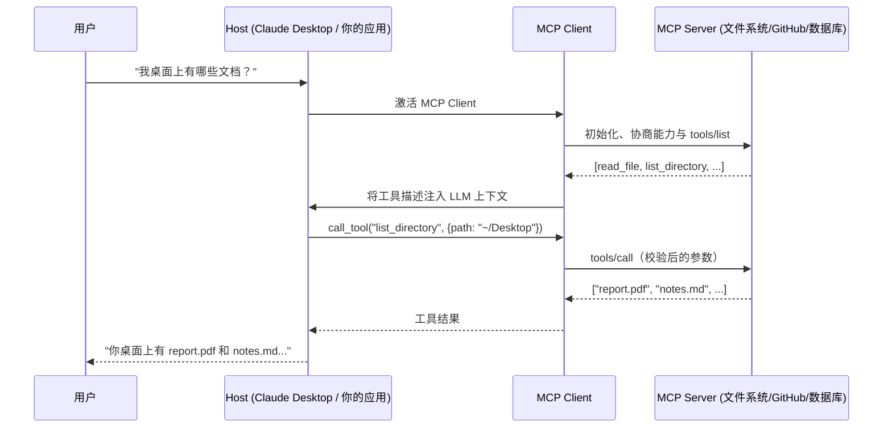

*图：此图仅示意 MCP 2025-11-25 的初始化、能力发现与工具调用交互；A2A 的职责和对象由下文说明，图中没有 A2A 区域。2026-07-28 的无状态发现另见本文版本说明。*

---

MCP规范应用与外部能力之间的发现和交互，A2A描述智能体之间的任务互操作。两者可以组合，但不是一个必须逐层叠加的协议栈。本文以MCP 2025-11-25规范和2026-10-19读取的A2A规范说明责任边界，不用生态成熟度替代实际兼容与权限验证。

## 为什么需要共同合同

跨团队接入文件、数据库或API时，重复适配往往包括能力描述、输入输出、错误与连接管理。统一协议可减少重复，但“都支持MCP”不保证具备同一能力、协议版本、认证方式或业务语义；初始化协商、权限与结果校验仍不可省略。

### Host / Client / Server 三层架构

[MCP 架构文档](https://modelcontextprotocol.io/docs/learn/architecture) 将 Host、Client、Server 以及 tools/resources/prompts 的数据层与传输层分开，协议重点是上下文和能力接入。

三层职责清晰：
- **Host**：管理用户交互、模型、连接和授权等应用策略
- **Client**：协议通信，负责与 Server 建连、发请求
- **Server**：功能实现，提供具体的工具/资源/提示词

### Stdio 与 Streamable HTTP 怎么选

传输方式不改变 MCP 的能力模型，只改变 Client 与 Server 如何建连：

| 传输方式 | 运行边界 | 优点 | 主要治理点 |
|------|------|------|------|
| **Stdio** | Host 启动并管理本地子进程 | 部署简单、天然绑定本机进程、适合 IDE 和本地工具 | 进程生命周期、环境变量、文件权限、标准错误日志 |
| **Streamable HTTP** | Server 作为独立网络服务 | 可远程访问、可独立扩缩容、便于多个 Client 复用 | 身份认证、租户隔离、连接恢复、超时与限流 |

本地文件、命令行与开发工具优先考虑 Stdio；跨机器共享、集中治理或需要弹性扩容时再采用 Streamable HTTP。一个 Host 接多个 Server 时，应为每个 Server 单独维护连接、能力清单、权限范围和故障状态，避免某个 Server 的超时拖垮整个 Agent Loop。

MCP 负责“能力如何发现和调用”，Skill 负责“任务如何被理解和执行”。Skill 可以按需加载说明并调用一个或多个 MCP 工具，但不应把认证、权限和重试策略藏进提示文本；这些仍由 Host 与 Client 的执行层强制保证。

### Tools、Resources与Prompts回答不同问题

| 能力 | 描述什么 | 应检查什么 |
| --- | --- | --- |
| Tools | 可调用操作及其输入、输出合同 | 参数、授权、错误与副作用；只读查询也可以是工具 |
| Resources | 通过URI标识的上下文数据 | 当前访问权限、内容类型、版本与读取范围 |
| Prompts | 可获取的提示模板及参数 | 模板来源、参数及宿主使用方式 |

上述原语分别由[Tools](https://modelcontextprotocol.io/specification/2025-11-25/server/tools)、[Resources](https://modelcontextprotocol.io/specification/2025-11-25/server/resources)与[Prompts](https://modelcontextprotocol.io/specification/2025-11-25/server/prompts)规定。服务可以只实现其中部分能力；发现清单不是实际授权，工具描述或注解也不能替代服务端控制。资源读取仍可能涉及敏感数据，不能因为“只读”就绕过权限。

例如数据分析服务可暴露经授权的Schema资源、受控查询工具与解释模板；这只是教学设计，不代表某个面试者项目真的实现了几种方法。介绍实际项目时必须用真实清单、请求与回执证明。

### 传输不能混同能力模型

[2025-11-25传输规范](https://modelcontextprotocol.io/specification/2025-11-25/basic/transports)列出stdio和Streamable HTTP。后者替代2024-11-05的HTTP+SSE传输；SSE可出现在Streamable HTTP流中，并不因此成为第三种当前标准传输。内存传输或框架自定义适配器属于具体实现，不应与标准传输平列。

部署选择需核协议版本、生命周期、Origin/认证、连接恢复与限流；HTTP服务并不因协议统一而自动安全，stdio子进程也有文件权限、环境与退出边界。SDK示例应固定包及版本，不能用未经核验的第三方类名冒充官方API。

## CLI 接口与 MCP 包装怎样分工

CLI 通常以命令、参数、标准输入输出与退出状态提供进程接口；MCP 约定客户端与服务端的消息、能力和工具合同。受控 MCP Server 可以调用现有 CLI，再把结果映射成协议返回，但原 CLI 不会自动因此成为 MCP Server。CLI 的“退出成功”也不等于业务后置条件已满足。

沿用本文 **2025-11-25** 合同，[stdio 规范](https://modelcontextprotocol.io/specification/2025-11-25/basic/transports)要求按行传递 JSON-RPC 消息，stdout 不能夹杂进度条或人类日志，日志可写 stderr。适配器还需定义参数与环境、输入输出、权限、超时、取消和未知副作用，避免把不可信参数拼成 shell 命令。

版本边界须另记：[2026-07-28 架构](https://modelcontextprotocol.io/docs/2026-07-28/learn/architecture)改用无状态请求元数据，并以 `server/discover` 提供版本、能力与身份发现。本文上方的初始化顺序图解释的是明确固定的 2025 版，不能当成所有版本都必须经过的握手；接入与迁移应分别核对所用版本。

比较性能时，分开测进程启动、连接、网络、序列化与业务执行，再看共享范围及治理成本。CLI、stdio MCP 与远程 MCP 都没有仅凭名称成立的延迟胜负；上面的包装是教学设计，不代表原作者实际采用了它。

口述时可先说：“CLI 是进程使用接口，MCP 是能力交互协议；可以受控包装，但参数、权限与业务结果仍须校验。再明确所用协议版本，不能把旧版初始化复制成跨版本保证。”

以下是教学模拟追问：

- **CLI 输出进度条，能直接接到 MCP stdout 吗？** 不能；适配器分离日志与协议消息，并校验返回结构。
- **本地 CLI 一定比远程 MCP 快吗？** 不能仅凭名称判断；比较相同任务的启动、连接和业务关键路径，注明环境与复用方式。

## MCP与模型工具调用如何组合

模型工具调用接口让模型提出函数与参数；MCP让应用发现服务的能力并按协议交互。宿主可把允许的MCP工具映射到模型工具接口，也可由代码或用户直接发起调用；MCP客户端本身不必依赖模型决策。

模型提出调用后，应用验证工具、参数和权限，再执行并核对结果。格式合法不等于业务动作完成，副作用工具还需处理确认、幂等、超时与未知结果。不能因为协议返回一段文本就宣布目标成功。

## A2A保留智能体任务边界

[A2A规范](https://a2a-protocol.org/latest/specification/)使用Agent Card、Message、Task与Artifact等对象表达远程智能体能力和任务结果。发现可通过`.well-known/agent-card.json`、目录或直接配置；认证使用声明的安全方案，不能把另一个协议的agent-description端点或DID设为A2A统一必选机制。

任务的状态、流式响应与具体操作随协议绑定和版本而定，不能用一个虚构REST路径图代替规范。使用A2A也不自动去掉协调者、实现全P2P或保证一次执行；委托方仍需验证对方结果、数据范围、超时、取消与幂等。MCP工具还可由远端Agent在内部使用，任务互操作和工具接入是可组合的不同责任。

## 从一次真实接入验收

先保存协商版本与实际能力清单，再核对一次允许调用、一次参数错误、一次授权拒绝及一次超时。调用结果和目标业务状态分别检查，日志按字段脱敏。对升级做旧客户端、新服务及可选能力缺失测试；协议名相同不能代替互操作验收。选服务器还应核维护者、来源、依赖与当前版本，而不是假设某个目录或包永远“官方且最好”。

## 出现于（热度来源）

<!-- interview-source-history:start -->
- [美团后端暑期一面：RAG 消融、工具调用与并发一致性](../../../interview/meituan/ai/meituan-ai-2.md)
- [腾讯云 CSIG 后台一面：Skill 边界与有序查找](../../../interview/tencent/ai/tencent-ai-23.md)
- [蚂蚁国际 Agent 一面：跨系统 AI 交付与 MCP 工具链](../../../interview/antfin/ai/antfin-ai-7.md)
- [美团本地核心一面：缓存一致性、库存故障与 Agent 记忆](../../../interview/meituan/ai/meituan-ai-4.md)
- [小红书 AI 全栈实习二面：工具服务选择与开发闭环](../../../interview/redbook/ai/redbook-ai-12.md)
- [字节全栈一二面：调度器、流式恢复与浏览器网络](../../../interview/bytedance/base/bytedance-base-53.md)
- [字节 Agent 实习：模型选择与可信通信](../../../interview/bytedance/base/bytedance-base-54.md)
- [字节 Agent 日常实习一面：Coding项目与记忆（2026 年 8 月）](../../../interview/bytedance/base/bytedance-base-10.md)
- [哔哩哔哩一面：端到端 AI Coding 与生产治理](../../../interview/bilibili/ai/bilibili-ai-2.md)
- [字节 Agent 开发二面（2026 年 7 月）](../../../interview/bytedance/base/bytedance-base-7.md)
- [OPPO IT 开发一面：ReAct、MCP 与智能问数](../../../interview/oppo/ai/oppo-ai-3.md)
- [字节 Agent Infra 校招：运行时、MySQL 与 LRU](../../../interview/bytedance/base/bytedance-base-25.md)
- [字节 Agent 实习：推理、微调与工具编排](../../../interview/bytedance/base/bytedance-base-51.md)
- [蚂蚁财富技术部一面：协作式 Agent、交付门禁与后端基础](../../../interview/antfin/ai/antfin-ai-4.md)
- [字节抖音电商 Agent 一至三面：AI Coding、证据校验与长文档](../../../interview/bytedance/base/bytedance-base-63.md)
- [字节剪映 AI 前端一面：Agent 运行时、MCP 与性能](../../../interview/bytedance/base/bytedance-base-30.md)
- [阿里云 AI 应用一面：并发审查、RAG 评估与海量商品](../../../interview/alibaba/ai/alibaba-ai-16.md)
- [快手 AI 应用开发一面：意图澄清、评测与 MCP 故障处理](../../../interview/kuaishou/ai/kuaishou-ai-3.md)
- [蚂蚁后端 AI 开发一面：Agent、Redis 与短链系统](../../../interview/antfin/ai/antfin-ai-3.md)
- [字节 Agent 全栈一面：工具、评测与编码](../../../interview/bytedance/base/bytedance-base-40.md)
- [58同城 Agent 开发一面：MCP、数据查询与后端基础](../../../interview/58tongcheng/ai/58tongcheng-ai-1.md)
- [腾讯 Agent 实习一面：RAG、工具与通信](../../../interview/tencent/ai/tencent-ai-10.md)
- [字节 Agent 与全栈：视频工作流、工具权限与 RAG](../../../interview/bytedance/base/bytedance-base-42.md)
<!-- interview-source-history:end -->

## 参考资料

- [MCP架构](https://modelcontextprotocol.io/docs/learn/architecture)
- [MCP 2025-11-25 Tools](https://modelcontextprotocol.io/specification/2025-11-25/server/tools)
- [MCP 2025-11-25 Resources](https://modelcontextprotocol.io/specification/2025-11-25/server/resources)
- [MCP 2025-11-25 Prompts](https://modelcontextprotocol.io/specification/2025-11-25/server/prompts)
- [MCP 2025-11-25 Transports](https://modelcontextprotocol.io/specification/2025-11-25/basic/transports)
- [A2A Protocol Specification](https://a2a-protocol.org/latest/specification/)（读取于2026-10-19；接入时固定协议版本）
- [MCP 2026-07-28 架构：无状态与发现](https://modelcontextprotocol.io/docs/2026-07-28/learn/architecture)（2026-10-20 北京时间核验；本文原顺序图仍限定 2025-11-25）
