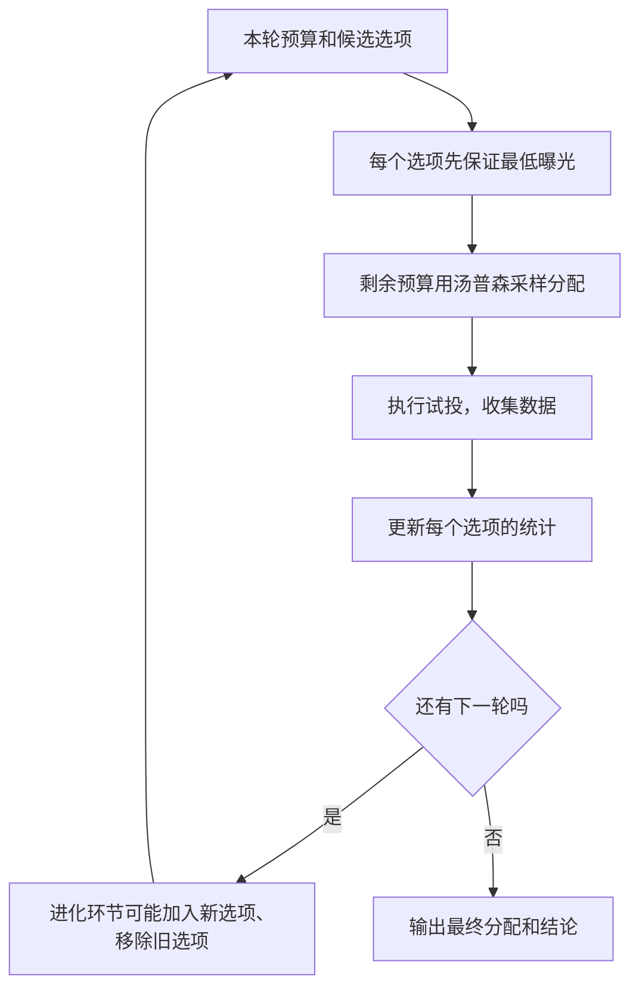

通过审核的素材有十几版，目标人群有四类，预算是有限的。这一环节决定每一轮把曝光分给谁：既要给每个组合足够的机会证明自己，又不能在明显不行的组合上浪费预算。

## 问题是什么

每个“素材乘人群”的组合是一个选项，每次曝光是一次尝试，点击或下单是回报。你不知道哪个选项最好，只能边试边学。这是一个经典的探索与利用问题：

| | 探索 | 利用 |
|---|---|---|
| 做法 | 把曝光分给还不了解的选项 | 把曝光集中到目前看起来最好的选项 |
| 过头的后果 | 预算花在明显差的选项上 | 过早认定一个其实只是运气好的选项 |

## 三种分配方式

| 方式 | 做法 | 评价 |
|---|---|---|
| 平均分配 | 每个选项相同的曝光 | 最简单，结论最干净，但在差的选项上浪费最多 |
| 先试后投 | 先平均试一小轮，再把剩余预算全给第一名 | 试的那一轮样本少，第一名可能选错 |
| 汤普森采样 | 每个选项按“它是最优的概率”分配曝光 | 自动平衡探索和利用，本项目采用 |

## 汤普森采样

对每个选项维护两个数：点击次数和未点击次数。它们确定了一个 Beta 分布，表示对这个选项真实点击率的认识。数据越多，分布越窄。

每一次曝光：从每个选项的分布里各抽一个值，把这次曝光给抽到值最大的那个。

```python
class ThompsonAllocator:
    def __init__(self, arms: list[Arm], prior_a: float = 1.0, prior_b: float = 19.0):
        self.stats = {a.key: [prior_a, prior_b] for a in arms}   # [成功, 失败]

    def allocate(self, budget: int, rng: np.random.Generator) -> dict:
        counts = Counter()
        for _ in range(budget):
            draws = {k: rng.beta(a, b) for k, (a, b) in self.stats.items()}
            counts[max(draws, key=draws.get)] += 1
        return counts

    def update(self, key, clicks: int, impressions: int):
        self.stats[key][0] += clicks
        self.stats[key][1] += impressions - clicks
```

为什么这样做是合理的：一个选项的数据很少时，它的分布很宽，偶尔会抽到很大的值，于是得到一些曝光，这是探索。一个选项的数据很多而且表现好时，它的分布窄而靠右，经常抽到最大值，这是利用。表现差的选项分布窄而靠左，几乎抽不到最大值，曝光自然减少。

先验 `Beta(1, 19)` 表示在没有数据时认为点击率大约是 5%。它应该和模拟环境的基准点击率大致对应。先验定得过于乐观，初期会在所有选项上浪费更多探索。

## 按批分配

真实的投放不是一次曝光一次决策，而是一批一批地分。一轮试投的做法：



**最低曝光**是必要的。新加入的素材没有任何数据，全靠先验竞争时可能几乎拿不到曝光。给每个选项一个保底量，本项目默认是本轮预算的 3%，保证它至少有一次像样的机会。

**新素材怎么起步**是一个设计点。进化环节改写出的新素材，可以继承父素材的一部分统计作为先验，例如把父素材的成功和失败次数各乘以 0.3。理由是改写后的版本和父版本相似，表现大概率接近。这个折扣系数是本项目的设定，可以调整。

## 优化目标：点击还是下单

| 目标 | 优点 | 问题 |
|---|---|---|
| 点击 | 数据多，学得快 | 会偏向吸引眼球但不带来购买的素材 |
| 下单 | 和业务目标一致 | 数据稀疏，需要更多曝光才能分辨 |

本项目的做法是按任务目标来定。目标是首单转化时，以每次曝光带来的下单数为回报；同时把点击率作为护栏指标：一个选项点击率很高而下单率明显偏低时，标记出来交给归因环节分析，它很可能是标题党。

回报换成下单之后，先验也要相应调低，分布收敛会更慢，所需的轮数更多。

## 预算约束

不同人群的规模不同，对同一类人群的曝光有上限。分配时加上约束：

```python
def allocate_with_caps(self, budget: int, caps: dict[int, int], rng) -> dict:
    counts, used = Counter(), Counter()
    for _ in range(budget):
        draws = {k: rng.beta(a, b) for k, (a, b) in self.stats.items()
                 if used[k.segment_id] < caps[k.segment_id]}
        if not draws:
            break
        best = max(draws, key=draws.get)
        counts[best] += 1
        used[best.segment_id] += 1
    return counts
```

约束带来一个结果：某类人群的上限用完之后，预算会流向次优的人群。这符合实际，再好的人群也有触达的上限。

## 什么时候可以下结论

每轮结束后算一个数：当前第一名确实是最优的概率。

```python
def prob_best(stats: dict, n: int = 20000, rng=None) -> dict:
    samples = {k: rng.beta(a, b, size=n) for k, (a, b) in stats.items()}
    winners = np.argmax(np.stack(list(samples.values())), axis=0)
    keys = list(samples)
    return {keys[i]: float((winners == i).mean()) for i in range(len(keys))}
```

本项目的停止规则是：第一名的这个概率连续两轮超过 0.9，或者预算用完。0.9 是起步值。

注意这个概率是按人群分别算的。不同人群的最优素材通常不一样，这正是分人群投放的意义。

## 用模拟检验分配策略

模拟环境在这里有一个真实环境没有的优势：你知道每个选项的真实点击率，因为它是环境的参数算出来的。于是可以直接衡量一个分配策略的好坏：

| 指标 | 含义 |
|---|---|
| 累计损失 | 和“每次都投给真正最优的选项”相比，少得到了多少点击或订单 |
| 选对的比例 | 多次独立运行中，最终选出的第一名确实是真实最优的比例 |

用相同的预算分别跑平均分配、先试后投、汤普森采样三种策略，各重复几十次，比较这两个指标。你应该能看到平均分配的累计损失最大。先试后投选对的比例在预算紧张时不稳定。

这个对比实验是本章可以写进简历的结果：在同一个环境、相同预算下，某种策略相比平均分配减少了多少损失。它比较的是分配策略本身，不依赖模拟用户有多像真人，因此结论相对站得住。

## 自己动手时的检查点

1. 实现汤普森采样，在一个你自己设定真实点击率的玩具环境里验证它能找到最优选项。
2. 加上最低曝光和人群上限，观察分配结果的变化。
3. 在模拟环境里对比三种分配策略的累计损失和选对的比例。
4. 把优化目标从点击换成下单，观察需要多少轮才能收敛。

## 面试常见追问

- **预算怎么分配？** 探索与利用的权衡，三种方式的对比，为什么选汤普森采样。
- **新素材没有数据怎么办？** 最低曝光保底，从父素材继承打过折的先验。
- **什么时候停止试投？** 第一名是最优的概率连续超过阈值，或预算用完。
- **优化点击率会带来什么问题？** 标题党，讲护栏指标和以下单为目标的代价。

延伸阅读：知识库的 [Agent A/B 测试与实验设计](../../knowledge/llm/production/agent-ab-testing.md)。
