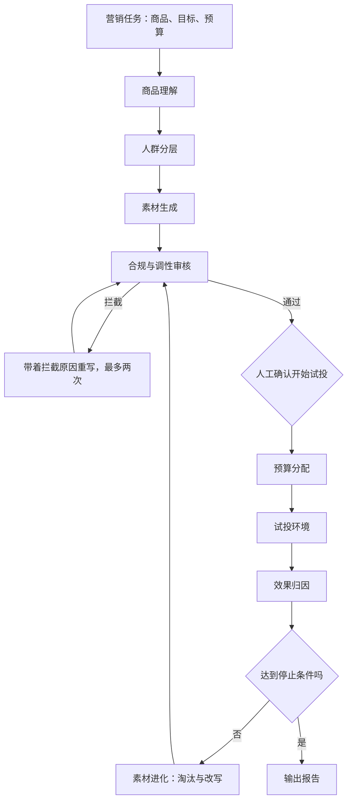

这一章给出系统的全貌：一个营销任务从输入到多轮优化结束，经过哪些部件，数据在哪里落地，哪些地方需要人来确认。

## 总体架构


系统分四块。

**活动主管**是唯一和用户对话的 Agent。它不自己写文案，也不自己看数据，只负责拆解任务、决定每一轮做什么、判断何时停。具体工作全部派给下面的环节。

**生产区**把一个商品变成一批可以投放的素材：

| 环节 | 输入 | 输出 |
|---|---|---|
| 商品理解 | 商品详情、评价 | 卖点清单，每个卖点带证据和使用限制 |
| 人群分层 | 卖点清单、行为数据 | 若干类目标人群，每类有画像和购买动机 |
| 素材生成 | 卖点、人群 | 每类人群若干版文案或脚本 |
| 合规与调性审核 | 素材、规则库 | 通过或拦截，拦截带原因 |

**试投区**用小流量验证素材，并把结果变成下一轮的输入：

| 环节 | 输入 | 输出 |
|---|---|---|
| 预算分配 | 通过审核的素材、本轮预算 | 每个素材和人群组合分到多少曝光 |
| 试投环境 | 素材、曝光量 | 曝光、点击、下单的日志 |
| 效果归因 | 投放日志 | 哪些卖点、哪些写法、对哪些人群有效 |
| 素材进化 | 归因结论、素材 | 淘汰名单和改写后的新素材 |

**数据层**是图中的五个库，所有环节通过它交换信息，而不是把大段内容塞进彼此的上下文。

## 三条设计约束

1. **没有通过审核的素材进不了试投。** 审核是生产区到试投区的唯一通道。进化环节改写出来的素材同样要重新送审，图中那条虚线表示的就是这一点。
2. **每个环节只通过数据层交接。** 素材生成环节写入素材库后返回一组编号，审核环节按编号去读。主管的上下文里只有编号和摘要，没有十六版文案的全文。
3. **花钱之前先问人。** 开始试投、追加预算这类动作，必须在看板上得到确认后才执行。

第二条是从第一个项目带过来的经验：窗口里只留索引，正文留在外面。

## 一次完整的活动



停止条件有三个，满足任意一个就停：预算用完；最优组合连续两轮没有变化且领先幅度超过波动范围；达到最大轮数。

## 主管怎么调度

主管用的就是第一个项目的执行循环，每个环节注册成一个工具：

```python
TOOLS = [
    Tool("understand_product", "提取商品卖点。输入商品编号，返回卖点清单的编号和摘要。", ...),
    Tool("segment_audience",   "基于卖点和行为数据划分人群。返回人群编号和一行描述。", ...),
    Tool("generate_creatives", "为指定人群和卖点生成素材。返回素材编号列表。", ...),
    Tool("review_creatives",   "审核一批素材。返回每个素材的结论和原因。", ...),
    Tool("plan_allocation",    "为本轮分配曝光。返回分配方案编号和摘要。", ...),
    Tool("run_trial",          "执行一轮试投。需要人工确认。返回日志批次编号。", ..., read_only=False),
    Tool("attribute",          "对一个日志批次做归因。返回结论摘要。", ...),
    Tool("evolve_creatives",   "根据归因结论淘汰和改写素材。返回新素材编号。", ...),
]
```

生成、审核这类环节内部又是一个独立的子任务，有自己的上下文和提示词。主管拿到的永远是编号和几行摘要。

这里有一个设计选择值得在面试时讲：**整体流程是固定的，为什么还要用一个主管 Agent，而不是写死的流水线？**

| | 写死的流水线 | 主管 Agent |
|---|---|---|
| 步骤顺序 | 固定 | 大体固定，可临场调整 |
| 处理意外 | 要预先写好每个分支 | 可以临时决定，例如某类人群完全没有反应时回去重新分层 |
| 可预测性 | 高 | 较低 |

本项目的做法是折中：主干顺序在主管的提示词里写明，关键的闸口（审核、人工确认、预算上限）由代码强制执行，主管只在主干允许的范围内做决定。也就是说，模型决定“接下来做什么”，代码决定“什么绝对不能做”。

## 数据模型

五个库里，商品库、人群画像库、素材库、投放日志各对应下面一张表。规则库是一份配置文件，格式在合规一章。

```sql
CREATE TABLE selling_point (
  id SERIAL PRIMARY KEY, product_id INT, text TEXT,
  evidence TEXT,            -- 来自详情或评价的原文依据
  claim_level TEXT          -- verified | needs_proof | forbidden
);
CREATE TABLE segment (
  id SERIAL PRIMARY KEY, campaign_id INT, name TEXT,
  profile JSONB,            -- 行为特征与动机
  size_share REAL           -- 占模拟用户池的比例
);
CREATE TABLE creative (
  id SERIAL PRIMARY KEY, campaign_id INT, segment_id INT,
  selling_point_ids INT[], style TEXT, body TEXT,
  parent_id INT,            -- 由哪版素材改写而来
  round INT, status TEXT,   -- draft | approved | rejected | retired
  review JSONB              -- 审核结论与原因
);
CREATE TABLE impression (
  id BIGSERIAL PRIMARY KEY, round INT, creative_id INT, segment_id INT,
  user_id INT, clicked BOOL, ordered BOOL, feedback TEXT
);
```

`creative.parent_id` 记录每版素材的来历。几轮之后可以画出一棵素材的谱系树，看到一版好素材是怎样一步步改出来的。归因和进化两章都依赖这个字段。

## 人在哪里介入

| 节点 | 人做什么 | 为什么 |
|---|---|---|
| 卖点清单 | 确认或删除标记为需要证据的卖点 | 模型分不清哪些功效有资质支持 |
| 开始试投 | 确认素材和预算 | 花钱的动作 |
| 审核的边界情况 | 模型裁判拿不准的素材由人决定 | 合规错误的代价高 |
| 每轮结论 | 可以否决自动淘汰的素材 | 模拟数据不可全信 |

看板的作用就是让这四个节点的确认足够快：一屏看清楚要确认的内容和依据。

## 代码目录

```text
growth/
  lead.py              活动主管
  stages/
    product.py         商品理解
    segment.py         人群分层
    creative.py        素材生成
    review.py          合规与调性审核
    allocate.py        预算分配
    attribute.py       效果归因
    evolve.py          素材进化
  sim/
    users.py           模拟用户池的构造
    trial.py           试投环境
  rules/               规则库
  store/               数据层
  api/                 看板接口与确认接口
  evals/               各环节的评测集
```

## 面试时怎么讲这张图

先说定位：一个把营销活动从素材生产到投放优化串成闭环的多 Agent 系统，试投环境是模拟的。再讲三条约束。然后根据面试官的兴趣展开：问合规就讲审核，问效果就讲归因和模拟的局限，问工程就讲并发和成本。

主动说明“试投环境是模拟的”很重要。这句话由你先说，是对边界清楚；由面试官追问出来，就成了项目的硬伤。

延伸阅读：[Supervisor 监督者模式](../../knowledge/llm/agent/agent-supervisor.md)、[Human-in-the-loop 审批与人工接管](../../knowledge/llm/agent/agent-human-in-loop.md)、[工作流状态、检查点与断点续跑](../../knowledge/llm/agent/agent-workflow-state.md)。
