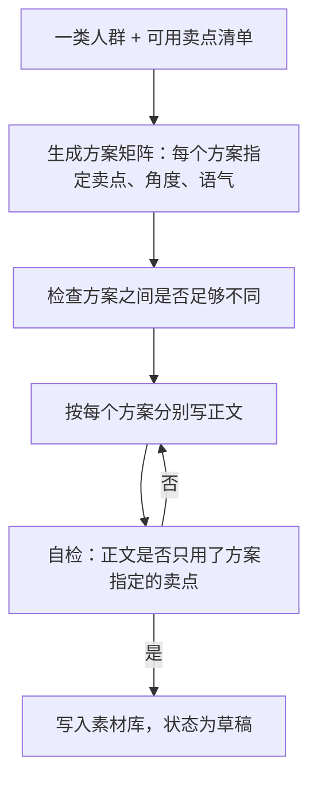

这一环节把卖点和人群变成具体的素材：短文案、商品标题、短视频脚本。难点不在于写出一版，而在于批量写出多版，各版之间有真实的差异，并且每一版都能说清楚它用了什么卖点、什么写法。

## 素材是结构化的

一版素材不只是一段文字。它带着一组标签，说明自己是怎么来的：

```python
@dataclass
class Creative:
    id: int
    segment_id: int
    selling_point_ids: list[int]   # 用了哪些卖点
    angle: str                     # 切入角度：痛点 / 场景 / 成分 / 对比 / 口碑
    tone: str                      # 语气：理性 / 亲切 / 俏皮
    format: str                    # short_copy | title | video_script
    body: str                      # 正文
    parent_id: int | None = None   # 由哪一版改写而来
```

这些标签是后面归因的抓手。只有文字没有标签，你只能知道“第 7 版点击率高”，不知道高在哪里。有了标签，才能说“对敏感肌人群，成分角度比场景角度有效”。

标签在生成之前就确定，不是生成之后再让模型去分析。

## 先定方案，再写正文



为什么分两步：让模型一次写出四版文案，四版往往是同一个意思换了几个词。先让它在方案层面拉开差异，再分别去写，差异才是实质性的。

方案矩阵长这样：

| 方案 | 卖点 | 角度 | 语气 |
|---|---|---|---|
| 1 | #3 不含酒精 | 成分 | 理性 |
| 2 | #3 不含酒精、#5 不黏腻 | 痛点 | 亲切 |
| 3 | #5 不黏腻 | 场景 | 俏皮 |
| 4 | #7 SPF50+、#8 便携 | 场景 | 亲切 |

对方案做一次程序检查：任意两个方案在卖点、角度、语气三项里至少有两项不同。不满足就让模型重出。

## 写正文的提示词

```text
为下面的人群写一条短文案。

人群：{segment.name}
使用场景：{segment.scenario}
他们担心：{segment.concerns}
对这类人避免强调：{segment.avoid}

本条文案的方案：
- 只使用这些卖点：{selling_points_with_evidence}
- 切入角度：{angle}
- 语气：{tone}

要求：
1. 不超过 40 个字。
2. 只陈述上面给出的卖点，不要添加任何其他功效、数据或承诺。
3. 不使用“最”“第一”“唯一”“100%”这类绝对化表述。
4. 不要与其他品牌或产品做比较。
5. 用这类人平时说话的方式写，可以参考这些评价原话的用词：{review_quotes}

只输出文案正文。
```

第 5 条是让文案不像机器写的最有效的一招。评价里用户自己的说法，比模型凭空想的说法更贴近真实表达。

第 2 到 4 条是合规要求的前置。审核环节会再查一遍，但在生成时就讲清楚，能大幅减少被拦截后重写的次数。

## 自检

正文写完后，在送审之前先做一次便宜的自检，只问一个问题：

```text
下面的文案中，有没有出现给定卖点之外的功效、数据或承诺？
给定卖点：{selling_points}
文案：{body}
只回答：没有 / 有（并指出是哪一句）
```

用一个便宜的模型来做。它拦下的是最常见的一类问题：模型写着写着自己加了一个卖点。

## 三种格式

| 格式 | 结构 | 长度 |
|---|---|---|
| 短文案 | 一到两句话 | 40 字以内 |
| 商品标题 | 品类词 + 核心卖点 + 规格 | 30 字以内 |
| 短视频脚本 | 分镜列表，每个分镜有画面、口播、时长 | 15 到 30 秒 |

短视频脚本用结构化的输出，方便后面按分镜做审核和修改：

```json
{
  "duration_s": 20,
  "shots": [
    {"t": "0-3",  "visual": "通勤路上，阳光刺眼，抬手遮挡", "voice": "夏天上班路上这十分钟，常常被忽略"},
    {"t": "3-10", "visual": "挤出乳液，手背推开的特写",     "voice": "这支推开就成膜，不用等"},
    {"t": "10-16","visual": "直接上底妆，镜头给到面部",     "voice": "后面直接上妆，不黏"},
    {"t": "16-20","visual": "放进通勤包，产品正面",         "voice": "50 毫升，放包里刚好"}
  ],
  "selling_point_ids": [5, 8]
}
```

本项目只生成脚本，不生成视频画面。视频生成和剪辑是另一个方向的问题，放进来会让项目失去重点。面试时被问到，可以说明脚本是视频生产的上游，分镜结构为接入后续的剪辑环节留了接口。

## 批量生成的工程问题

4 类人群、每类 4 版、3 种格式，一轮就是 48 次生成加 48 次自检。几个要点：

- **并行，但要限流。** 各版素材之间互不依赖，用信号量控制并发数，尊重模型接口的限流。
- **稳定的部分放在提示词前面。** 同一个商品的卖点清单、同一类人群的描述在多次调用中是相同的，放在前面可以命中缓存。
- **失败的单独重试。** 一版生成失败不影响其他版，重试两次后仍失败就跳过并记录。
- **去重。** 新生成的素材和素材库里已有的做相似度比对，过于接近的丢弃。到了第三、四轮，模型很容易写出和之前几乎一样的东西。

## 这个环节怎么评测

素材的最终好坏由试投数据说话。在送去试投之前，先保证三件基本的事：

| 指标 | 怎么算 | 用什么判 |
|---|---|---|
| 忠实 | 正文没有使用方案之外的卖点的比例 | 模型裁判，每条只判这一件事 |
| 差异 | 同一人群下各版素材两两之间的平均相似度 | 向量相似度，越低越好 |
| 一次过审率 | 首次送审即通过的比例 | 审核环节的结果 |

模型裁判的用法和「Agent 评测与自进化平台」项目的评分器一章相同：问题问小、固定输出、用人工标注校准。

## 自己动手时的检查点

1. 为一类人群生成方案矩阵，确认程序检查能拦下差异不足的方案。
2. 对比“一次写四版”和“先定方案再分别写”两种做法下，四版素材之间的相似度。
3. 去掉提示词里的评价原话，对比文案读起来的差别。
4. 统计一轮生成的调用次数、用量和耗时，并记录一次过审率。

## 面试常见追问

- **怎么让生成的多版素材真的不一样？** 先定方案矩阵再写正文，方案层面做差异检查。
- **为什么素材要带标签？** 为归因服务，举一个有标签和没标签时结论的对比。
- **怎么保证文案不乱说？** 卖点白名单、生成时的约束、自检、审核四层。
- **批量生成怎么控制成本和延迟？** 并行限流、利用缓存、便宜模型做自检、失败隔离。

延伸阅读：知识库的 [Token、延迟与成本优化](../../knowledge/llm/production/llm-cost-optimize.md)、[并行工具调用与依赖调度](../../knowledge/llm/agent/agent-parallel-tools.md)。
