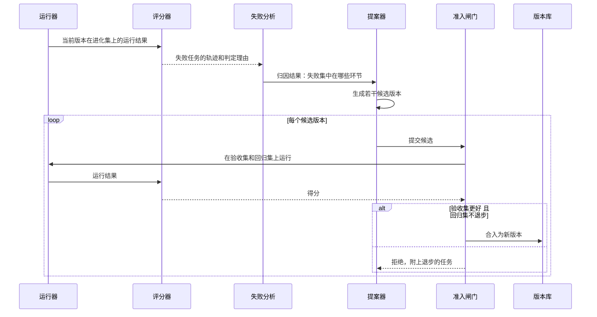

这一章给出平台的全貌：有哪些部件、数据怎么流动、一个新版本从提出到合入要经过什么。后面每一章展开其中一个部件。

## 总体架构


平台分三块。

**被测对象**是一个能在无界面模式下运行的 Agent。平台把它看成一个“版本”：系统提示词、经验手册、配置与工具集、外壳代码四层内容的一次快照。评测针对的是某个版本，进化产出的是新的版本。

**评测链路**负责回答“这个版本怎么样”：

| 部件 | 职责 |
|---|---|
| 任务集 | 定义考什么。分成进化集、验收集、回归集三套，互不重叠 |
| 运行器 | 在隔离环境里用指定版本逐条运行任务，每条运行多次 |
| 评分器 | 判定每次运行的结果。有代码判定、模型裁判、人工抽检三种 |
| 结果库 | 保存每次运行的轨迹、得分、用量、耗时 |
| 报告 | 汇总成可靠性、成本和版本对比 |
| 评分器审计 | 向评分器注入已知错误，检验它自己准不准 |

**自进化链路**负责回答“怎样变好”：

| 部件 | 职责 |
|---|---|
| 失败分析 | 读结果库里的失败轨迹，把失败归因到具体环节 |
| 提案器 | 针对归因结果提出修改，分四级，改动范围由小到大 |
| 候选版本池 | 保存尚未合入的候选版本，允许多个各有所长的版本并存 |
| 准入闸门 | 候选版本在验收集上更好并且在回归集上不退步，才合入 |
| 版本库 | 保存所有已合入的版本，任何版本都能回放和回退 |

## 三条设计约束

1. **进化链路不能绕过评测链路。** 提案器产出的任何东西都只是候选，决定它去留的唯一依据是准入闸门用评测链路跑出来的结果。
2. **提案器只能看进化集。** 失败分析和提案器读取的轨迹只来自进化集。验收集和回归集的轨迹对它们不可见，否则验收就失去了意义。
3. **一个版本是不可变的。** 版本一旦生成就不再修改，改动只能生成新版本。这样任何一次评测结果都能对应到确切的内容，也才谈得上回退。

## 版本由什么组成

```python
@dataclass(frozen=True)
class AgentVersion:
    id: str                      # 内容的哈希值
    parent: str | None           # 从哪个版本改来
    system_prompt: str           # 第一级进化改这里
    playbook: list[PlaybookItem] # 第二级进化改这里
    config: dict                 # 第三级：预算、阈值、工具集、工具说明
    code_ref: str                # 第四级：外壳代码的提交号
    note: str = ""               # 这次修改想解决什么
```

四个字段正好对应四级进化的作用对象。级别越高，能改的字段越多：


## 一轮进化的完整流程



被拒绝的候选不会被丢弃，拒绝理由会进入下一轮提案器的输入，避免重复提出同样的修改。

## 被测对象的接入约定

平台对被测对象只有一个接口要求：

```python
class AgentUnderTest(Protocol):
    async def run(self, task_prompt: str, workdir: Path, version: AgentVersion) -> RunOutput: ...

@dataclass
class RunOutput:
    final_reply: str
    trajectory: list[dict]       # 完整消息列表，含工具调用和结果
    usage: Usage                 # 输入输出用量
    stopped: str                 # 正常结束 / 轮次上限 / 超时 / 出错
```

第一个项目的无界面模式天然满足这个约定。接别的 Agent 时写一个适配器即可。

## 数据怎么存

```sql
CREATE TABLE run (
  id          INTEGER PRIMARY KEY,
  version_id  TEXT NOT NULL,
  task_id     TEXT NOT NULL,
  split       TEXT NOT NULL,     -- evolve | accept | regress
  attempt     INTEGER NOT NULL,  -- 同一任务的第几次运行
  passed      INTEGER,           -- 评分结果
  grader      TEXT,              -- 用的哪个评分器及其版本
  input_tokens INTEGER, output_tokens INTEGER, seconds REAL,
  stopped     TEXT,
  trajectory_path TEXT           -- 轨迹文件位置
);
```

`grader` 一列要带评分器的版本。评分器本身会被修改（审计一章会改它），改过之后旧分数和新分数不能直接比较。

## 代码目录

```text
evo/
  tasks/         任务定义与三套划分
  runner/        隔离环境、并发、重复运行
  graders/       代码判定、模型裁判、抽检队列
  audit/         故障注入与评分器审计
  store/         结果库与版本库
  report/        可靠性、成本、版本对比
  evolve/
    diagnose.py  失败分析
    prompt.py    第一级
    playbook.py  第二级
    config.py    第三级
    code.py      第四级
    gate.py      准入闸门
  cli.py
```

## 面试时怎么讲这张图

先说定位：一个给 Agent 用的评测和持续改进平台。再讲三条约束，重点是第二条，即进化用的数据和验收用的数据严格分开。然后挑评测或进化里你做得最深的一块展开。

常见追问和对应章节：

- 评测集怎么建？见任务集一章。
- 模型当裁判可信吗？见评分器和审计两章。
- 怎么知道提升是真的？见可靠性一章。
- 自动改出来的版本改坏了怎么办？见副作用一章。

延伸阅读：[发布质量门禁与回归阻断](../../knowledge/llm/production/agent-quality-gates.md)、[Trace、Span、Run 与工具调用事件模型](../../knowledge/llm/production/agent-trace-model.md)。
