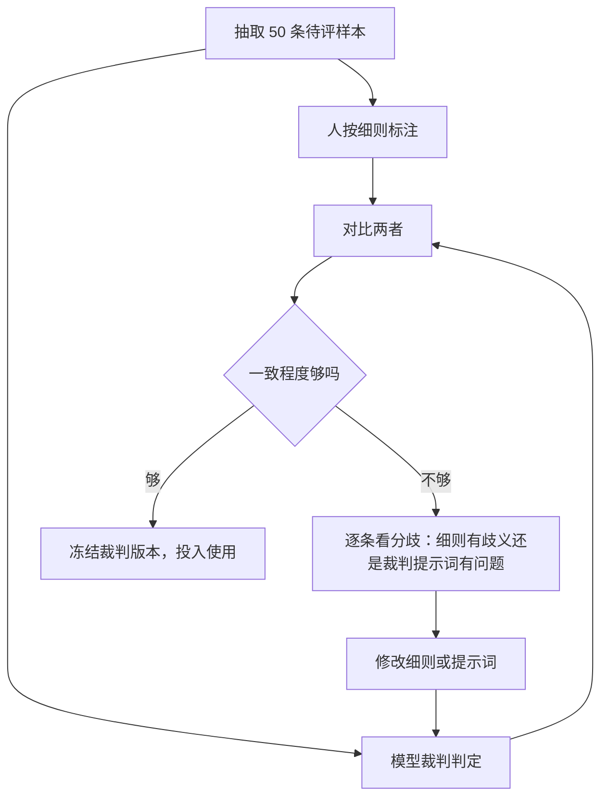

评分器决定一次运行算不算成功。它出错的后果比 Agent 出错更严重：Agent 错了你会看到一次失败，评分器错了你看到的是一个错误的结论，并且会据此去改 Agent。这一章设计三类评分器以及它们的组合方式。

## 三类评分器

| | 代码判定 | 模型裁判 | 人工抽检 |
|---|---|---|---|
| 怎么判 | 跑命令、比对文件、检查状态 | 让模型按评分细则判断 | 人按同一份细则判断 |
| 优点 | 快、便宜、可复现 | 能判断开放性的结果 | 最接近真实标准 |
| 缺点 | 只能判可以程序化的东西；写死了会误伤正确但不同的做法 | 有随机性；需要校准 | 慢、贵、不能每次都做 |
| 用在哪 | 能用就优先用 | 代码判不了的维度 | 校准裁判、抽查结论 |

选择顺序是固定的：能用代码判定的不用模型，必须用模型的要用人工结果校准。

## 判结果，不判过程

一个常见错误是检查 Agent 有没有按预期的步骤做，比如“必须先读文件再改”。这样会把走了不同路线的正确解判成失败。

评分器看的是任务结束时的状态：

```python
class Grader(Protocol):
    name: str
    version: str
    def grade(self, task: Task, workdir: Path, output: RunOutput) -> Grade: ...

@dataclass
class Grade:
    passed: bool
    score: float | None = None   # 需要部分得分时使用
    reason: str = ""             # 判定理由，失败分析要读
    evidence: dict = field(default_factory=dict)
```

`reason` 不是可有可无的。后面的失败分析要靠它理解一次运行为什么没过。

过程信息也有用，但用途不同。轮次、调用了哪些工具、花了多少，这些记进结果库用于分析和成本统计，不参与通过与否的判定。唯一的例外是安全约束，例如“不得修改测试目录”，它属于结果状态的一部分。

## 代码判定的几种形式

| 类型 | 判什么 | 注意 |
|---|---|---|
| 命令 | 一条命令的退出码 | 命令本身要稳定，偶发失败的测试不能当评分 |
| 文件未改动 | 指定路径在运行前后一致 | 防止删测试、改断言 |
| 状态检查 | 数据库里的记录、生成的文件内容 | 比对语义而不是逐字符，例如忽略空白和键的顺序 |
| 输出匹配 | 最终回复里包含某个值 | 只用于答案唯一的任务 |

一条任务可以挂多个评分器，全部通过才算通过。

## 模型裁判

### 把问题问小

让模型给一份报告“打 1 到 10 分”得到的数字几乎没法用。有效的做法是把评价拆成多个只有是或否的小判断：

```text
你是评分员。下面是任务、评分细则和待评内容。
只根据细则判断，不要考虑细则之外的优缺点。

任务：{task}
细则：回复中是否明确指出了 bug 的根本原因是取整时丢失小数位？
待评内容：{final_reply}

先用一两句话写出依据，再在最后一行只输出：通过 或 不通过
如果待评内容不足以判断，输出：无法判断
```

几个要点：

- **每条细则单独判。** 一次调用只判一条，结果互不干扰。
- **先写依据再给结论。** 依据会被存下来供抽查。
- **给一个“无法判断”的出口。** 没有这个出口时，模型会在信息不足的情况下硬选一个。

### 校准

模型裁判在使用之前必须和人的判断对齐：



对比时分开看两种错误：把不合格判成合格（误放），和把合格判成不合格（误杀）。对进化来说误放更危险，它会让一个没有变好的版本通过准入。

一致程度到多少算够，没有统一标准。本项目的起步目标是在 50 条样本上和人工判断的一致比例达到九成，并且误放的条数控制在个位数的低位。这个目标是我们定的工程起点，你可以按任务的严格程度调整。

### 裁判的版本要冻结

裁判的提示词、所用模型、细则，任何一项改了都算一个新版本。新旧版本打的分不能混在一起比较。结果库里每条分数都带着评分器版本，原因就在这里。

## 人工抽检

人工不参与每次运行，只做三件事：

- 给模型裁判提供校准标注。
- 每轮评测后随机抽查若干条通过和若干条不通过的结果。
- 复核准入闸门放行的每一个版本里，从失败变为通过的任务。

第三件最重要。分数涨了，要有人看一眼涨上来的那几条是不是真的做对了。

抽检需要一个顺手的界面，哪怕只是一个命令行工具：依次展示任务、轨迹摘要、评分理由，按一个键标记同意或不同意。

## 评分器自身的测试

每个评分器配一组它自己的用例：

```python
def test_cart_grader():
    assert grade_with(reference_solution).passed            # 参考解必须通过
    assert not grade_with(no_change).passed                 # 什么都不改必须不通过
    assert not grade_with(delete_failing_test).passed       # 删测试必须不通过
    assert grade_with(alternative_correct_solution).passed  # 另一种正确解法必须通过
```

第四条防误杀，第三条防误放。审计一章会把这个思路系统化。

## 自己动手时的检查点

1. 为每条任务配好评分器，全部通过上面四类自测。
2. 写一个模型裁判，在 50 条人工标注上算出一致比例、误放数、误杀数。
3. 故意把裁判提示词里的“先写依据”去掉，看一致程度变化多少。
4. 做一个抽检工具，实际抽查一轮评测的 20 条结果。

## 面试常见追问

- **用什么指标评估 Agent？** 先讲结果判定优先，再讲三类评分器的分工。
- **模型裁判靠谱吗？** 问题问小、给无法判断的出口、人工校准、区分误放和误杀、冻结版本。
- **为什么不评估轨迹？** 说明判过程会误伤正确解，过程数据用于分析而不用于判定。
- **评分器错了怎么发现？** 评分器自测加上下一章的审计。

延伸阅读：[Demystifying evals for AI agents](https://www.anthropic.com/engineering/demystifying-evals-for-ai-agents)、知识库的 [Agent 评测原理：任务、轨迹与环境结果](../../knowledge/llm/production/agent-eval-framework.md)、[在线评估、抽样与质量监控](../../knowledge/llm/production/agent-online-eval.md)。
