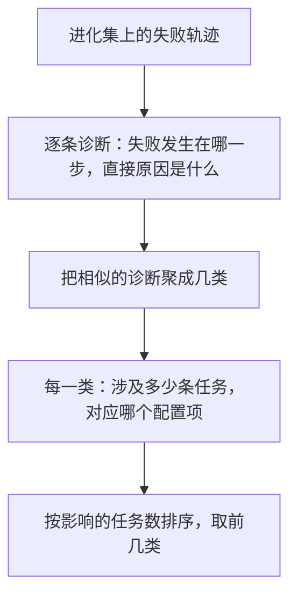

前两级改的都是给模型看的文字。有些失败文字解决不了：工具的返回太长把关键报错截掉了，轮次上限太低导致任务做到一半被打断，压缩阈值太激进把用户的限制压没了。这一级进化的对象是 Agent 外壳的配置和工具定义。

本章的思路来自 2026 年 6 月的论文《Self-Harness: Harnesses That Improve Themselves》。

## 论文说了什么，我们做了什么

先把边界讲清楚。论文描述了一个三阶段的循环：

1. **弱点挖掘**：从执行轨迹里找出当前模型特有的失败模式。
2. **外壳提案**：针对这些失败提出多样的、最小化的外壳修改。
3. **提案验证**：修改只有通过回归测试才被接受。

论文报告在 Terminal-Bench-2.0、SWE-bench Verified、AppWorld 三个基准和三个模型的九种组合上，最终的外壳在参与优化的任务和留出的任务上通过率都有提升。

论文公开了官方代码，仓库链接在论文页上，想看原版实现可以去读。本章没有照搬它，而是按这三个阶段自己设计了一个简化版：哪些配置可以改、弱点怎么聚类、修改怎么表达，都是本项目的设计，不代表论文的做法。面试时也请这样表述。

论文里有一个值得记住的观点：失败模式是“模型特有”的。同一套外壳配上不同的模型，短板不一样。这解释了为什么外壳值得针对你实际使用的模型来调，而不是照搬别人的配置。

## 可以改什么

把第一个项目里散落在各处的可调项收进一份声明式的配置，进化只能改这份配置：

```yaml
loop:
  max_turns: 50
  parallel_readonly: true
context:
  compress_threshold: 0.8        # 用量达到窗口的多少时触发压缩
  keep_recent_turns: 6
  tool_result_limit: 8000        # 单个工具结果的长度上限
tools:
  enabled: [read_file, edit_file, write_file, run_command, find, search, spawn]
  descriptions:
    run_command: "在项目目录执行一条命令……"
  result_format:
    run_command: { head: 2000, tail: 4000 }   # 截断时保留头尾各多少
subagent:
  max_parallel: 3
  max_turns: 30
reminders:
  after_edit: ""                 # 修改文件后追加给模型的一句提示
```

每一项都有类型和允许的取值范围，定义在一份模式文件里。超出范围的修改在提出时就被拒绝：

```python
BOUNDS = {
    "loop.max_turns": Int(10, 200),
    "context.compress_threshold": Float(0.5, 0.95),
    "context.tool_result_limit": Int(1000, 50000),
    "tools.enabled": Subset(ALL_TOOLS, required={"read_file"}),
    "tools.descriptions.*": Text(max_len=1500),
}
```

**权限规则不在可改范围内。** 这是一条硬约束。一个能自己放宽权限的 Agent，早晚会为了通过任务而放宽它。

## 第一步：弱点挖掘

第一个项目的评测一章里手工做过失败归类。这里把它自动化，并且要求归因指向外壳的某个部件：



逐条诊断的输出是结构化的：

```python
@dataclass
class Diagnosis:
    task_id: str
    failed_at_turn: int
    symptom: str          # 看到了什么，如“在同一个报错上重试了 9 次”
    cause: str            # 推断的原因，如“报错的关键行位于被截断的中间部分”
    component: str        # loop | context | tool:<名称> | subagent | prompt | unknown
    evidence: list[int]   # 支持这个判断的轨迹位置
```

`evidence` 字段要求诊断指出轨迹里的具体位置。没有证据的诊断不进入聚类。`component` 为 `prompt` 的交回第一、二级处理，`unknown` 的留给人看。

聚类之后得到的是这样一张表：

| 弱点 | 涉及任务 | 对应部件 |
|---|---|---|
| 测试输出被截断，关键报错不在保留的头尾里 | 7 | `tools.result_format.run_command` |
| 修改后未运行测试就结束 | 5 | `reminders.after_edit` |
| 达到轮次上限时仍在正常推进 | 3 | `loop.max_turns` |

表里的内容是示意。

## 第二步：提出最小修改

对每一类弱点，让模型提出两到三个不同的修改方案。两个要求来自论文里的两个词：多样、最小。

- **最小**：一个提案只改一项配置，或者紧密相关的两三项。改动小才能归因，出了问题才能单独回退。
- **多样**：同一个弱点给出不同思路的方案。例如输出被截断，可以调大保留的尾部，也可以改成按关键词提取报错行，还可以在工具说明里教模型用过滤命令缩小输出。

```python
@dataclass
class Proposal:
    weakness: str
    changes: dict[str, Any]     # 配置路径 → 新值
    rationale: str
    expected_effect: str        # 预期哪些任务会变好
    risk: str                   # 可能让哪类任务变差
```

要求提案写出 `risk`，是让提案模型自己先想一遍副作用。把轮次上限调高能救回被打断的任务，也会让本来该早停的失败多烧一倍的钱。

## 第三步：验证

每个提案生成一个候选版本，按固定的顺序验证，前一步不过就不做后一步：


*图：从左到右越来越贵，所以把便宜的检查放在前面，尽早拒绝。*

先跑受影响的那几条任务，是因为它最便宜而且最能说明问题：一个声称解决截断问题的修改，如果连那 7 条任务都没改善，后面的评测就不用做了。

多个提案各自通过后，不能直接假设它们叠加起来也好。把通过的提案合成一个版本，再完整过一次闸门。

## 新增工具算哪一级

给 Agent 加一个全新的工具需要写代码，属于第四级。这一级只做三种和工具有关的修改：启用或停用已有工具、改写工具说明、调整工具结果的格式化参数。

改工具说明看起来和改提示词差不多，但作用的位置不同：模型每次决定用哪个工具、参数怎么填，读的都是这段说明。它值不值得改，用你自己的评测来回答，把它当作一类普通提案走同样的闸门。

## 自己动手时的检查点

1. 把第一个项目的可调项收进一份配置，并写出每一项的允许范围。
2. 实现弱点挖掘，把自动聚类的结果和你手工归类的结果对比。
3. 对最大的一类弱点生成三个提案，分别走完验证流程。
4. 尝试让提案器修改权限规则，确认被范围检查拒绝。

## 面试常见追问

- **除了提示词还能优化什么？** 讲外壳配置和工具定义，举截断、轮次、提醒三个例子。
- **怎么自动发现 Agent 的弱点？** 逐条诊断并要求给出轨迹证据，聚类，按影响面排序。
- **自动修改配置安全吗？** 可改范围是声明式的、有边界，权限不在其中；每次改动最小化；三步验证。
- **这是复现论文吗？** 如实说：按论文的三阶段思路自己实现的简化版，在自己的任务集上跑。

延伸阅读：[Self-Harness 论文](https://arxiv.org/abs/2606.09498)、Lilian Weng 的综述文章 [Harness Engineering for Self-Improvement](https://lilianweng.github.io/posts/2026-07-04-harness/)、知识库的 [Agent 工具契约、Schema 与错误语义](../../knowledge/llm/agent/agent-tool-design.md)。
