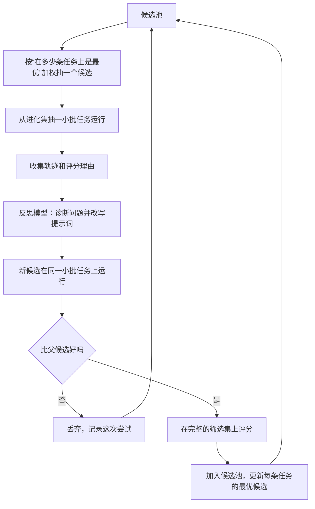

从这一章开始进入自进化。第一级只改一样东西：系统提示词。改动范围最小、最容易回退，也是四级里最成熟的一级。

本章实践的方法是 GEPA（Genetic-Pareto），论文《GEPA: Reflective Prompt Evolution Can Outperform Reinforcement Learning》，有官方开源实现。

## GEPA 的核心想法

传统的自动提示词优化把评测当成一个只返回分数的黑盒：换个提示词，看分数涨没涨。GEPA 的出发点是，一次运行留下的信息远不止一个分数。轨迹里有模型的推理、工具调用、报错信息，评分器还给了判定理由。这些都是自然语言，可以交给另一个模型去读，让它说出问题在哪、提示词该怎么改。

三个关键设计：

| 设计 | 做法 | 解决什么 |
|---|---|---|
| 反思式改写 | 让模型读失败轨迹和评分理由，诊断原因后改写提示词 | 每一次运行都得到大量可用信息，需要的运行次数少 |
| 保留一组候选 | 不只留总分最高的一个，凡是在某条任务上表现最好的候选都留下 | 避免过早收敛到一个局部最优 |
| 合并 | 把两个在不同任务上各有所长的候选的修改合到一起 | 组合互补的改进 |

## 一轮迭代



先在小批上筛、通过了再跑完整评测，是控制成本的关键。大多数改写不会带来提升，没有必要为它们付完整评测的钱。

## 为什么保留一组而不是一个

设想两个候选：甲在定位类任务上强，乙在验证类任务上强，总分相同。只留一个就丢掉了另一半信息。

GEPA 的做法是按任务记录“哪个候选在这条任务上得分最高”，只要一个候选在至少一条任务上是最优的，它就留在池里。抽取父候选时，在越多任务上最优的候选被抽中的概率越高。

```python
def select_parent(pool: list[Candidate], scores: dict[str, dict[str, float]], rng) -> Candidate:
    """scores[candidate_id][task_id] = 得分"""
    wins = Counter()
    for task in all_tasks(scores):
        best = max(scores[c.id][task] for c in pool)
        for c in pool:
            if scores[c.id][task] == best:
                wins[c.id] += 1
    frontier = [c for c in pool if wins[c.id] > 0]
    return rng.choices(frontier, weights=[wins[c.id] for c in frontier])[0]
```

这是按论文思路写的简化版，官方实现还包含去除被完全支配的候选等细节。

## 反思提示词

反思模型的输入有四部分：当前提示词、若干条运行记录、每条记录的评分理由、此前被拒绝的修改。

```text
你在改进一个编程 Agent 的系统提示词。

当前提示词：
{current_prompt}

下面是它在几条任务上的表现。每条包含任务、轨迹摘要、结果和评分理由：
{examples}

此前尝试过但没有带来提升的修改：
{rejected_attempts}

请完成两步：
1. 诊断：这些失败有没有共同原因？原因是否可以归结为提示词没有说清楚某件事？
   如果失败与提示词无关（例如工具本身有缺陷），直接说明，不要强行修改。
2. 改写：给出修改后的完整提示词。只针对诊断出的问题修改，保留其余内容。
   写成通用的指导，不要提及具体任务里的文件名或数值。
```

最后一句是防止过拟合的第一道防线。反思模型很容易把“在 cart.py 里记得保留两位小数”写进提示词，这在进化集上涨分，在别处毫无用处。

给反思模型的例子里要同时包含成功和失败的运行。只看失败会让它不断加限制，最后把本来能做对的任务也改坏。

## 反馈信息的质量决定上限

GEPA 能否起作用，很大程度上取决于交给反思模型的文字有多少信息量。对比两种评分理由：

```text
差：未通过。

好：未通过。pytest 报告 test_discount_rounding 失败：期望 9.99，实际 10.0。
    Agent 在第 6 轮修改了 cart.py，之后没有再运行测试，直接回复“已修复”。
```

评分器一章要求每个评分结果都带 `reason`，就是为这里准备的。

## 接入准入闸门

GEPA 内部的筛选用的是进化集。它产出的最优候选仍然只是候选，要经过准入闸门：

```python
async def evolve_prompt(current: AgentVersion, rounds: int) -> AgentVersion:
    pool = [Candidate(current.system_prompt)]
    for _ in range(rounds):
        parent = select_parent(pool, scores, rng)
        batch = rng.sample(EVOLVE_SET, k=4)
        traces = await run_and_grade(parent, batch)
        child = await reflect_and_rewrite(parent, traces, rejected)
        if await better_on(child, parent, batch):
            scores[child.id] = await full_scores(child, EVOLVE_SET)
            pool.append(child)
        else:
            rejected.append(summary(child))
    best = max(pool, key=lambda c: mean(scores[c.id].values()))
    candidate = current.with_prompt(best.text, note=best.diagnosis)
    return await gate.admit(candidate, baseline=current)   # 验收集和回归集
```

小批的大小、轮数是可以调的。本项目的起步值是每批 4 条、6 到 10 轮，按你的预算调整。

## 用官方实现对照

自己写完简化版之后，用官方的 `gepa` 库在同样的任务上跑一遍对比。接入时你需要提供一个适配器，告诉它怎样用某个候选提示词运行一批任务并返回分数和反馈文字。对照的目的有两个：检查你的实现有没有明显更差，以及读官方代码里你没想到的细节。

## 预期和边界

- 提示词进化最擅长修的是“没讲清楚”的问题，例如没有要求验证、没有说明何时该提问。
- 它修不了能力问题和工具问题。反思模型诊断出“失败与提示词无关”的任务，留给后面的级别。
- 提示词会越改越长。每次合入时记录长度，长度明显增长而提升有限时，让反思模型做一次只精简不加内容的改写，再过一次闸门。
- 在几十条任务上，提升可能落在波动范围内。按可靠性一章的办法判断，不要只报一个涨了的数。

## 自己动手时的检查点

1. 实现反思式改写，跑通一轮：读轨迹、诊断、改写、小批验证。
2. 实现按任务保留候选的候选池，观察池里是否出现各有所长的候选。
3. 让最优候选过准入闸门，记录验收集和回归集上的变化。
4. 检查合入的提示词里有没有出现具体任务的文件名或数值。

## 面试常见追问

- **自动提示词优化怎么做的？** 反思式改写、保留一组候选、先小批后完整三点。
- **和直接让模型改提示词有什么不同？** 有轨迹和评分理由作依据，有候选池避免单线爬坡，有独立的验收。
- **怎么防止过拟合到评测集？** 反思提示词要求写通用指导、进化集和验收集分开、人工复核合入的修改。
- **GEPA 和强化学习比有什么优势？** 论文的主张是利用文字反馈可以用少得多的运行次数取得提升。讲清楚这是论文在它的基准上的结论。

延伸阅读：[GEPA 论文](https://arxiv.org/abs/2507.19457)、[官方实现 gepa-ai/gepa](https://github.com/gepa-ai/gepa)、知识库的 [Prompt、工具与模型升级回归测试](../../knowledge/llm/production/agent-prompt-regression.md)。
