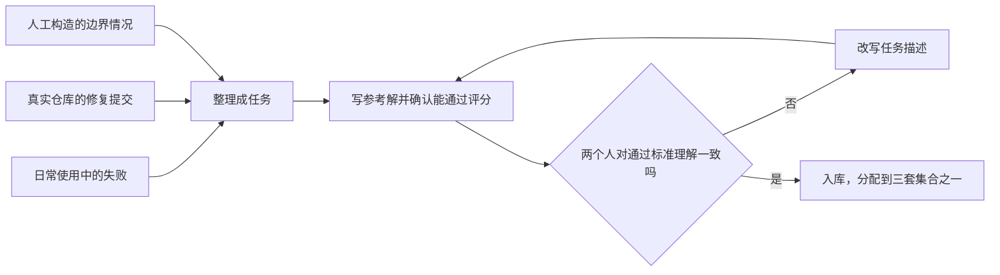

评测的质量上限由任务集决定。这一章建立任务集，并把它划成三套用途不同、互不重叠的集合。后面所有的评测结论和进化决策都建立在这一步上。

本章的做法主要依据 Anthropic 工程团队 2026 年 1 月的文章《Demystifying evals for AI agents》。

## 一条好任务的标准

| 标准 | 含义 | 反例 |
|---|---|---|
| 无歧义 | 两个懂行的人独立看，对“做成了没有”判断一致 | “把这段代码优化一下” |
| 有参考解 | 至少有一个已知能通过评分的解法，证明任务可解 | 任务写完没人试过能不能做出来 |
| 结果可判定 | 判定依据是最终状态，而不是某条特定路径 | 要求必须调用某个工具才算对 |
| 环境可复原 | 每次运行从同一个干净状态开始 | 上一次运行留下的文件影响下一次 |

第二条最容易被跳过。没有参考解的任务，Agent 失败时你分不清是 Agent 不行还是任务本身做不出来。文章里的建议是：通过率长期为零的任务，多半是任务或评分有问题，应该先查任务。

第三条值得多说一句。Agent 经常会找到你没想到的正确做法。评分只看结果，才不会把这些做法误判成失败。

## 任务从哪里来



三个来源按价值排序：

1. **日常使用中的失败。** 你用 Agent 时遇到的真实翻车，最能代表它的短板。文章的建议是尽早开始，从 20 到 50 条来自真实失败的任务起步，不必等到有几百条。
2. **真实仓库的修复提交。** 把代码回退到修复前，用修复时新增的测试作判定。
3. **人工构造。** 用来补齐前两类覆盖不到的情况。

## 正反例要平衡

只收集“应该做某事”的任务，会把 Agent 往一个方向推。例如任务集里全是需要联网搜索的问题，进化出来的版本就会什么都去搜。

每一类行为都配上反向的任务：

| 应该做 | 不应该做 |
|---|---|
| 信息不足时向用户提问 | 信息足够时不要多问 |
| 需要全局查找时派子任务 | 两步能做完的事不要派子任务 |
| 改完代码运行测试 | 只问问题时不要去改代码 |

## 三套集合

这是本项目和普通评测最大的不同。因为后面要用评测结果来驱动修改，同一批任务不能既当教材又当考卷。

| 集合 | 谁能看 | 用途 | 建议占比 |
|---|---|---|---|
| 进化集 | 失败分析和提案器 | 找问题、提出修改 | 约一半 |
| 验收集 | 只有准入闸门 | 判断候选版本是否真的更好 | 约四分之一 |
| 回归集 | 只有准入闸门 | 检查原来会做的任务有没有被改坏 | 约四分之一 |

占比是本项目的起步建议，不是定论。

划分时的三条规则：

- **按来源分层后再随机分。** 每套集合里各种难度和类型的比例应当接近，否则验收集的分数和进化集没有可比性。
- **相似的任务放进同一套。** 同一个 bug 的两种问法如果分到进化集和验收集，等于泄题。
- **回归集选当前版本稳定通过的任务。** 它的作用是报警，一条本来就时过时不过的任务报不了警。

```python
def split(tasks: list[Task], seed: int, stable_ids: set[str]) -> dict[str, list[Task]]:
    groups = group_by_similarity(tasks)          # 相似任务捆在一起
    rng = random.Random(seed)
    out = {"evolve": [], "accept": [], "regress": []}

    # 回归集：只从当前版本每次都通过的任务组里抽，约占四分之一
    stable = [g for g in groups if all(t.id in stable_ids for t in g.tasks)]
    rng.shuffle(stable)
    regress = stable[: len(groups) // 4]
    for g in regress:
        out["regress"].extend(g.tasks)

    # 其余的按来源和难度分层，再按 2:1 分给进化集和验收集
    by_stratum = defaultdict(list)
    for g in groups:
        if g not in regress:
            by_stratum[(g.source, g.difficulty)].append(g)
    for stratum in by_stratum.values():
        rng.shuffle(stratum)
        for i, g in enumerate(stratum):
            out[("evolve", "evolve", "accept")[i % 3]].extend(g.tasks)
    return out
```

`stable_ids` 来自当前版本的一次重复评测：每次都通过的任务才算稳定。稳定的任务多半偏简单，所以回归集的难度分布会和另外两套不一样。这没有关系，回归集只用来看有没有退步，不拿它的通过率和别的集合比。

划分用固定的随机种子并记录下来，结果才能复现。

## 验收集会被“用旧”

每做一次准入判定，验收集就泄露一点信息：通过的修改被留下，没通过的被淘汰，几十轮之后留下来的版本整体上已经在向验收集靠拢。所以：

- 记录验收集被用过多少次。
- 定期从新的真实失败里补充任务，把用旧的验收任务降级到进化集。
- 另外留一小份从不参与任何判定的任务，只在项目最后用一次，报告最终数字。

反向任务的评分方式和普通任务相反：什么都不改才算通过。配套源码在任务文件里用 `expect_noop` 标记这类任务，审计时「空提交应该不通过」这条检查对它们反过来。自带的 14 条任务里有两条是这样的，都放在回归集。

副作用一章会回到这个问题，那里有一篇论文专门讨论为什么准入判定需要新的、独立的验证数据。

## 任务文件格式

```yaml
id: cart-rounding
split: accept
source: real_failure        # real_failure | upstream_fix | synthetic
difficulty: single_file     # single_file | multi_file | locate_then_fix
similar_group: cart-pricing # 相似任务共用同一个组名
env:
  repo: fixtures/shop
  setup: git checkout bug/cart-rounding
prompt: tests/test_cart.py 里有一条用例挂了，帮我修好
graders:
  - type: command
    run: pytest tests/test_cart.py -q
  - type: unchanged
    paths: [tests/]
reference_solution: solutions/cart-rounding.patch
```

入库前有一步自动检查：应用参考解后跑一遍评分，必须通过；不应用参考解跑一遍评分，必须不通过。两条都满足的任务才算有效。

## 自己动手时的检查点

1. 收集 30 条以上任务，其中至少一半来自你真实遇到的失败。
2. 对每条任务跑“有参考解通过、无参考解不通过”的自动检查。
3. 找一个同学只看任务描述，说出他认为的通过标准，和你的评分规则对比。
4. 完成三套划分，确认每套里各难度的比例接近。

## 面试常见追问

- **评测集怎么建的？** 来源、四条标准、参考解校验。
- **什么是好的评测集？** 无歧义、可判定、正反平衡、有难度梯度、和真实使用分布接近。
- **为什么要分三套？** 进化要看失败细节，验收不能被看到；回归集单独负责发现退步。
- **评测集多大才够？** 说明起步规模和理由，再讲怎样用多次运行和逐条对比弥补规模小的问题。

延伸阅读：[Demystifying evals for AI agents](https://www.anthropic.com/engineering/demystifying-evals-for-ai-agents)（Anthropic，2026-01）、知识库的 [Agent Benchmark 的设计与解读](../../knowledge/llm/production/agent-benchmark.md)、[线上反馈、评估集与持续改进闭环](../../knowledge/llm/production/agent-feedback-loop.md)。
