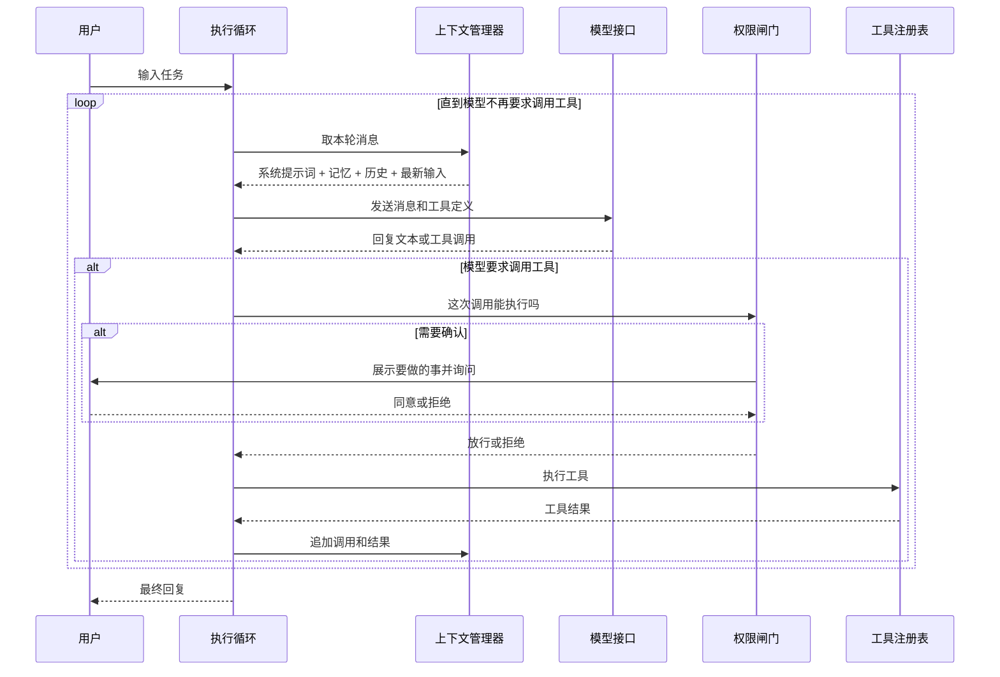

这一章给出整个系统的全貌：有哪些部件、各自负责什么、一次任务从输入到结束经过哪些部件。后面每一章都是把这里的一个部件展开。

## 总体架构


系统分成五块。

**交互层**负责和人打交道，它不包含任何 Agent 逻辑。终端界面处理输入、流式输出和确认弹窗；研究进度页展示计划、来源和报告；无界面模式不显示任何东西，只返回结果，留给评测脚本批量调用。三种入口调用的是同一个内核接口。

**内核层**是两种模式共用的部分，共四个部件：

| 部件 | 职责 | 不负责 |
|---|---|---|
| 执行循环 | 调模型、派发工具调用、收集结果、判断何时停 | 不知道工具具体做什么 |
| 上下文管理器 | 拼装每次发给模型的消息、统计用量、超限时压缩 | 不决定调用哪个工具 |
| 权限闸门 | 按规则判定一次工具调用是放行、询问还是拒绝 | 不执行工具 |
| 子任务调度器 | 派出子任务、控制并行、只把结论收回来 | 不关心子任务里发生了什么 |

**能力层**决定这个 Agent 会做什么。工具注册表是唯一入口，每个工具登记名称、用途说明、参数格式和执行器。编程工具、研究工具、技能加载器、MCP 客户端都通过它注册。切换模式就是换一组注册进去的工具，内核一行不用改。

**状态层**保存需要跨步骤或跨会话留下来的东西：会话记录、长期记忆、检查点。

**外部依赖**包括模型接口、本机文件系统、搜索服务和 MCP 服务。

## 三条设计约束

整个项目的代码结构由三条约束决定，后面每章都会回到它们。

1. **内核不认识具体工具。** 执行循环只知道“模型要求调用一个叫某某的工具，参数是这些”，然后交给注册表。这样新增工具、切换模式、接入 MCP 都不触碰内核。
2. **每一次工具调用都先过权限闸门。** 没有任何路径可以绕开它，包括子任务里的调用和 MCP 工具的调用。
3. **子任务拥有独立的上下文。** 子任务调度器启动的是一个全新的执行循环，它的消息列表和主任务互不可见，结束后只交回一段结论。这是控制上下文长度最有效的手段。

## 一次任务的完整流程

以“修一条挂掉的测试”为例，一次任务在各部件之间这样流转：



几个容易忽略的细节：

- 模型一次回复里可能要求调用多个工具。只读的工具可以并行执行，会修改东西的工具必须按顺序执行。
- 用户拒绝一次操作不是错误。拒绝本身要作为工具结果喂回模型，让它换一种做法。
- 循环有三个出口：模型不再要求调用工具、达到最大轮次、用户中断。三种情况都要把会话记录完整落盘。

## 核心数据结构

全系统只流转一种消息格式，和模型接口保持一致，这样拼装和落盘都不需要转换：

```python
from dataclasses import dataclass, field
from typing import Any, Literal

@dataclass
class ToolCall:
    id: str            # 模型生成的调用编号，结果要用它对应回去
    name: str
    arguments: dict[str, Any]

@dataclass
class Message:
    role: Literal["system", "user", "assistant", "tool"]
    content: str = ""
    tool_calls: list[ToolCall] = field(default_factory=list)  # 仅 assistant
    tool_call_id: str | None = None                            # 仅 tool
```

工具用一个统一的结构登记：

```python
@dataclass
class Tool:
    name: str
    description: str               # 写给模型看的用途说明
    parameters: dict[str, Any]     # JSON Schema
    run: Callable[..., Awaitable[str]]
    read_only: bool = False        # 决定能否并行、是否默认放行
```

## 代码目录

```text
agent/
  kernel/
    loop.py          执行循环
    context.py       上下文管理器
    permission.py    权限闸门
    subagent.py      子任务调度器
  tools/
    registry.py      工具注册表
    coding/          读、写、改、命令、查找、搜索
    research/        联网搜索、读网页、压缩
  extensions/
    mcp_client.py    MCP 客户端
    skills.py        技能加载器
  state/
    session.py       会话记录
    memory.py        长期记忆
    checkpoint.py    检查点
  ui/
    cli.py           终端界面
    headless.py      无界面模式
  modes.py           每种模式装配哪些工具和提示词
evals/               任务集与评分器
```

`modes.py` 是两种模式唯一分叉的地方。它只做三件事：选系统提示词、选注册哪些工具、选默认的权限规则。

## 面试时怎么讲这张图

被要求介绍项目架构时，建议按这个顺序：先说一句定位（自己写的 Agent 内核，同一套内核支持编程和研究两种模式），再讲三条设计约束，最后挑一个你做得最深的部件展开。直接从目录结构讲起容易变成念文件名。

常见追问和对应章节：

- 为什么不用现成框架？见上一章“不用框架”一节。
- 内核怎么做到不认识工具？见工具系统一章。
- 上下文满了怎么办？见上下文管理一章。
- 子任务和多智能体是什么关系？见子任务调度一章。

延伸阅读：知识库的 [从零构建 Agent 运行时](../../knowledge/llm/agent/build-agent-framework.md) 和 [Coding Agent 的架构与执行循环](../../knowledge/llm/agent/agent-coding.md)。
