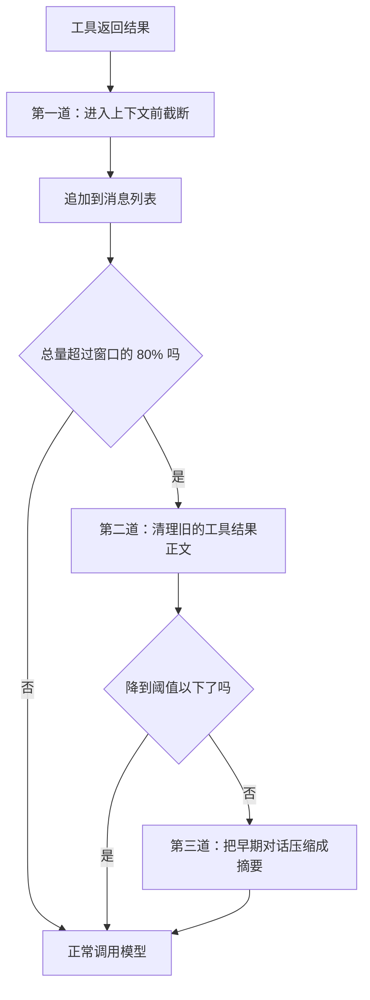

模型每次调用能看到的内容有上限，而一次修 bug 的任务读几个文件、跑几次测试就能把窗口填满。上下文管理器负责决定每一次调用时，窗口里放什么、放多少、放不下时舍弃什么。

## 窗口里有什么


拼装顺序有讲究：稳定不变的内容放前面，变化快的放后面。多数模型接口支持对相同的前缀做缓存，命中缓存的部分计费更低、响应更快。如果把每轮都变的内容，比如当前时间，插在最前面，后面所有内容的缓存都会失效。

## 用量从哪里来

真实任务里，占用窗口最多的不是对话，而是工具结果。一次典型的修 bug 任务大致是这样的构成（示意，比例因任务而异）：

| 内容 | 占用 |
|---|---|
| 系统提示词和工具定义 | 固定的一小部分 |
| 用户输入和模型的文字回复 | 很少 |
| 读文件的结果 | 多 |
| 命令输出，尤其是测试日志 | 多 |

所以控制上下文的第一原则是管住工具结果，而不是压缩对话。

## 三道防线



80% 是本项目的默认阈值，留出的余量用于放模型的下一次回复，可以按模型调整。

### 第一道：结果进入上下文前就截断

这一步在工具注册表里完成，上一章已经讲过。每个工具结果有长度上限，超出时保留头尾并说明如何获取其余部分。这是成本最低、效果最好的一道。

### 第二道：清理旧的工具结果

十轮之前读过的文件内容，现在多半已经没用了，或者文件已经被改过、内容过时了。清理时保留调用记录，只把结果正文替换成一行占位：

```text
[此处是 read_file("shop/cart.py") 的结果，已清理以节省空间。需要时请重新读取。]
```

保留调用记录很重要：模型需要知道自己读过这个文件，只是内容不在眼前了。清理从最早的开始，最近几轮的结果不动。

### 第三道：压缩成摘要

前两道都不够时，才把早期的对话交给模型总结成一段摘要，替换掉原文。这一步有信息损失，所以放在最后。

摘要的提示词要明确要求保留这些内容：

- 用户最初的任务和中途追加的要求。
- 已经完成了什么，改了哪些文件。
- 试过但失败的做法，避免重蹈覆辙。
- 当前正在做的一步和接下来的打算。
- 用户表达过的偏好和明确的禁止事项。

最后一条最容易丢。用户在第三轮说过“不要动测试文件”，压缩之后如果这句话没了，模型在第三十轮就可能去改测试。

## 压缩时的两个硬约束

**不能拆散一对工具调用和它的结果。** 模型接口要求每个工具调用后面必须跟着对应的结果消息。如果压缩的切分点正好落在一次调用和它的结果之间，下一次请求会直接被拒绝。切分点只能选在一轮完整结束的位置。

```python
def safe_split_point(messages: list[Message], target: int) -> int:
    """从 target 往前找第一个可以安全切开的位置。"""
    i = target
    while i > 0:
        m = messages[i]
        # 切点之后的第一条不能是工具结果，也不能紧跟在带工具调用的回复后面
        if m.role != "tool" and not messages[i - 1].tool_calls:
            return i
        i -= 1
    return 0
```

**最近的内容原样保留。** 摘要只覆盖较早的部分，最近若干轮不动。模型正在进行的那一步依赖精确的文件内容和报错信息，摘要给不了这种精度。

## 怎么数用量

精确的用量由模型接口在每次响应里返回，这是最可靠的数字，直接用它判断是否超过阈值。

在发请求之前想预估时，有两种办法：用对应模型的分词器在本地计数，或者用字符数做粗略估算。不同模型的分词规则不同，粗略估算只适合用来决定“要不要提前压缩”，不能用来做精确的计费。

## 把大内容放到窗口外面

除了压缩，还有一种思路是从一开始就不把大内容放进窗口：

- **子任务**。把“在仓库里找到所有调用这个函数的地方”派给子任务，它在自己的上下文里读几十个文件，只交回一份清单。子任务调度一章专门讲。
- **写到文件里**。研究模式下，研究员把整理好的资料写到工作目录的文件里，主管需要时再读取其中一段。
- **按需加载**。技能的详细说明平时不在窗口里，用到时才读入。MCP 与技能一章讲。

这三种做法的共同点是：窗口里只留索引，正文留在外面。

## 自己动手时的检查点

1. 把阈值临时调到很低，跑一个需要十几步的任务，确认压缩之后任务仍能完成。
2. 开头对它说一句限制（比如不要改某个文件），触发压缩后检查它是否仍然遵守。
3. 检查压缩后的消息列表，确认没有孤立的工具调用或工具结果。
4. 对比压缩前后同一任务的总用量，记下来，这是简历上可以写的数字。

## 面试常见追问

- **上下文满了怎么办？** 按三道防线讲，强调先管工具结果、最后才做摘要。
- **压缩会丢信息，怎么保证任务不跑偏？** 讲摘要必须保留的五类内容，以及最近若干轮原样保留。
- **为什么不直接用更大窗口的模型？** 成本和延迟随长度增长；内容过长时模型对中间部分的利用会变差。
- **提示词缓存怎么利用？** 讲稳定内容放前、变化内容放后的拼装顺序。

延伸阅读：[上下文工程](../../knowledge/llm/agent/context-engineering.md)、[会话摘要、压缩与记忆提炼](../../knowledge/llm/agent/agent-memory-summarization.md)、[Token、Context Window 与 KV Cache](../../knowledge/llm/basics/llm-token-context.md)。
