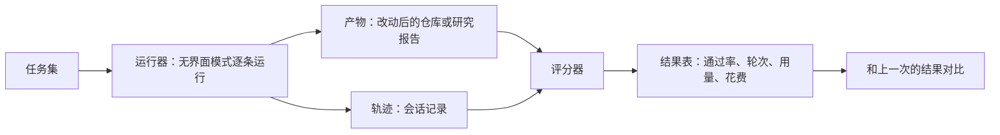

做到这里，Agent 已经能用了。但“能用”说服不了面试官，也说服不了你自己：改了一句系统提示词之后它是变好了还是变差了，凭感觉判断不出来。这一章给它配一套最小的评测：一组任务、一个评分器、一份能对比的结果。

这里只做够用的版本。评测本身怎么做深，包括轨迹评分、评测可靠性和基于评测的自动改进，是「Agent 评测与自进化平台」项目的主题。

## 评测由什么组成



四样东西各管一件事：任务集定义考什么，运行器负责在干净的环境里跑，评分器判定对错，结果表让两次运行可以比较。

## 编程模式的任务集

### 一条任务长什么样

```yaml
id: cart-rounding
repo: fixtures/shop          # 一个小型示例仓库
setup: git checkout bug/cart-rounding
prompt: tests/test_cart.py 里有一条用例挂了，帮我修好
check: pytest tests/test_cart.py -q
forbid_changes:              # 不允许动的文件
  - tests/
max_turns: 30
```

评分规则是确定的：`check` 命令退出码为 0，并且 `forbid_changes` 里的路径没有被改动，才算通过。第二个条件必不可少，否则 Agent 可以通过删掉失败的用例来“修好”测试。

### 任务从哪里来

- **自己造。** 在示例仓库里故意引入一个 bug，写一条能暴露它的测试。成本低，适合起步。
- **从真实提交里取。** 找一个开源仓库的修复提交，把代码回退到修复之前，用修复时新增的测试作为检查。更真实，但要确认测试在本地能稳定运行。
- **从失败里取。** 你自己使用时遇到 Agent 做错的任务，整理成一条用例。这类任务最有价值。

起步规模 20 条左右就能看出趋势。任务要有难度梯度：单文件修改、跨文件修改、需要先定位再修改的各占一部分。全是简单题时通过率接近满分，什么也比较不出来。

### 环境隔离

每条任务在一份全新的仓库副本里运行，跑完即弃。任务之间共用目录会互相污染：上一条任务留下的改动会让下一条莫名通过或失败。有条件就每条任务起一个容器，没有条件至少每次复制一份目录。

## 研究模式的任务集

研究报告没有唯一正确答案，评分要拆成几个可以分别判断的维度：

| 维度 | 怎么判 | 用什么判 |
|---|---|---|
| 引用有效 | 报告里每个编号都在来源库里，网址能访问 | 程序 |
| 引用支持论断 | 抽取带引用的句子，判断对应摘录是否支持它 | 模型评分 |
| 覆盖要点 | 事先为每个问题写好必须提到的若干要点，判断报告是否覆盖 | 模型评分 |
| 没有编造 | 不带引用的事实性论断占比 | 模型评分 |

### 模型评分怎么做才可信

让模型给报告打一个总分是最不可靠的做法。可行的做法是把问题问得很小：

```text
下面是一个论断和一段来源摘录。
论断：{claim}
摘录：{excerpt}

摘录是否支持这个论断？只回答下面三个之一：
支持 / 部分支持 / 不支持
然后用一句话说明理由。
```

每次只判断一个论断和一段摘录，输出是固定的三选一。这样的判断结果稳定得多，也方便你抽查。

评分器本身也需要校验：自己手工标注 30 到 50 条，对比模型评分和你的判断。两者差得多就改评分提示词，直到基本一致再拿它去评别的。没有校验过的模型评分，数字再好看也不能用。

## 运行器

```python
async def run_task(task: Task, config: AgentConfig) -> Result:
    workdir = prepare_clean_copy(task)                 # 干净副本
    agent = build_agent(config, mode=task.mode, cwd=workdir,
                        headless=True, allow=task.allow_rules)
    started = time.monotonic()
    try:
        outcome = await asyncio.wait_for(agent.run(task.prompt), timeout=task.timeout)
    except asyncio.TimeoutError:
        outcome = Outcome(stopped="timeout")
    return Result(
        task_id=task.id,
        passed=grade(task, workdir, outcome),
        turns=outcome.turns,
        input_tokens=outcome.usage.input,
        output_tokens=outcome.usage.output,
        seconds=time.monotonic() - started,
        stopped=outcome.stopped,                       # 正常结束 / 达到轮次上限 / 超时
        session_file=outcome.session_file,             # 留着看失败原因
    )
```

运行器用的是权限一章的无界面模式：需要询问的操作一律视为拒绝，任务自带一份显式的放行规则。

## 同一条任务要跑多次

模型输出有随机性，同一条任务这次过了下次可能不过。只跑一次得到的通过率，波动可能比你想验证的改进还大。

- 每条任务跑 3 次以上，报告平均通过率。
- 对比两个版本时，同时看“每条任务的通过次数”有多少条变了。20 条任务里只变了 1 条，不足以下结论。
- 把结果里不稳定的任务单独列出来。它们往往说明任务描述本身有歧义。

## 结果怎么看

一次运行输出一张表：

| 指标 | 含义 |
|---|---|
| 通过率 | 最主要的指标 |
| 平均轮次 | 完成一条任务调了多少次模型 |
| 平均用量和花费 | 输入输出的总量，乘以单价 |
| 停止原因分布 | 正常结束、达到轮次上限、超时各占多少 |

通过率之外的三项同样重要。一次改动让通过率涨了一点、花费翻了一倍，未必值得。

### 失败归类比通过率更有用

把失败任务的会话记录逐条打开看，归到几类里：

| 类别 | 表现 | 通常改哪里 |
|---|---|---|
| 没找到位置 | 一直在读无关文件 | 查找和搜索工具的说明、是否该派子任务 |
| 改错了 | 定位正确但改动有误 | 改完后是否运行了测试 |
| 没验证就结束 | 改完直接回复“已修复” | 系统提示词里对验证的要求 |
| 耗尽轮次 | 在同一个错误上反复尝试 | 错误信息是否清楚、是否有重复检测 |
| 被权限拒绝后放弃 | 换不出别的做法 | 拒绝结果的写法 |

面试时讲“我发现 40% 的失败是没验证就结束，于是在提示词里加了一条，通过率从多少涨到多少”，比只报一个总通过率有说服力得多。这里的数字必须是你自己跑出来的。

## 用评测做回归

把评测接进日常改动的流程：

1. 改提示词、工具说明或压缩策略之前，先跑一次，存为基线。
2. 改完再跑，和基线逐条对比。
3. 有任务从通过变成失败时，先看它的会话记录再决定要不要保留这次改动。

研究模式一章里那些默认预算（3 轮、3 个并行、8 次搜索），就应该用这个流程在你自己的题集上调。

## 这套评测的边界

要对自己的数字诚实：

- 20 条自己造的任务不能代表真实世界。它能告诉你的是“这次改动在这组任务上有没有变差”，不能告诉你“这个 Agent 有多强”。
- 任务是你写的，提示词也是你对着这些任务调的，时间长了会过拟合。留出一部分任务平时不看，只在最后验证时用。
- 想和公开结果比较时，可以在公开基准的一个子集上跑，并写清楚用的是哪个子集、哪个模型、跑了几次。

## 写进简历的写法

评测给了你三类可以写的数字，都要来自你自己的运行结果：

- 在多少条任务上的通过率，以及用的什么模型。
- 某一项改进前后的对比，例如上下文压缩让平均用量下降了多少。
- 失败归类后做的针对性改进和效果。

不要写没有跑过的数字。面试官追问“这个通过率是怎么测的”，你要能把任务集、评分规则和运行次数讲清楚。

## 自己动手时的检查点

1. 写出 10 条编程任务，全部能在干净副本里一条命令跑完并出分。
2. 写一条“删掉测试就能通过”的任务，确认评分器判它不通过。
3. 同一个版本连跑两次，看通过率差多少，据此决定每条任务要重复几次。
4. 手工标注 30 条引用判断，算出模型评分和你的一致比例。

## 面试常见追问

- **怎么评估你的 Agent？** 任务集、确定性检查加模型评分、多次运行、失败归类四步。
- **模型评分靠谱吗？** 把问题问小、固定输出格式、用人工标注校验一致性。
- **结果不稳定怎么办？** 多次运行取平均，看逐条变化而不只看总分。
- **怎么防止在评测集上过拟合？** 留出集，以及持续从真实失败里补充新任务。

延伸阅读：[Agent 评估](../../knowledge/llm/agent/agent-evaluation.md)、[评测框架设计](../../knowledge/llm/production/agent-eval-framework.md)、[Benchmark](../../knowledge/llm/production/agent-benchmark.md)、[提示词回归测试](../../knowledge/llm/production/agent-prompt-regression.md)。
