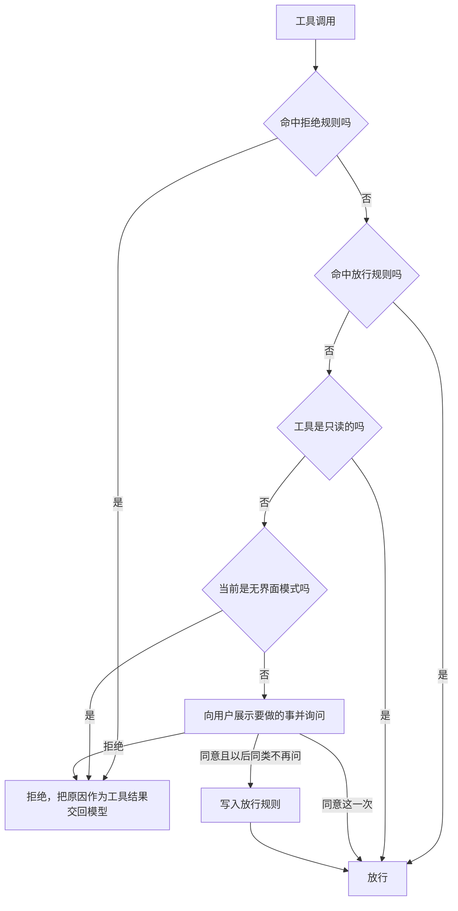

一个能改文件、能跑命令的程序，出错的代价是真实的。权限闸门的任务是在每次工具调用执行之前做一次判定：直接放行、先问用户、还是直接拒绝。

## 设计目标

权限系统要同时满足两件互相拉扯的事：

- **足够安全**。删除文件、推送代码、访问项目外的路径，不能在用户不知情时发生。
- **不烦人**。每读一个文件都弹确认，用户很快会养成不看就按同意的习惯，确认就失去了意义。

解决办法是分级：只读操作默认放行，会改动东西的操作先问，明显危险的操作直接拒绝。再允许用户把问过一次的同类操作设为以后不再问。

## 判定流程



判定顺序是固定的：拒绝规则优先于放行规则，规则优先于默认行为。这个顺序保证了用户写下的“永远不许”不会被后来的“以后都同意”覆盖。

## 规则怎么表达

一条规则由三部分组成：工具名、参数匹配方式、结论。

```python
@dataclass
class Rule:
    tool: str                    # 工具名，如 "run_command"
    pattern: str                 # 对关键参数的通配匹配，如 "pytest *"
    decision: Literal["allow", "deny"]
```

规则来自三个地方，按优先级从高到低：

| 来源 | 存放位置 | 例子 |
|---|---|---|
| 内置的拒绝规则 | 代码里 | 递归删除根目录、改写磁盘、关机 |
| 项目规则 | 项目目录下的配置文件，可提交到仓库 | 允许 `pytest *`，拒绝 `git push *` |
| 本次会话里用户新同意的 | 内存，退出即失效 | 允许 `npm run lint` |

## 命令匹配的难点

执行命令这个工具的参数是一整条字符串，匹配它比匹配文件路径难得多。几个必须处理的情况：

- **拼接命令**。`pytest && rm -rf build` 不能因为前半段匹配了 `pytest *` 就整条放行。做法是按 `&&`、`||`、`;`、`|` 拆开，每一段分别判定，任何一段需要确认则整条需要确认。
- **命令替换**。包含 `$( )` 或反引号的命令无法静态判断会执行什么，一律询问。
- **改写同一件事的多种写法**。`rm -rf` 和 `rm -fr` 是同一件事，拒绝规则按命令名和参数集合判断，不按字符串。

这一段不需要做到无懈可击。目标是挡住模型的无心之失，而不是对抗蓄意攻击。对抗性的场景要靠沙箱，放在本章最后讲。

## 路径边界

读、写、改三个文件工具在执行前统一做一次路径检查：

1. 把路径解析成绝对路径，展开符号链接。
2. 解析结果必须位于项目目录之内，否则拒绝。
3. 项目内的敏感文件，如密钥文件、环境变量文件，读取也需要确认。

先展开符号链接再判断是关键。项目里一个指向外部的链接可以让“项目内”的路径实际落在任何地方。

## 确认弹窗展示什么

用户需要在两三秒内判断能不能同意，所以弹窗只展示判断所需的信息：

- 改文件：展示改动前后的对比，而不是整个文件。
- 执行命令：展示完整命令和将要执行的目录。
- 写新文件：展示路径和前若干行。

三个选项：同意这一次、同意且本会话内同类不再问、拒绝。拒绝时允许用户补一句原因，这句话会和拒绝结果一起交回模型，往往比模型自己猜更快回到正轨。

## 被拒绝之后

拒绝是一次正常的工具结果，不是错误。交回模型的内容要让它知道该怎么办：

```text
用户拒绝了这次操作：run_command("git push origin main")
用户说明：不要推送，改完告诉我就行。
请不要重试同样的操作，换一种方式继续，或者向用户说明情况。
```

## 无界面模式

评测脚本批量运行时没有人可以按确认。此时的规则是：凡是需要询问的一律视为拒绝，同时允许启动时传入一份事先写好的放行规则。评测环境通常在一次性的容器里，可以给得宽一些，但这份规则必须显式写出来，不能是“无界面就全部放行”。

## 沙箱和权限的关系

权限闸门是在“做之前拦一下”，沙箱是“即使做了也出不去”。两者互补：

| | 权限闸门 | 沙箱 |
|---|---|---|
| 防的是 | 模型的误操作 | 恶意内容诱导出的操作 |
| 作用点 | 工具执行之前 | 进程运行时 |
| 本项目里 | 完整实现 | 提供用容器运行的方式，作为选做 |

当 Agent 会读取不受信任的内容时，比如研究模式里的网页，仅靠权限闸门是不够的：网页里的文字可能伪装成指令。研究模式一章会回到这个问题。

## 自己动手时的检查点

1. 让它执行 `pytest && rm -rf build`，确认会询问，而不是因为前半段已放行就直接执行。
2. 在项目里放一个指向外部目录的符号链接，让它读链接下的文件，确认被拒绝。
3. 拒绝一次修改并写一句原因，确认模型下一步采纳了你的说明。
4. 无界面模式下执行需要确认的操作，确认被拒绝而不是卡住等待输入。

## 面试常见追问

- **怎么防止 Agent 执行危险命令？** 分级规则、命令拆分判定、路径边界三层，再说明权限和沙箱的分工。
- **人工确认怎么不打断体验？** 只读默认放行、同类操作记住选择、确认时只展示差异。
- **提示词注入怎么防？** 承认权限闸门防不住这类问题，说明需要沙箱、最小权限和对外部内容的隔离。

延伸阅读：[最小权限、授权与工具调用确认](../../knowledge/llm/production/agent-permission-model.md)、[Human-in-the-loop 审批与人工接管](../../knowledge/llm/agent/agent-human-in-loop.md)、[代码执行、浏览器与文件操作沙箱](../../knowledge/llm/agent/agent-sandbox.md)。
